# Building the free5GC Deployment Skill: Guiding Beginners to an End-to-End Test

>[!NOTE]
> Author: [Meng-Han, Hsieh](https://github.com/c9274326)
> Date: 2026/08/12

## Abstract

Our goal in building [free5gc-deploy](https://github.com/free5gc/agent-skills/tree/main/skills/free5gc-deploy) is to help beginners deploy free5GC and complete an end-to-end (E2E) connectivity test with an AI agent's guidance. We want to reduce the learning cost of a first deployment: deciding which instructions apply, adapting network addresses, understanding terminal output, and knowing what to check next.

The skill organizes official deployment knowledge into seven workflow stages, supported by focused reference documents and read-only diagnostic scripts. It gives Codex a way to guide the user from environment inspection through installation, core startup, UE registration, PDU session establishment, and traffic through the UE tunnel.

This article explains the design and follows an actual single-VM conversation. The walkthrough includes two useful discoveries—a tool-shell PATH issue and an overlapping subnet—and ends with successful tunnel-bound pings to two external destinations.

## Background: Why a First Deployment Needs Guidance

A free5GC lab connects several layers: the Ubuntu environment, Go tools, MongoDB, the gtp5g kernel module, core network functions (NFs), subscriber records, and a RAN/UE simulator. A newcomer may follow individual commands successfully while still being uncertain whether the complete system works.

For example, a built UPF binary does not establish that the kernel module is ready. An accepted SMF–UPF association does not establish that a UE can register. A successful ping from the VM's ordinary shell does not establish that packets traveled through the simulated UE's data session.

The skill addresses these gaps by pairing each action with its purpose and expected evidence. Beginners can learn the deployment process as they run it, without first having to reconstruct every dependency from multiple documents. This is the intended benefit; the walkthrough below demonstrates one successful lab run, rather than a measured reduction in onboarding time.

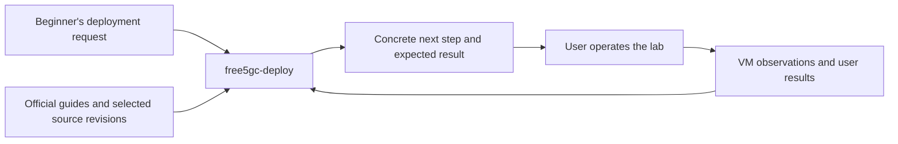

## How We Built the Skill

### 1. Define the Scope Around a Beginner's Outcome

We defined the skill around installation, validation, troubleshooting, and a guided free-ran-ue connectivity test on Ubuntu. It supports both a single VM with network namespace isolation and a two-VM topology with the core and simulator on separate machines.

The target outcome determines the stopping point. An install-only request can finish with installation evidence and an explicit statement that E2E remains untested. A request for a full connectivity test continues until registration, session, tunnel, and traffic evidence are available.

We also distinguish the agent's workstation from the deployment target. The agent may have local file access, remote access, or only the user's pasted output. Instructions must work with those differences instead of assuming that the agent always runs on the Ubuntu VM.

### 2. Separate Workflow Instructions, References, and Diagnostics

The package has three responsibilities:

```text
free5gc-deploy/
├── SKILL.md                      # Scope, boundaries, workflow, state
├── references/
│   ├── sources.md                # Official sources and reviewed revisions
│   ├── preflight.md              # Target environment and topology
│   ├── installation.md           # Official installer and user handoff
│   ├── verification.md           # Evidence levels and diagnostic contract
│   ├── end-to-end-test.md        # Subscriber, simulator, and connectivity
│   └── troubleshooting.md        # Diagnosis and focused repairs
└── scripts/
    ├── collect-env.sh            # Environment observations
    ├── check-install.sh          # Installation observations
    ├── common.sh                 # Shared diagnostic functions
    ├── inspect-artifacts.py      # Inspect expected build outputs
    └── check-config.py           # Check supported static YAML relationships
```

`SKILL.md` provides the compact control flow. The agent reads the references needed for the current stage, keeping unrelated installation or troubleshooting details out of the immediate conversation. The scripts collect repeatable observations, while the agent interprets them in the context of the user's request.

This structure also makes maintenance more focused: a simulator configuration change belongs in the relevant reference and checks, while the overall workflow can remain recognizable to users.

### 3. Reconcile Documentation with the Selected Checkout

We organized an official source index and recorded reviewed source revisions. Deployment instructions can change, and older guide examples may differ from the current YAML schema or startup commands. The skill therefore asks the agent to inspect the selected checkout before preparing commands.

Several distinctions recorded in the references affect a first lab directly:

- The UPF GTP-U bind address is an N3/N9 address. The N6 egress interface is a separate routing/NAT choice.
- The reviewed namespace script creates `free-ran-ns` and `free-ue-ns`; the core, MongoDB, and Webconsole stay in the default network namespace.
- The actual UPF YAML key is `gtpu.ifList`; a historical namespace example contains `iifList`.
- The selected core can manage per-DNN NAT/FORWARD rules through its UPF configuration, so old broad iptables recipes should not be added blindly.
- Current build outputs and configuration fields must be read from the checkout rather than copied mechanically from older examples.

The [source index](https://github.com/free5gc/agent-skills/blob/main/skills/free5gc-deploy/references/sources.md) records these differences and their source pins. A source review establishes what the instructions describe; runtime evidence establishes whether a particular VM deployment works.

### 4. Make Observation and User Operation Explicit

The bundled diagnostics are read-only and noninteractive. They do not invoke the installer, start NFs, create subscribers, or alter network namespaces. The complete official installer runs in the user's own target-host Bash terminal, preserving its `source` semantics and interactive behavior.

For a beginner, this produces a clear division of work: Codex explains and checks; the user performs the system operation and returns its result. Password entry stays in the user's terminal. Existing configuration changes and subscriber records are preserved.

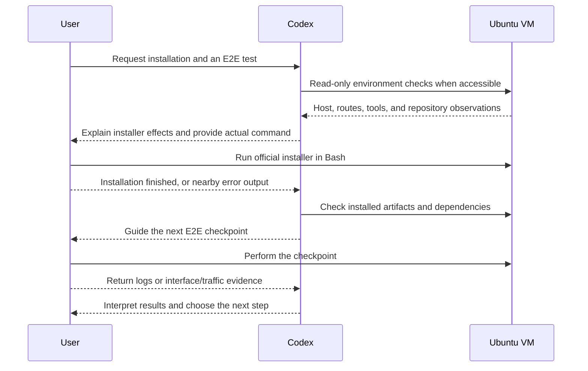

## The Seven Workflow Stages

These stages are a conversational workflow, not a background service or a required state daemon. The agent keeps a compact record of the target, topology, source revisions, local changes, addresses, current stage, pending action, and evidence. That record helps the conversation resume without asking the beginner to repeat known information.

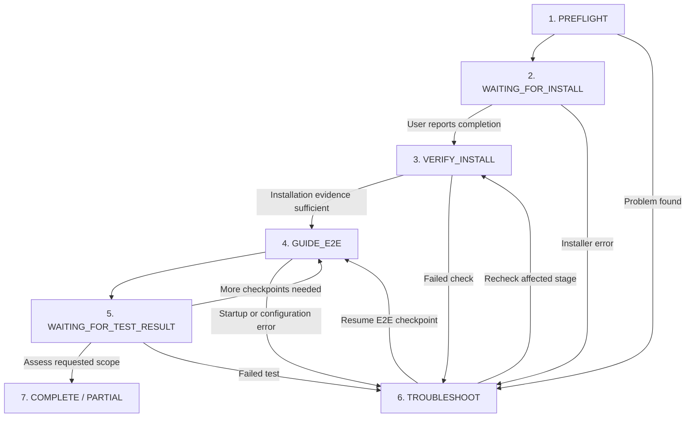

### 1. PREFLIGHT — Understand the Target Before Installing

Preflight establishes where the deployment will run and which topology the user wants. The agent inspects Ubuntu version, CPU architecture and exposed AVX, kernel, memory, storage, network addresses/routes, tools, existing repositories, MongoDB, and gtp5g state.

Network interface selection follows topology and route evidence. With multiple NICs, the agent must identify RAN reachability and data-network egress rather than choosing the first interface name it sees. Unsupported or unresolved prerequisites stop the installation path until clarified.

**Learning benefit:** the beginner sees why a specific interface and setup apply to their VM. Unavailable observations remain unknown instead of becoming invented compatibility claims.

### 2. WAITING_FOR_INSTALL — Hand Off the Complete Official Installer

The agent prepares a command using the confirmed repository path and interface, explains the selected installer's effects, and asks the user to return after running it. In our lab the command was:

```bash
cd /home/ubuntu/free5gc
source quick-setup.sh -i enp0s3
```

Those values belong to this VM. The skill instructs the agent to substitute actual values for another deployment. It preserves `source` rather than replacing the installer with `bash`, a pipeline, or a reconstructed set of installation stages.

The waiting state matters because the agent cannot infer the completion of a command in another terminal. The user's reply resumes verification; it is not itself proof of a successful installation.

**Learning benefit:** the user gets one concrete installation action, an explanation of its system changes, and a clear way to return with errors.

### 3. VERIFY_INSTALL — Check What Was Installed

After the user returns, the agent checks expected build outputs, Webconsole files, tool versions, MongoDB usability, gtp5g for the running kernel, repository changes, and supported basic configuration relationships.

The diagnostic vocabulary preserves uncertainty:

| Result | Meaning |
| --- | --- |
| `PASS` | The particular check has supporting evidence |
| `FAIL` | The check found a proven problem |
| `UNKNOWN` | Available evidence does not resolve the check |
| `UNAVAILABLE` | A tool, permission, or timeout prevents observation; an unknown subtype |

Summary counts describe observations. Even a successful static check does not prove NF readiness or UE connectivity. The checker deliberately emits an unknown runtime observation because it does not perform those tests.

**Learning benefit:** the beginner learns to distinguish installed files from a running network and can locate a failed dependency before starting the simulator.

### 4. GUIDE_E2E — Teach One Checkpoint at a Time

This stage guides simulator build/configuration, network preparation, core startup, subscriber creation, gNB setup, and UE startup. Each instruction specifies the host, namespace, working directory, privilege, expected result, and whether the terminal must stay open.

For a single VM, separate terminals are useful for long-running processes, but namespace entry provides network isolation. The skill makes that distinction explicit so a newcomer can understand where each command runs.

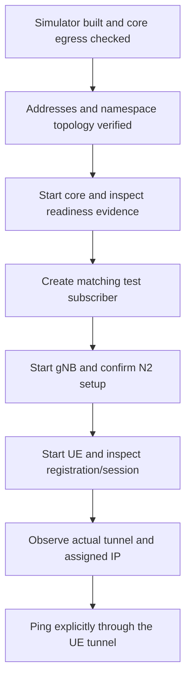

**Learning benefit:** every checkpoint introduces a small part of the system and a recognizable success condition. Failures can be investigated before dependent steps add more confusing output.

### 5. WAITING_FOR_TEST_RESULT — Collect Evidence from the UE Path

The agent asks for registration/session logs, the actual UE tunnel and address, and ping statistics explicitly bound to that tunnel. It uses the observed interface name; a configured base name such as `ueTun` may become `ueTun0` at runtime.

In a single-VM lab, the final ping runs inside the UE namespace. An ordinary host ping only verifies the host's own egress and cannot substitute for this result.

**Learning benefit:** the user learns what an E2E claim needs: successful signaling and packets through the data path, with packet loss reported visibly.

### 6. TROUBLESHOOT — Repair the Failed Stage

Troubleshooting is available whenever a problem appears, including before installation verification. Its loop is evidence → hypothesis → check → minimal repair → recheck. Reinstallation is not the default response.

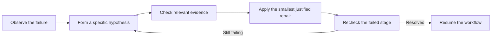

For example, an unavailable `go` command may reflect the tool shell's PATH. A failed data-path check may involve N6 routing or forwarding even after registration succeeds. The skill keeps those possibilities separate and preserves existing deployment data while investigating.

**Learning benefit:** the beginner can understand why a repair is proposed and avoid restarting the entire deployment for a localized issue.

### 7. COMPLETE / PARTIAL — Report Each Level Separately

The final assessment separates installation, core startup, and E2E results:

| Level | Evidence to seek |
| --- | --- |
| Installation | Expected artifacts, appropriate tools, MongoDB usability, kernel module, and supported configuration checks |
| Core startup | Required NF processes and logs, NRF/SBI registration, applicable PFCP association, and AMF N2 readiness |
| E2E | UE registration, matching PDU session/address, actual tunnel, and replies explicitly through that tunnel |

`COMPLETE` means the requested scope has sufficient evidence. `PARTIAL` means work or evidence remains. One PFCP association line proves that association; it does not establish every NF's health. The agent should report the scope of each observation rather than turning a single successful line into a universal verdict.

**Learning benefit:** the user leaves with a clear account of what worked, what was tested, and what still needs attention.

## A Real Conversation: From a Request to UE Connectivity

### Request and Installation Handoff

The walkthrough started with a simple request:

> Help me install free5GC on my Ubuntu VM. I want a single-VM namespace test.

Codex read the deployment skill and entered preflight. The VM exposed x86_64 with AVX, ran Ubuntu 25.04 with kernel `6.14.0-37-generic`, and had roughly 7.4 GB memory and 39 GB available storage. The existing free5GC checkout was clean. Route evidence identified `enp0s3`, with address `10.0.2.15`, as Internet egress.

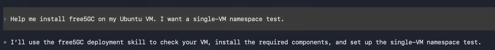

Figure 1: The user's requested topology establishes the deployment scope.

The agent explained the installer effects, including dependencies, MongoDB, builds, forwarding, configuration changes, and stopping/disabling UFW, then handed over the full official command. The user ran it in the VM's Bash terminal.

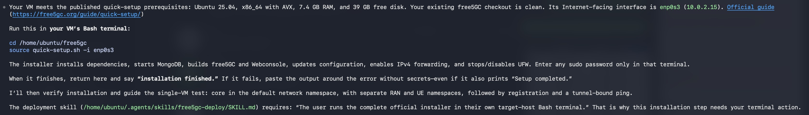

Figure 2: Installation instructions include the actual path/interface and a clear return checkpoint.

### Verification Reveals Environment-Specific Details

After the user replied that installation had finished, Codex checked binaries, Webconsole files, MongoDB, and gtp5g. Initially its tool shell could not find Go. Running `/usr/local/go/bin/go version` showed Go 1.26.2, and adjusting the diagnostic PATH made the tool observable. A later restricted PATH also omitted administrative tool directories, which affected `iptables` and `modinfo` observations until corrected.

The final installation checker summary was:

```text
SUMMARY pass=39 fail=0 unknown=1 (observations only)
```

The remaining unknown concerned runtime tests. Separately, a MongoDB ping returned `1`. These checks supported proceeding with the lab while keeping core startup and UE connectivity unverified.

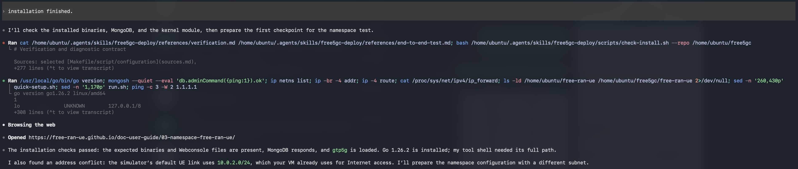

Figure 3: Verification distinguishes a PATH issue from a missing installation and discovers an address overlap.

### Adapt the Namespace Topology to the VM

The reviewed simulator recipe used `10.0.2.0/24` for its RAN–UE link. Our VM already used that subnet on `enp0s3`. Rather than copy the example unchanged, the agent prepared `10.0.3.0/24` for the lab link, updated the simulator YAML and namespace script consistently, and removed a redundant connected-route addition in that script.

Core N2/N3 addresses changed to `10.0.1.1`; the external N6 interface remained `enp0s3`. Core configuration backups used the suffix `.before-namespace`. The agent prepared local files and built the simulator; the user performed privileged namespace setup in the terminal.

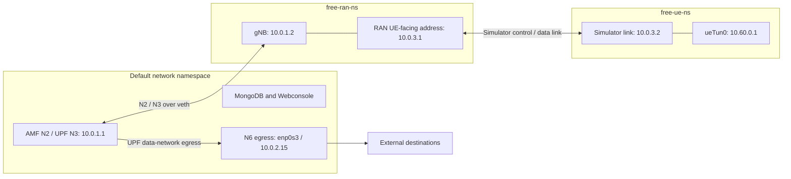

The RAN–UE link address `10.0.3.2` and PDU-session address `10.60.0.1` serve different purposes. The former connects simulator components; the latter is the UE address used by the final tunnel-bound traffic test.

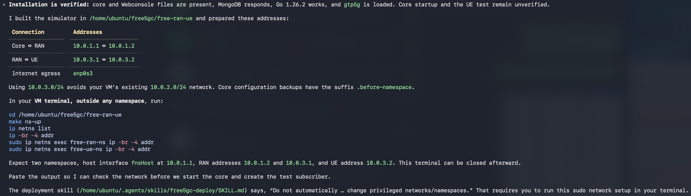

Figure 4: Concrete addresses replace generic examples while preserving the external egress interface.

The user ran `make ns-up` and returned namespace/interface observations. They showed `fnsHost` at `10.0.1.1`, RAN interfaces at `10.0.1.2` and `10.0.3.1`, and the UE-side interface at `10.0.3.2`.

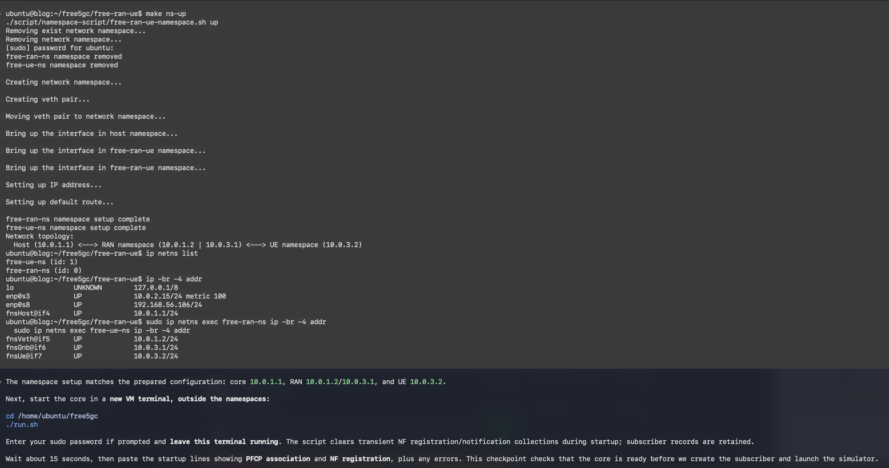

Figure 5: Actual interface observations confirm the topology before core startup.

### Core Association and Subscriber Preparation

The user started the core outside the namespaces and returned an SMF log reporting an accepted PFCP association response from UPF `127.0.0.8`. Codex identified that as association evidence and explicitly said remaining core readiness evidence was still needed.

Next, the user started Webconsole in the default network namespace and created a public lab-only test subscriber matching the simulator. The guide explained matching identity/authentication fields, PLMN, slice, and DNN, and asked the user to check for an existing SUPI before creating a record.

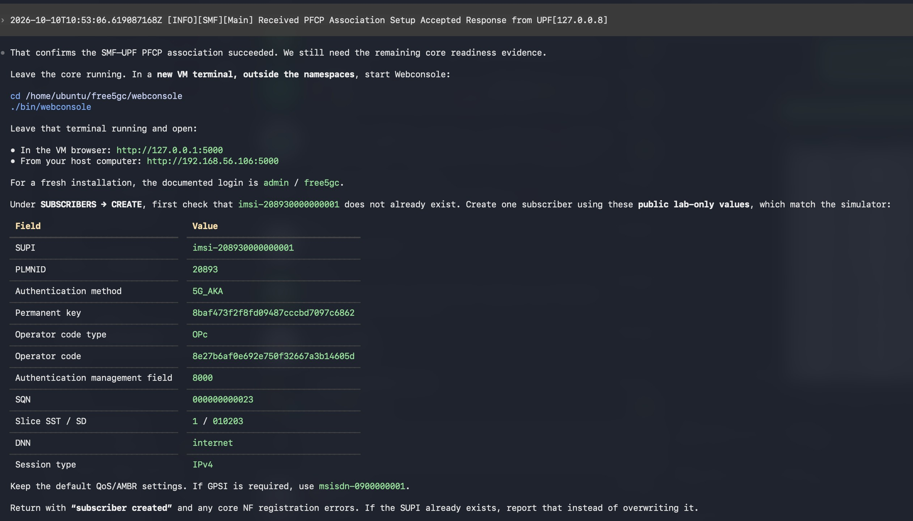

Figure 6: The subscriber checkpoint connects Webconsole fields to simulator configuration. Authentication values shown here are public test data for an isolated lab.

### gNB Setup and UE Registration

After subscriber creation, Codex instructed the user to enter `free-ran-ns` and launch the gNB. It specified which terminals had to stay running and requested the N2 setup result before launching the UE.

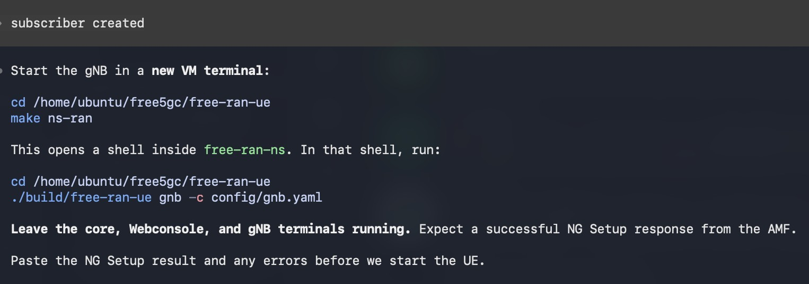

Figure 7: Namespace entry, command location, and terminal lifetime are explained together.

The returned gNB logs showed connection to AMF `10.0.1.1:38412` and completed N2 setup. Its UE-facing control/data listeners used `10.0.3.1`. The UDP UPF connection log alone was not treated as a successful data-path test; the UE traffic check came later.

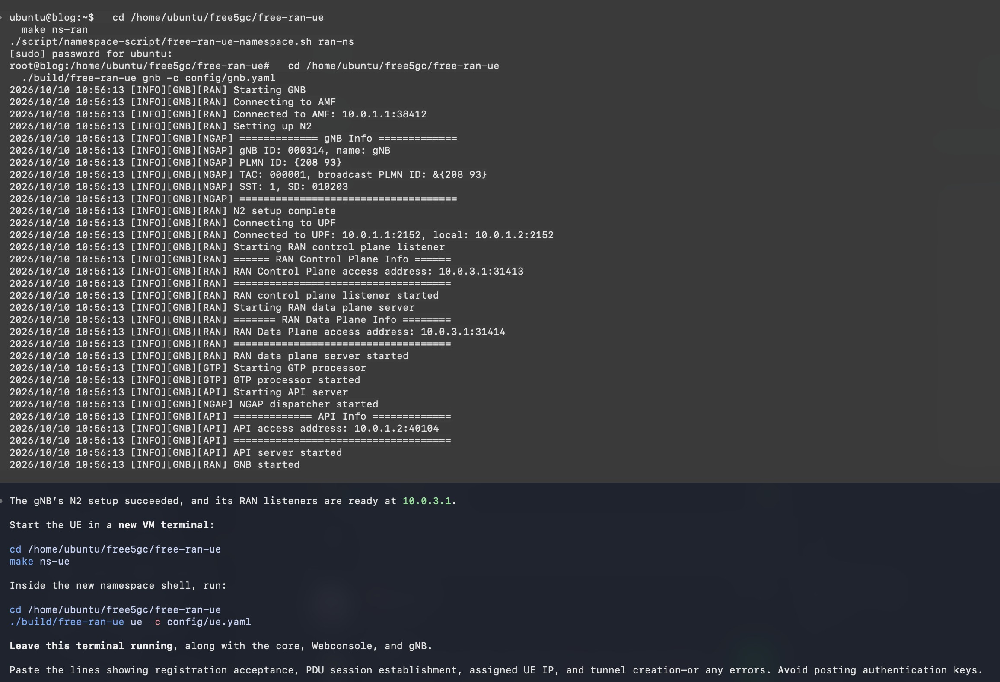

Figure 8: N2 setup evidence allows the walkthrough to proceed to UE registration.

Inside `free-ue-ns`, the user launched the UE. The logs reported registration completion, PDU session establishment for DNN `internet`, assigned address `10.60.0.1`, and tunnel device `ueTun0`.

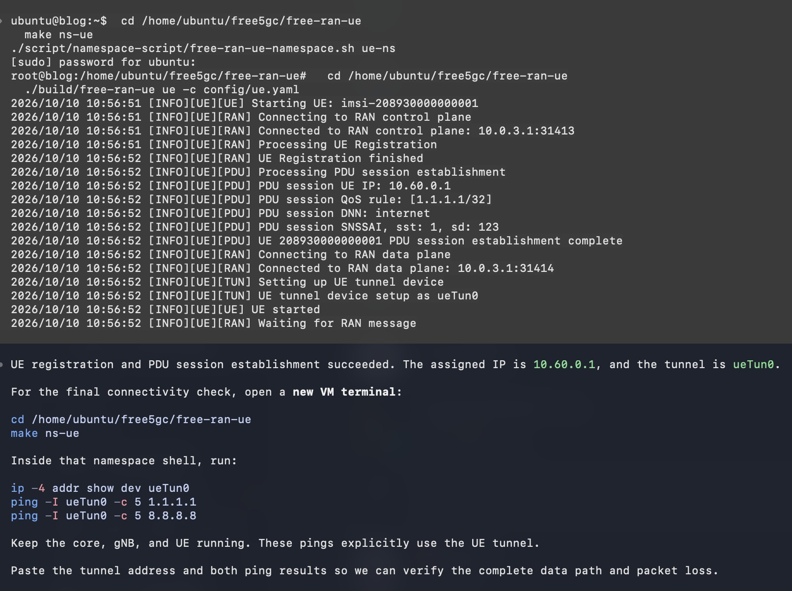

Figure 9: The next test uses the observed tunnel name and assigned address.

### Final Traffic Evidence

In another shell inside `free-ue-ns`, the user ran:

```bash
ip -4 addr show dev ueTun0
ping -I ueTun0 -c 5 1.1.1.1
ping -I ueTun0 -c 5 8.8.8.8
```

The interface had `10.60.0.1/32`, and both ping outputs explicitly showed traffic originating from that address through `ueTun0`.

| Destination | Packets sent / received | Loss | Average RTT |
| --- | --- | --- | --- |
| `1.1.1.1` | 5 / 5 | 0% | 5.077 ms |
| `8.8.8.8` | 5 / 5 | 0% | 5.087 ms |

These are observations from five packets per destination in this lab, not a performance benchmark. Together with the preceding registration/session evidence, they support the demonstrated UE connectivity result.

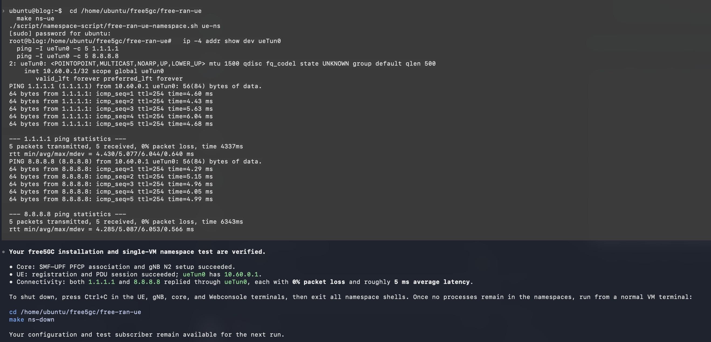

Figure 10: The final checkpoint verifies traffic through the UE tunnel and reports packet loss.

Cleanup guidance followed the same explicit approach: stop UE, gNB, core, and Webconsole; exit namespace shells; confirm no processes remain; then run `make ns-down` from the default namespace. Configuration and the test subscriber are retained for reuse.

## What This Design Gives Beginners

The skill lowers the amount of deployment knowledge a newcomer must assemble before making progress. Paths and interfaces come from their environment. Each terminal has a stated role. Logs have an explanation. Errors lead to a focused investigation. Completion depends on visible evidence.

The lab also shows why this guidance must remain adaptive. A fixed subnet example would have overlapped the VM's network; a missing command observation could have prompted an unnecessary Go reinstall. Reading actual routes, checking the installed executable, and rechecking the affected observation kept the walkthrough moving.

The package describes two-VM guidance as well, but this article demonstrates the single-VM topology only. New source revisions, Ubuntu/package combinations, and kernel/module combinations require renewed review and runtime validation. Future maintenance should preserve the seven-stage structure while updating its references and diagnostics with those changes.

## Conclusion

We built free5gc-deploy around a beginner's concrete goal: deploy a lab and demonstrate an E2E UE connectivity test. Its seven workflow stages organize the next action, the evidence needed to proceed, and the response to failure. Focused references provide deployment knowledge, and read-only scripts make observations repeatable.

In the demonstrated conversation, that structure guided the user from an initial request through installation verification, namespace adaptation, subscriber preparation, gNB setup, UE registration, and successful tunnel-bound traffic. The same checkpoints also teach the user how the components fit together, making a first deployment easier to follow and a subsequent failure easier to diagnose.

## References

- [free5gc-deploy skill and supporting files](https://github.com/free5gc/agent-skills/tree/main/skills/free5gc-deploy)
- [Skill workflow definition](https://github.com/free5gc/agent-skills/blob/main/skills/free5gc-deploy/SKILL.md)
- [Reviewed sources, revisions, and documentation differences](https://github.com/free5gc/agent-skills/blob/main/skills/free5gc-deploy/references/sources.md)
- [Official free5GC quick setup](https://free5gc.org/guide/quick-setup/)
- [free-ran-ue user guide](https://free-ran-ue.github.io/doc-user-guide/)
- [Single-VM namespace guide](https://free-ran-ue.github.io/doc-user-guide/03-namespace-free-ran-ue/)

## About

Hello! I'm Meng-Han Hsieh, and I've recently started exploring 5G technology and engaging with the free5GC community. I hope you find this blog post useful, and don't hesitate to reach out if you have recommendations for improvement.

### Connect with Me

- GitHub: [Meng-Han, Hsieh](https://github.com/c9274326)
