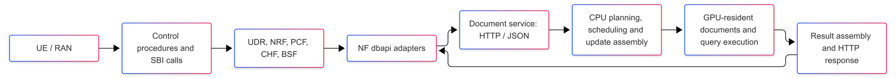
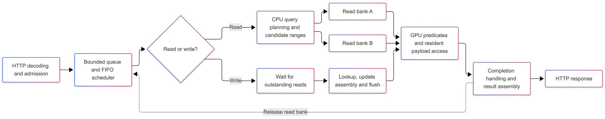
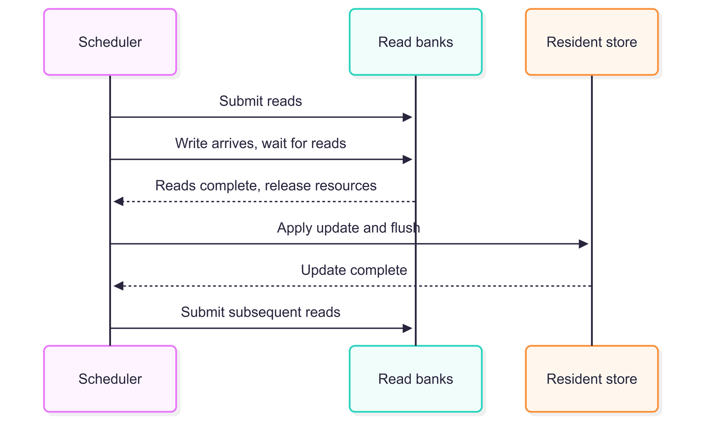
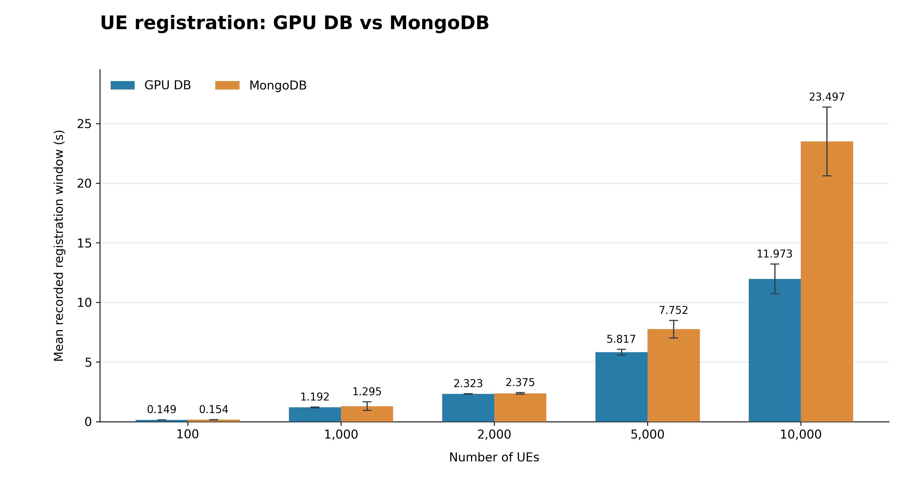

# Exploring GPU-Resident Databases for the 5G Core

>[!NOTE]
> Author: Chia-Hui, Chen
> Date: 2026/10/11

---

## 1. Introduction

GPUs can process many tasks in parallel, and a core network generates numerous data requests when many UEs register. Bringing the two together is appealing, but requests must reach the GPU and results must return to the network functions (NFs) promptly. Authentication state, subscription data, and updates required by control procedures must remain correct.

We want to answer a practical question: **Can a GPU-resident database serving existing free5GC data operations help real UEs receive Registration Accept sooner?** This experiment covers registration only; it does not establish PDU sessions.

We implemented a separate document service and connected the database access paths of UDR, NRF, PCF, CHF, and BSF to it. The NF service-based interfaces (SBIs) and the existing RAN/UPF topology remain unchanged. The working set is loaded into GPU VRAM before testing, and the CPU and GPU cooperate to execute data operations at runtime.

This article compares registration time across UE populations with one UE launched every 1 ms. It describes the current architecture, implementation limitations, and directions for performance analysis. Ten measured runs were completed at each scale. Mean registration windows were similar at smaller populations, while the GPU configuration showed larger reductions at 5,000 and 10,000 UEs. Persistence and recovery are outside the scope of this proof of concept (PoC).

## 2. Database Work in the Core Goes beyond Subscription Reads

UE registration involves authentication, subscription, and context data. PDU session establishment can also involve policy and charging data. NRF manages NF profiles and handles discovery and OAuth-related queries. These operations are distributed across NFs, so every NF that directly connects to a database needs to route its data access to the GPU DB.

| NF | Data operations handled by the adapter |
|---|---|
| UDR | Authentication, subscription, provisioned/policy, and context documents |
| NRF | NF profiles, discovery/OAuth queries, subscriptions, and urilist |
| PCF | Reads and writes involving flowRule, qosFlow, and chargingData |
| CHF | Rating- and quota-related data operations |
| BSF | pcfBindings, startup loading, and lastAccessTime updates |

Services such as AMF, UDM, and SMF obtain data from other NFs through SBI calls, preserving their existing service interactions. NFs that access the database directly use an adapter to reach the GPU DB.

## 3. Architecture: Keeping Procedures in the NFs and Data Operations in the Service

We added a dbapi adapter at each relevant NF's database call boundary. The GPU version sends data operations to a shared document service, replacing the original MongoDB data access.

*Figure 1. Runtime architecture of the GPU version. The NF group represents services connected through adapters.*

The Mongo baseline uses a separate copy of free5GC without the GPU DB modifications and retains its native MongoDB access path. It is not a backend switch within the GPU version. Both configurations use matching topology, workload generation, and common performance optimizations. Initial GPU data can be exported from MongoDB as a snapshot and preloaded before testing. This preparation is excluded from registration timing and does not imply continuous MongoDB access or synchronization at runtime.

### 3.1. Resident Data Still Requires Host Work

The CPU handles HTTP/JSON, query parsing, candidate-range planning, update assembly, scheduling, and responses. The GPU evaluates document predicates and accesses resident payloads. Writes also require CPU preparation and the upload of updated data.

Keeping the data resident avoids transferring the entire working set for every query. Query control data, results, and updates still need to move. The service therefore uses CPU/GPU cooperation; it does not execute the entire MongoDB system on the GPU.

*Figure 2. Scheduling within the current document service. The two read banks provide resources for two sets of queries in flight, rather than two complete database replicas. Writes remain subject to a global read/write barrier.*

### 3.2. Two Banks Need Actual Concurrency

The two banks allow new reads to be submitted without always waiting for the previous batch to be fully collected and its resources released. The completion scheduler briefly spins to check GPU completion, then falls back to polling waits when necessary. This reduces the delay that timer-based waiting can add to short queries.

Two banks do not guarantee continuous overlap. A lack of requests, intervening writes, or resource waits can leave only one bank active. Spinning also consumes CPU time, so both CPU cost and completion time matter; GPU utilization alone cannot determine whether the design is effective.

### 3.3. Writes Introduce an Explicit Ordering Boundary

Before a write, the scheduler waits for outstanding reads to complete. Subsequent reads execute after the update finishes. This global barrier simplifies read/write visibility, but it also limits concurrency between independent operations on different UEs.

*Figure 3. The current read/write ordering boundary. It protects visibility, but two UEs can still wait on each other even when they access different documents.*

## 4. Moving from a Prototype to Real Core Procedures

Data is first exported from local MongoDB as a snapshot and loaded into an empty GPU service. The core network is then started. This experiment runs UE registration, ending the timing window at Registration Accept without establishing PDU sessions. It exercises real NF calls rather than only offline GPU kernels.

To serve NF data operations, the document service implements document reads, conditional queries, inserts, updates, and deletes. It also includes upsert, replacement, insert-unique, delete-many, drop, NRF pull, and elemMatch operations. Each NF's dbapi adapter translates existing database calls into service requests. The CPU parses requests and assembles updates, while the GPU evaluates predicates and accesses resident documents.

The implementation is not a complete MongoDB replacement. Document size, query instruction count, and term count are bounded. BSON types and string comparisons are supported only within the implemented subset. Full MongoDB query and transaction capabilities, persistence, and failure recovery are not provided. The working set is limited by VRAM capacity, writes still require CPU assembly and data uploads, and the global read/write barrier restricts concurrency.

## 5. Experimental Design and Results

### 5.1. Registration Only, without PDU Sessions

The experiment uses PacketRusher to launch one UE every 1 ms, giving a nominal launch rate of approximately 1,000 UEs/s. The tested populations are 100, 1,000, 2,000, 5,000, and 10,000 UEs. Ten measured runs were completed for each backend at each UE scale, with warmup runs excluded from the averages. The workload uses `--tr 1 --npdu 0`, with no PDU session establishment.

Changing the UE population primarily changes how long injection continues; it does not increase the nominal arrival rate. Injecting 10,000 UEs takes approximately 10 seconds, while 100 UEs take approximately 0.1 seconds. Differences across scales therefore reflect both injection duration and the core network's processing progress.

The registration window begins when the first UE starts registration and ends at the last Registration Accept timestamp recorded by the measurement tool. It includes launch pacing, RAN and NF processing, SBI calls, database work, and waiting at the tail of the run. This measures the elapsed time of the overall registration workload.

### 5.2. Results

The table compares registration windows across UE populations using means, medians, and standard deviations. It also reports how many runs provide usable timing windows.

| UEs | GPU mean ± SD (s) | Mongo mean ± SD (s) | GPU median (s) | Mongo median (s) | Mongo / GPU mean ratio | 
|---:|---:|---:|---:|---:|---:|
| 100 | 0.1489 ± 0.0046 | 0.1544 ± 0.0131 | 0.1480 | 0.1490 | 1.037× |
| 1,000 | 1.1919 ± 0.0304 | 1.2951 ± 0.3592 | 1.1850 | 1.1825 | 1.087× |
| 2,000 | 2.3234 ± 0.0287 | 2.3747 ± 0.0646 | 2.3190 | 2.3640 | 1.022× |
| 5,000 | 5.8171 ± 0.2428 | 7.7521 ± 0.7453 | 5.6940 | 7.9565 | 1.333× |
| 10,000 | 11.9735 ± 1.2386 | 23.4972 ± 2.8836 | 11.5685 | 23.4060 | 1.962× |

*Table 1. Registration windows across UE populations, with one UE launched every 1 ms. SD denotes standard deviation across ten measured runs. A mean ratio above 1 indicates a shorter average window for the GPU configuration.*

The GPU configuration had a shorter mean registration window at every tested scale. Differences were modest at 100–2,000 UEs, with mean reductions of approximately 3.6%, 8.0%, and 2.2%, respectively. At 1,000 UEs, however, the medians were nearly identical, with Mongo slightly lower. Mongo’s maximum of 2.316 seconds and higher standard deviation suggest that the mean difference at this scale was influenced by unusually long runs.

The gap widened at 5,000 and 10,000 UEs. At 5,000 UEs, the mean window decreased from 7.7521 to 5.8171 seconds, a reduction of approximately 25.0%. At 10,000 UEs, it decreased from 23.4972 to 11.9735 seconds, a reduction of approximately 49.0%, corresponding to a Mongo/GPU mean ratio of 1.962×. The medians showed the same direction at both scales, and GPU timing variability was lower across all tested populations.

*Figure 4. Mean recorded registration window for GPU DB and MongoDB across UE populations. One UE is launched every 1 ms, with no PDU session establishment. Bars show the mean of ten measured runs; error bars indicate ±1 standard deviation. Lower values indicate shorter registration windows.*

Because the launch interval remained fixed, larger populations extended the injection period rather than increasing the nominal arrival rate. These results show a wider performance gap during longer registration workloads; they do not establish a higher maximum sustainable arrival rate or isolate GPU execution as the cause.

## 6. Limitations

The current architecture suggests several factors that may affect performance. Overall registration time captures the combined difference, but does not separate the costs of individual stages.

### 6.1. A Batch Limit Does Not Guarantee a Full Batch

The batch limit sets the maximum number of requests handled together; it does not guarantee that every batch will fill. NF calls have dependencies, and requests arrive at different times. Even with more UEs, a submission may contain only a few requests. Small batches make it harder to amortize the fixed costs of GPU submission and result collection.

### 6.2. Host/Device Transfers and Submission Costs

Keeping the working set in VRAM avoids transferring the complete dataset for every query. Query parameters still move from host to device, results return to the host, and writes upload updated data. For queries with little computational work, host/device transfers, kernel submission, and synchronization waits can account for much of the elapsed time. Reducing transfer frequency and combining small transfers can help amortize these costs.

### 6.3. Mixed Reads and Writes Can Interrupt the Pipeline

Registration is not a read-only workload. Authentication data, context, and other state updates occur between reads. The global barrier can repeatedly drain the read banks.

An advantage in a read-only benchmark may therefore not carry over to real registration. If the queue grows at larger scales while batches remain small and writes frequently stop the banks, synchronization and the write path need attention, rather than simply a higher batch limit.

### 6.4. Other Stages Can Still Determine Completion Time

The registration window is determined by the last completion and can be affected by queues in other NFs, retransmissions, and tail events. A faster GPU DB may simply move the bottleneck to AMF, SBI, or the RAN.

End-to-end timing reflects the whole registration flow. Its mean and variation alone cannot reveal how much faster the database is or identify a particular NF as the bottleneck.

## 7. Next Steps: Explaining the Performance Gap

With the five-scale comparison completed, the next step is to explain why the gap widens during longer registration workloads. Profiling can examine database queues, actual batch sizes, read/write barriers, and NF resource usage. Experiments with different launch intervals can then test whether the advantage persists as the offered arrival rate changes.

If the core network cannot generate enough database load, a real DB trace can be replayed while preserving operation order within each UE and allowing different UEs to run concurrently. This separates how much work the database can process from how much work the core can deliver. Trace replay results do not replace end-to-end measurements with real UEs.

Possible design improvements include narrower synchronization, lower write flush and transfer costs, and adaptive batch waiting. These remain future work. In particular, replacing the global barrier with synchronization per key or collection requires handling index consistency, operations across documents, and shared data so that higher throughput does not compromise read/write semantics.

The Mongo baseline should retain appropriate indexes and connection reuse. Common performance optimizations are aligned between the configurations. The GPU PoC lacks persistence and recovery, while MongoDB may incur their costs. These differences need to be recorded rather than attributing every advantage to GPU hardware.

## 8. Conclusion

The measurements show modest mean differences at smaller UE populations and substantially shorter GPU registration windows at 5,000 and 10,000 UEs. At 10,000 UEs, the mean recorded window was approximately 49.0% shorter. These results support further exploration of GPU-resident databases in the core network, while additional profiling and completion accounting are needed to explain the improvement and establish its operating limits.

The opportunities for improvement lie in reducing submission and transfer costs for small requests, forming effective batches, and limiting the disruption that write barriers cause to the read pipeline. The completed experiments provide an initial view of its effect on registration time. Further measurements at different arrival rates can clarify where the advantage persists.

## References
- [CUDA Programming Guide: Asynchronous Execution](https://docs.nvidia.com/cuda/cuda-programming-guide/02-basics/asynchronous-execution.html): Streams provide opportunities for overlap when resource and dependency conditions permit; asynchronous API use alone does not demonstrate overlap.
- [CUDA C++ Best Practices Guide](https://docs.nvidia.com/cuda/archive/12.5.1/cuda-c-best-practices-guide/index.html): Memory Optimizations.
- [PacketRusher](https://github.com/HewlettPackard/PacketRusher): An open-source UE and gNB simulator used to generate the multi-UE registration workload in this study.
- [Building and Testing a free5GC and PacketRusher Lab](https://free5gc.org/guide/PacketRusher-tutorial/PacketRusher-tutorial/): A setup guide for integrating PacketRusher with free5GC and testing UE registration and PDU session establishment.

**About Me**
Hi, I'm Chia-Hui Chen. I'm currently diving into 5G technology and the free5GC project. I hope you find this blog valuable! Feel free to reach out if you have any feedback or would like to discuss anything further.