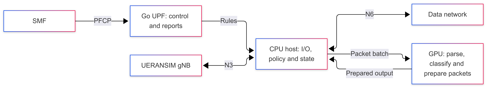
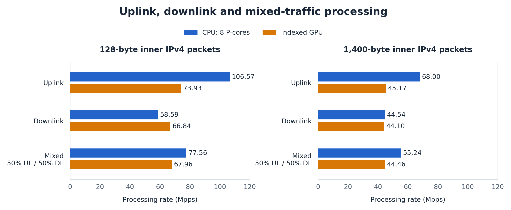
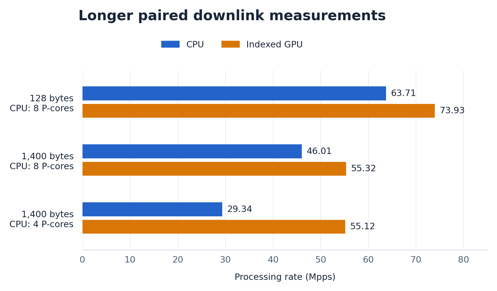

# Exploring GPU Acceleration for free5GC's UPF Data Plane

> [!NOTE]
> Author: [Yu-Chen Chan](https://github.com/solar224)
> Date: 2026/10/11

---

## 1. Introduction

A 5G core network's User Plane Function (UPF) carries traffic between mobile users and the data network. Every packet requires processing: finding its forwarding rules, handling tunnel headers, applying policy and recording usage. This makes the UPF data plane a candidate for GPU acceleration.

Our starting point was [Taehee Yoo's presentation at the Linux Plumbers Conference (LPC) 2025](https://lpc.events/event/19/contributions/2267/), which explores kernel-native packet processing on AMD GPUs through Linux's XDP packet-processing interface and emphasizes efficient packet movement. It motivated our focus on packet movement and parallel processing.

We built a CPU/GPU forwarding prototype inside free5GC, verified live session traffic and compared GPU processing with a tuned multicore CPU. The experiments examine CPU/GPU responsibilities and the processing changes needed to use GPU parallelism effectively.

The implementation passed live forwarding checks. Processing comparisons using rules from ten real sessions showed different outcomes by direction and CPU allocation: CPU led the exploratory uplink and mixed-traffic cases at the largest tested core budget, while longer downlink tests found **16–21% higher GPU processing rates** than the corresponding CPU configurations.

---

## 2. Understanding the UPF Data Plane

The data plane is the path that carries user packets. In our environment, UERANSIM simulates the user equipment (UE) and base station (gNB). The UPF connects the base station over **N3**, and the data network (DN) over **N6**. GTP-U, the GPRS Tunnelling Protocol for user traffic, carries the UE's IP packets across N3. A Protocol Data Unit (PDU) session establishes the UE's logical connection to a data network, with rules governing its traffic.

*Figure 1. The UPF's position between the access network and the data network.*

**Uplink (UL)** carries traffic from UE toward DN. The gNB wraps the UE's IP packet in a GTP-U tunnel. The UPF identifies the applicable rules, applies policy, removes the tunnel header and forwards admitted traffic toward N6. **Downlink (DL)** carries traffic from DN toward UE; the UPF selects the destination tunnel and prepares a GTP-U packet for the gNB.

The Session Management Function (SMF) controls this behavior through the Packet Forwarding Control Protocol (PFCP):

- **PDR — Packet Detection Rule:** identifies which policy applies to a packet.
- **FAR — Forwarding Action Rule:** specifies the forwarding action and destination.
- **QER — QoS Enforcement Rule:** controls admission and rate limits.
- **URR — Usage Reporting Rule:** measures traffic and requests usage reports.

These roles are defined in [3GPP TS 29.244](https://www.etsi.org/deliver/etsi_ts/129200_129299/129244/18.08.00_60/ts_129244v180800p.pdf). Processing also updates usage counters and sequence numbers that label successive tunnel packets. This information is called **state** because it changes as packets are handled.

---

## 3. Building a CPU/GPU UPF

### 3.1. CPU and GPU Responsibilities

We added a research forwarding backend to the existing UPF. Go continues to handle PFCP and reporting. A C++ host engine handles network input/output (I/O) through N3 User Datagram Protocol (UDP) sockets and an N6 virtual network interface (Linux TUN). Its CUDA worker, using NVIDIA's GPU programming platform, parses packets, selects rules and prepares tunnel transformations.

*Figure 2. The live forwarding prototype uses CPU network I/O and GPU packet preparation.*

A batch is a group of packets processed together. After GPU preparation, the host applies policy and commits state before transmitting admitted output. This division keeps network I/O and control on the CPU while introducing GPU work into the data path.

CPU and CUDA research modes share the same I/O and host policy. Functional checks completed **3,000 UE/gNB/UPF/DN echo roundtrips**, exercising GPU-prepared output in both directions. This established a working forwarding prototype for further study.

### 3.2. Examining More of the Processing on GPU

We also implemented a GPU processing kernel that handles usage and sequence updates alongside packet preparation. To compare this processing with CPU execution, we captured rules from **ten real SMF-admitted PDU sessions** and generated controlled packets matching them.

The captured snapshot contains **40 PDRs, 40 FARs, 30 QERs and 40 URRs**. A lookup group narrows the candidate PDRs using the packet's tunnel identifier on uplink or destination UE address on downlink. Each group in this snapshot has two candidates. The optimization below focuses on processing the associated forwarding and usage rules.

---

## 4. Optimizing and Measuring GPU Processing

### 4.1. Reducing Repeated Work

Our initial GPU processing algorithm assigned tasks to individual FARs and URRs. Each task examined the entire packet batch to find its contributions, repeating that search across many rules.

We replaced this repeated search with **ordered worklists**. The GPU groups contributions by FAR or URR, then each rule processes only its own entries. For example, if packets 1 and 3 contribute to usage rule A, its list contains those two positions. A packet linked to several usage rules contributes to each relevant list. The results call this implementation the **indexed GPU**.

Different rule tasks can execute in parallel. Each list preserves packet order for sequence allocation and for identifying the packet that reaches a configured usage amount and triggers a report. The timed work includes building the lists, updating state and preparing complete output packets.

### 4.2. Comparison with Multicore CPU

The machine has an **Intel i9-12900 and an RTX 3090**, using CUDA 12.6.3. Both backends process controlled IPv4/UDP packets with the same captured rules, QER admission gates and URRs. Admission gates permit or block traffic; rate-based policing is disabled in this comparison.

For this processing comparison, inputs are already in CPU system memory (RAM) or GPU memory (VRAM). Each trial repeatedly processes prepared batches, timing parsing, rule lookup, usage and sequence updates, generation of usage-report data and preparation of complete output packet bytes.

The i9-12900 has eight performance cores (P-cores) and eight efficiency cores (E-cores). Here, **CPU budget** means the P-cores available to processing, including its coordinating thread. We tested budgets of one, two, four and eight P-cores, using rule-scanning and indexed CPU methods. Eight uses all the performance cores and is the largest budget in this sweep; E-cores are excluded. This is a core-allocation comparison, rather than a price comparison.

To examine packet-size sensitivity, we used **128-byte and 1,400-byte inner IPv4 packets**, representing shorter and longer processing inputs. The size includes the inner IP and UDP headers and payload, and excludes the outer tunnel headers. Each size was tested in UL-only, DL-only and **50:50 mixed traffic**, with equal numbers of UL and DL packets.

We also tested **batch sizes of 128, 512, 2,048 and 8,192 packets** to compare how much work each processor handles together. For each workload and CPU budget, the reported configuration uses the fastest measured method and batch; GPU selects its own batch independently.

The measurements have two stages: a short sweep to select configurations, followed by longer paired downlink trials. A pair measures CPU and GPU on the same workload in one comparison block; their execution order is randomized.

### 4.3. Uplink, Downlink and Mixed Traffic

The exploratory sweep used five repetitions per configuration, each lasting at least 50 ms. Figure 3 compares the selected CPU configuration within **eight P-cores** with the indexed GPU. CPU selected batch 8,192 for 128-byte packets and 2,048 for 1,400-byte packets; GPU selected 8,192 for all six cases.

**Mpps** means millions of memory-resident packets processed per second; higher is faster. Each rate is the median of five measurements. Blue bars represent CPU and orange bars represent indexed GPU; the numbers at their ends give the measured rates. Both packet-size panels use the same scale, starting at zero.

*Figure 3. Processing rates by direction and packet size in the exploratory sweep.*

Within this eight-P-core comparison, CPU leads both uplink and mixed-traffic sizes. GPU leads the 128-byte downlink case, while the 1,400-byte downlink case is close to parity.

### 4.4. Longer Downlink Measurements

The follow-up focuses on downlink because the sweep showed a GPU lead or near parity there. We froze the selected methods and batches and ran ten paired trials per case, each lasting at least five seconds, with randomized order. This stage examines the selected configurations over longer measurement intervals.

With **eight P-cores**, 128-byte downlink processing reached **63.71 Mpps on CPU and 73.93 Mpps on GPU**, a paired improvement of approximately **16%**. At 1,400 bytes, the rates were **46.01 Mpps on CPU and 55.32 Mpps on GPU**, approximately **21% improvement**. CPU retained batches of 8,192 and 2,048 respectively; GPU used 8,192.

To examine a smaller CPU budget, we also measured 1,400-byte downlink with **four P-cores**. CPU selected batch 512 and achieved **29.34 Mpps**; GPU used batch 8,192 and achieved **55.12 Mpps**. This paired comparison produced the approximately **88% GPU advantage**.

These measurements use the same algorithms as the short sweep, in a separate time window. The 1,400-byte downlink result changed from near parity to a GPU lead. Percentages compare CPU and GPU within the longer window. Each trial pair contributes a GPU/CPU ratio; we combine those ten ratios using their geometric mean, an average for multiplicative comparisons, to report speedup.

Figure 4 summarizes these downlink comparisons. Bar lengths and end labels show median processing rates. The CPU allocation is stated separately for each case.

*Figure 4. Downlink processing rates for the selected CPU allocations.*

The worklist improvement also has a direct GPU control: in the longer 1,400-byte, eight-P-core comparison, the initial GPU algorithm reached **45.80 Mpps**, and the indexed algorithm reached **55.32 Mpps**, approximately **21% improvement**.

### 4.5. Why the Results Depend on the Workload

The direction changes the work being processed. In this implementation, downlink builds outgoing GTP-U headers and allocates sequence numbers. The ordered GPU tasks directly target sequence allocation and usage updates. Each lookup group still has just two PDR candidates, so the optimization concentrates on state processing rather than making rule matching more complex.

The CPU reference also benefits from indexing and multiple cores. The GPU pays for grouping contributions and synchronizing its parallel stages inside the timed processing. For example, in 128-byte uplink, indexing raised GPU processing from **56.14 to 73.93 Mpps**, while CPU achieved **106.57 Mpps**. An effective GPU optimization can coexist with a faster CPU result for that workload.

Correctness checks compare output packet bytes, usage and sequence counters, and generated usage-report data against the CPU reference.

---

## 5. Conclusion

This experiment demonstrates a working CPU/GPU forwarding prototype and an optimization for packet-and-state processing. The results identify a conditional GPU advantage: the eight-P-core CPU leads the exploratory uplink and mixed-traffic cases, while the longer downlink comparison shows **16–21% GPU gains**. A smaller CPU allocation also makes GPU processing more competitive in the measured configurations.

The processing rates apply to repeated, memory-resident batches, with GPU launch and completion costs amortized. The live forwarding prototype and the indexed processor have separate results; the initial live configuration did not establish a full-path speedup.

The study provides a basis for discussing how traffic direction, CPU allocation and ordered state processing shape the CPU/GPU trade-off. Network I/O, batch waiting, latency and energy extend that discussion from processing speed to the requirements of a UPF data plane.

## Reference

- [free5GC go-upf](https://github.com/free5gc/go-upf) and [gtp5g](https://github.com/free5gc/gtp5g): The native UPF implementation and its GTP-U Linux kernel forwarding module.
- [UERANSIM](https://github.com/aligungr/UERANSIM): The UE and gNodeB simulator used to establish real PDU sessions.
- [3GPP TS 29.244, version 18.8.0](https://www.etsi.org/deliver/etsi_ts/129200_129299/129244/18.08.00_60/ts_129244v180800p.pdf): PFCP and the packet forwarding model.
- [3GPP TS 29.281, version 18.2.0](https://www.etsi.org/deliver/etsi_ts/129200_129299/129281/18.02.00_60/ts_129281v180200p.pdf): GTP-U headers and sequence-number behavior.
- [NVIDIA CUB BlockRadixSort](https://nvidia.github.io/cccl/unstable/cub/api/classcub_1_1BlockRadixSort.html): The sorting primitive used in the contribution index.
- [Kernel-Native Packet Processing on AMD GPUs](https://lpc.events/event/19/contributions/2267/), Taehee Yoo, LPC 2025; [presentation slides](https://lpc.events/event/19/contributions/2267/attachments/1961/4179/LPC2025-Kernel-Native%20Packet%20processing.pdf): The starting reference for exploring GPU packet processing and packet movement.

---

## About

Hello, I'm [Yu-Chen Chan](https://github.com/solar224). This project explores GPU acceleration of free5GC UPF through implementation and measurement. I hope the article helps you understand the approach and its results. Questions, suggestions and ideas for further experiments are welcome.

### Connect with Me

- GitHub: [solar224](https://github.com/solar224)
