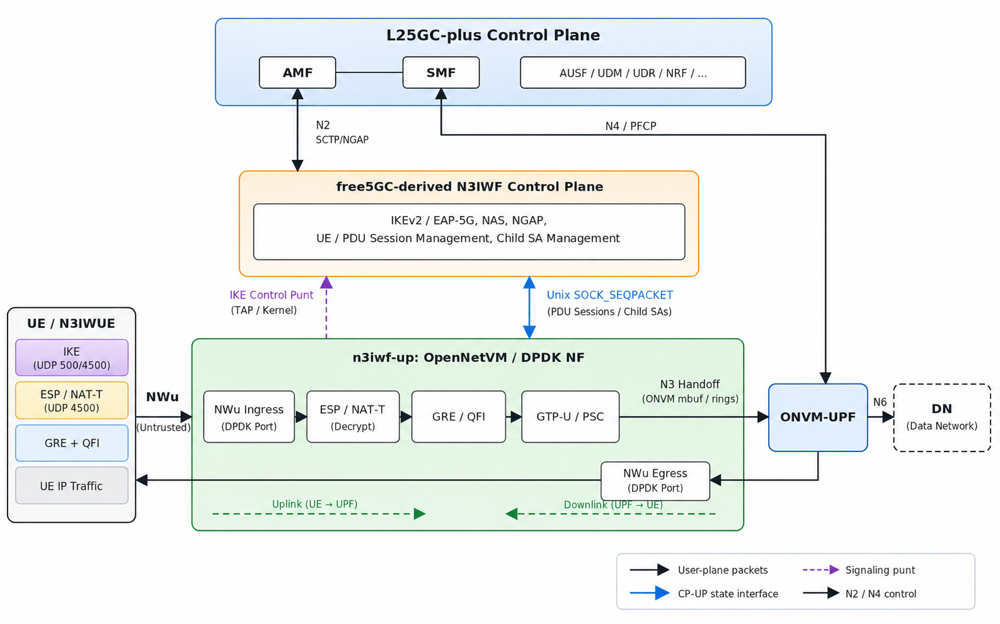
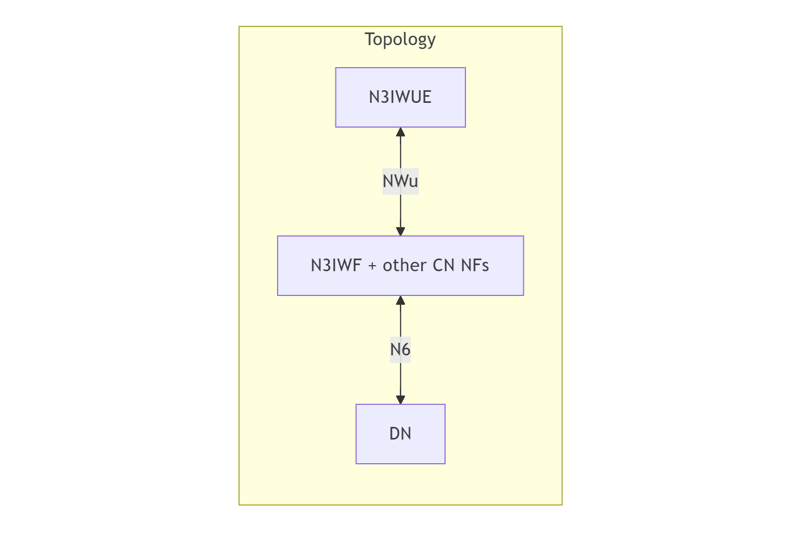

# A High-Performance DPDK-Based N3IWF: From Linux Networking to Shared Memory

>[!NOTE]
> Author: [Chieh Cheng Kuo](https://github.com/Jasonkuo23)
> Date: 2026/10/16

## Introduction

Wi-Fi and 5G may seem like two separate networks, but a device connected through Wi-Fi can still access the 5G Core (5GC). The **Non-3GPP Interworking Function (N3IWF)** makes this possible by allowing devices to securely connect to the 5GC over untrusted networks, such as public Wi-Fi.

However, the original free5GC N3IWF relies on both the Linux kernel and a Go-based forwarding process to handle user traffic, introducing additional packet-processing overhead. To address this, our **DPDK-based N3IWF** moves user-plane processing into userspace and connects directly to the L25GC+ UPF through shared memory, while retaining the existing free5GC control plane.

## Background: N3IWF and Packet Processing

### How Does N3IWF Forward User Traffic?

N3IWF acts as a gateway between the UE and the 5GC. It establishes IPsec tunnels to protect communication over untrusted networks, handles signaling, and forwards user traffic toward the UPF.

On the UE-facing side, user traffic is carried inside GRE and protected by ESP. On the core-facing side, the UPF expects GTP-U packets over the N3 interface. N3IWF must therefore handle encryption, decryption, and tunnel conversion in both directions.

### Why Is the Original N3IWF a Bottleneck?

In the original free5GC implementation, Linux XFRM handles IPsec processing, while a Go-based userspace process performs tunnel conversion and forwarding. As a result, packets repeatedly cross the kernel–userspace boundary, introducing additional data movement and processing overhead.

This becomes a bottleneck as traffic increases. Even with a high-performance UPF, the overall throughput can still be limited by how quickly N3IWF processes and forwards packets.

## Implementation: A DPDK User Plane Connected by Shared Memory

DPDK-based N3IWF architecture

### Separating Signaling from Packet Processing

The proposed design separates N3IWF into two components:

- **N3IWF-CP:** A Go-based control plane derived from free5GC. It handles IKEv2, authentication signaling, NAS relay, NGAP communication, and session management.
- **N3IWF-UP:** A C-based user plane implemented as an OpenNetVM network function. It handles IPsec processing, GRE encapsulation and decapsulation, and GTP-U forwarding.

The control plane remains responsible for establishing sessions and negotiating IPsec Security Associations (SAs). Once a PDU-session Child SA is established, N3IWF-CP sends the required security parameters and forwarding information to N3IWF-UP through a **Unix-domain socket**. The user plane then maintains its own forwarding state and processes packets without consulting the control plane for every packet.

Not all IPsec processing is moved to DPDK. The signaling Child SA remains in Linux XFRM so that the existing NAS signaling procedures can continue to work. For deployments using a shared access NIC, selected IKE and signaling ESP packets are forwarded to Linux through a TAP interface, while PDU-session ESP traffic is handled by DPDK.

This separation makes it possible to optimize high-volume user-plane traffic without redesigning the existing N3IWF signaling procedures.

### Moving the Packet Path into Userspace

One of the main reasons for using the **Data Plane Development Kit (DPDK)** is to avoid repeated kernel networking overhead. Instead of relying on the traditional interrupt-driven packet reception path, DPDK uses poll-mode drivers to receive and transmit packets directly in userspace.

In this implementation, N3IWF-UP runs on a dedicated forwarding core that continuously polls for packets. This consumes CPU resources even when traffic is light, but it avoids much of the interrupt and scheduling overhead associated with conventional packet processing.

Another important part of the implementation is how packets are handled in memory.

DPDK stores packets in **`mbufs`**, which contain the packet data and its associated metadata. Rather than allocating a new buffer whenever a packet needs a different tunnel header, N3IWF-UP reuses the existing `mbuf`.

For example, when processing an uplink packet, N3IWF-UP authenticates and decrypts the ESP packet, removes the GRE header, and adds the appropriate GTP-U headers. These operations are performed in place by adjusting the packet's headroom and data pointers.

The reverse happens for downlink traffic: GTP-U headers are removed, GRE is added, and the packet is encrypted using ESP before being sent toward the UE.

User-plane ESP processing is also moved from Linux XFRM to DPDK's IPsec and cryptodev libraries. Software cryptography, accelerated by CPU instructions, allows the entire user-plane forwarding path to run on commodity servers without requiring dedicated encryption hardware.

Together, these changes reduce unnecessary data movement and keep packet processing within the DPDK datapath.

### Turning N3 into a Shared-Memory Handoff

Moving N3IWF packet processing to DPDK is only part of the optimization. Another important step is improving how packets move between N3IWF and the UPF.

In a conventional separate-host deployment, N3IWF forwards GTP-U packets over a physical N3 link. This involves NIC transmission and reception, even though both functions are part of the same 5G system.

Our design takes a different approach: **N3IWF-UP and UPF-U run on the same server and exchange packets through OpenNetVM shared-memory rings.**

OpenNetVM manages shared packet buffers using hugepage-backed memory pools. Because both network functions can access these buffers, packets can be transferred between them without copying the entire payload into another buffer.

When N3IWF-UP finishes processing an uplink packet, it passes the `mbuf` to OpenNetVM. The ONVM manager uses the packet metadata to determine the destination network function and forwards the `mbuf` through the appropriate ring. The UPF then receives the same packet buffer and continues processing it.

Importantly, **the N3 interface and its packet format remain unchanged**. N3IWF-UP still produces standard GTP-U packets, including the required PDU session and QoS information. What changes is the way those packets reach the UPF: instead of traveling over a physical network link, they are handed off through shared memory.

Consider an uplink packet as an example. After ESP decryption, N3IWF-UP extracts the QoS Flow Identifier (QFI) from the GRE header and creates the corresponding GTP-U packet with a PDU Session Container. The `mbuf` is then passed to UPF-U through OpenNetVM, where the UPF applies its forwarding rules and sends the traffic toward the data network over N6.

Downlink traffic follows the reverse path. UPF-U passes a GTP-U packet to N3IWF-UP, which converts it into GRE protected by ESP and transmits it toward the UE.

This approach keeps the N3 protocol behavior intact while removing the need for physical N3 transmission between the two co-located functions.

## Experiment Results: UDP Packet-Size Sweep

To see how much these changes improve forwarding performance, we eavaluated UDP uplink throughput using `iperf3` on the FABRIC testbed.

The experiment compares two deployment configurations:

- **Deployment A:** The DPDK-based N3IWF integrated with the L25GC+ UPF through OpenNetVM shared memory.
- **Deployment B:** The original Linux-based free5GC N3IWF and free5GC core deployed on the same host using Linux networking.

Two UDP packet sizes, 512 and 1200 bytes, were tested to examine how per-packet processing overhead affects throughput.

The table below summarizes the measured maximum loss-free throughput.

| UDP packet size | A: DPDK + L25GC+ | B: Linux + free5GC |
|---|---:|---:|
| 512 bytes | 320 Mbps | 110 Mbps |
| 1200 bytes | 725 Mbps | 230 Mbps |

The difference is already clear with 512-byte packets. Deployment A achieves **320 Mbps**, compared with 110 Mbps for B. That is approximately **2.9× higher throughput**.

With larger 1200-byte packets, both deployments benefit from carrying more payload data per packet. However, the DPDK-based design still reaches **725 Mbps**, compared with 230 Mbps for B.

This behavior makes sense when considering the work performed on each packet. Operations such as packet lookup, tunnel-header manipulation, and transitions between kernel and userspace introduce overhead regardless of packet size. With smaller packets, these costs account for a larger portion of the processing time.

By keeping packet processing inside DPDK and forwarding N3 traffic through shared memory, the integrated design reduces several sources of overhead found in the reference deployment.

## Final Thoughts

The goal of this project is to make N3IWF forwarding more efficient without rebuilding the entire N3IWF from scratch.

Keeping the existing free5GC control plane while moving user-plane IPsec and tunnel processing into DPDK reduces the overhead of repeatedly passing packets between Linux and userspace. Integrating N3IWF-UP with the L25GC+ UPF through OpenNetVM shared memory further avoids unnecessary physical N3 transmission.

The UDP results show that these changes can make a substantial difference, especially when processing smaller packets where per-packet overhead becomes more noticeable.

There is still room for improvement. Currently, N3IWF-CP and N3IWF-UP exchange session and security-association updates through a Unix-domain socket. A possible next step is to explore a shared-memory interface for these control-plane updates as well.

The current DPDK N3IWF code is in this [repo](https://github.com/Jasonkuo23/onvm-upf/tree/feat/n3iwf), it will soon be integrated in [L25GC+](https://github.com/nycu-ucr/L25GC-plus).

## Referemces

- [TS 124.502](https://www.etsi.org/deliver/etsi_ts/124500_124599/124502/17.05.00_60/ts_124502v170500p.pdf)
- [free5GC N3IWF](https://github.com/free5gc/n3iwf/tree/445f45b13ed8ef3e8a4f5e7279735b42efb9ee12)
- [L25GC+](https://github.com/nycu-ucr/L25GC-plus)
- [ONVM-UPF](https://github.com/nycu-ucr/onvm-upf)
- [Data Plane Development Kit (DPDK)](https://www.dpdk.org/)

## About me

Hi! I'm Chieh-Cheng Kuo, currently working on developing DPDK-based N3IWF for Integrating L25GC-plus. I hope you find this blog interesting, and feel free to contact me if you'd like to discuss anything!