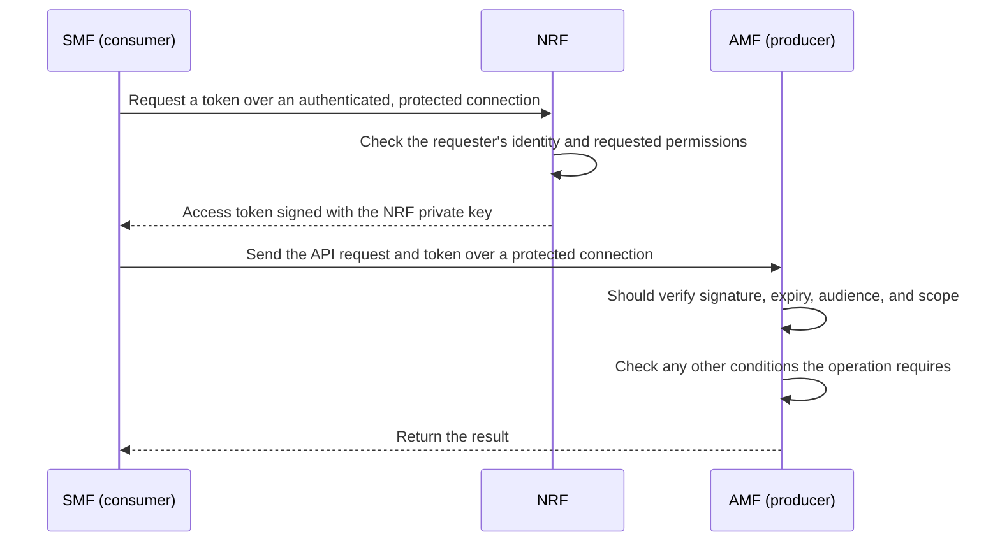
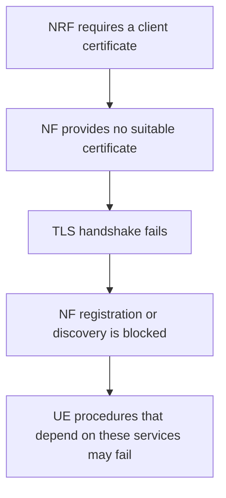

# Getting Started with free5GC SBI Security: How Certificates, TLS, and OAuth2 Work Together

> [!NOTE]
> Author: [Jing-Jhih Du](https://github.com/djhih)
> Date: 2026/10/22

---

## Introduction

In free5GC, Network Functions (NFs) such as the AMF and SMF call each other's services over the Service Based Interface (SBI). To protect these connections, most of us first think of two things: switch to HTTPS and turn on OAuth2. HTTPS protects the transport; OAuth2 restricts access to services.

Whether they actually work depends on the whole verification chain: who holds the private keys, whether TLS verifies the peer, and whether the receiving service checks the token's conditions. Turning a feature on in a config file does not guarantee every link is in place. One missing link can still leave room for impersonation or unauthorized access.

free5GC [issue #1164](https://github.com/free5gc/free5gc/issues/1164), about private keys published in the repository, is a good starting point. A deployment that keeps those keys shares its signing capability with anyone who has the repository. To see what replacing the keys fixes, and what it does not, we need to look at certificate issuance, TLS authentication, and token verification separately.

This post follows a single SBI request through these mechanisms, walks through common integration pitfalls in the source code, and ends with checks you can run in your own test environment.

The code examples are based on the versions used by free5GC v4.3.0; the token analysis uses openapi v1.3.0 and golang-jwt/jwt/v5 v5.2.2. For other versions, check against their implementation and configuration.

## Background: How an SBI Request Is Trusted

Suppose the SMF calls a service on the AMF. The SMF is the consumer and the AMF is the producer. Besides NF registration and discovery, the NRF also issues OAuth2 access tokens.

The diagram shows how the work is meant to be divided. The producer-side checks are design requirements; the version discussed here handles `exp` and `aud` differently, as later sections explain.



*Figure 1: The intended authorization flow between an NF consumer, the NRF, and an NF producer. TLS authentication handles connection identity; token verification handles service authorization. Not every check shown is fully implemented in the version discussed here.*

### Certificates and TLS: Who Am I Talking To?

A certificate holds a public key, identity information, a validity period, and its intended usage, signed by its issuer. A TLS client verifies the chain against a trusted Certificate Authority (CA), then checks that the certificate's name matches the expected server. The trusted CAs must come from trusted configuration, not from whatever certificate the peer sends as `root.pem`.

If the server also requires and verifies a client certificate, the connection uses mutual TLS (mTLS). Note that an NF's server certificate on disk is not automatically sent when the NF acts as a client; each direction is configured separately.

Certificates can be shared; their private keys must stay secret. Anyone with a private key can produce valid signatures, and a verifier cannot tell from the signature alone whether the signer was authorized. Also, PEM is just an encoding: a `.pem` file may hold a certificate or a private key, so the extension does not tell you whether it is safe to share.

### OAuth2 and JWT: What Is This Request Allowed to Do?

OAuth2 handles authorization, and free5GC uses JWT as the token format. The NRF signs tokens with its private key; producers verify them with the matching public key. The signature protects integrity, not confidentiality.

A bearer token can be used by whoever holds it, without proving possession of the NRF's key, so the token itself must not leak. Sent over plain HTTP, it can be picked up and reused by anyone who can observe the traffic. [RFC 6750 §1.2](https://www.rfc-editor.org/rfc/rfc6750.html#section-1.2)

Beyond the signature, a producer also checks the token's conditions:

| Claim | Purpose | What to check |
| --- | --- | --- |
| `exp` | Expiration time | Whether the token has expired, and whether the claim is required |
| `nbf` | Not-before time | If present, whether the token may be used yet |
| `aud` | Intended audience | Whether this service is one of the intended recipients |
| `scope` | Service permissions | Whether it covers the service this request needs, e.g. `namf-comm` |
| `iss` | Claimed issuer | Handled according to the system's trust design |

The JWT specification defines how `aud` and `exp` are processed, but each application decides which claims are required and which values are allowed. "Optional" in the generic specification does not mean a system may skip these checks. [RFC 7519 §4.1.3–4.1.4](https://www.rfc-editor.org/rfc/rfc7519.html#section-4.1.3)

## Implementation: How free5GC Uses These Keys

To understand the impact of a published private key, we first need to know what each file is for and where the code loads it.

In the version discussed here, with OAuth2 enabled, the NRF reads `root.key`, `root.pem`, and `nrf.key` from the configured paths. If an existing key parses, the NRF keeps using it; a restart does not replace it. [NRF initialization code](https://github.com/free5gc/nrf/blob/4522e4a9d71493bfd6a6efdd25e48c1a023e1e6b/internal/context/context.go#L63-L111)

| File | Usage in this version |
| --- | --- |
| `root.key`, `root.pem` | NRF issues certificates; with `https + oauth`, the NRF also uses this CA to verify client certificates |
| `nrf.key` | NRF signs access tokens; also used by the NRF's HTTPS server |
| `nrf.pem` | NFs take the token verification public key from it; also the NRF's HTTPS server certificate |
| `<nf>.key`, `<nf>.pem` | The corresponding NF's HTTPS server private key and certificate |

See the [NRF TLS configuration](https://github.com/free5gc/nrf/blob/4522e4a9d71493bfd6a6efdd25e48c1a023e1e6b/internal/sbi/server.go#L65-L92), [token issuance](https://github.com/free5gc/nrf/blob/4522e4a9d71493bfd6a6efdd25e48c1a023e1e6b/internal/sbi/processor/access_token.go#L67-L81), and [token verification](https://github.com/free5gc/openapi/blob/f2b816c20b76022ea26a6df471bb34a4179cc555/oauth/oauth.go#L57-L91).

One detail is easy to misread: this initialization re-issues `nrf.pem` every time, but its public key still comes from the loaded `nrf.key`. A new certificate or fingerprint does not mean a new private key.

### What the Producer Actually Verifies

In this version, `VerifyOAuth` loads the public key and passes the token with an empty `Nrf_AccTok_AccessTokenClaims` to `jwt.ParseWithClaims`. The key callback requires RSA with `RS512`; the parser itself checks the signature through `token.Method.Verify(...)`. Any parsing or verification error makes `VerifyOAuth` reject the token. [free5GC VerifyOAuth](https://github.com/free5gc/openapi/blob/f2b816c20b76022ea26a6df471bb34a4179cc555/oauth/oauth.go#L57-L91), [JWT parser](https://github.com/golang-jwt/jwt/blob/v5.2.2/parser.go)

What is actually verified only becomes clear when reading free5GC and the library together:

| Item | What this version actually does |
| --- | --- |
| Algorithm and signature | Restricted to `RS512`, verified with the loaded public key |
| `scope` | Compared against the caller's `serviceName`; an empty `serviceName` means no scope restriction |
| `exp` | An expiry check runs, but the getter cannot see the payload's expiry and `exp` is not required, so the check has no effect |
| `aud` | No expected audience is configured, and the code does not compare recipients itself |
| `nbf` | If present, the library still checks that the token may be used yet |

The `exp` and `aud` limitations come from the claims structure and validator settings, traced below. So an expired token may pass when everything else holds, while a bad signature, a missing required scope, or a future `nbf` is still rejected. [JWT validator](https://github.com/golang-jwt/jwt/blob/v5.2.2/validator.go)

### How a Published Private Key Affects Authorization

If a deployment keeps the published `nrf.key`, anyone else can sign tokens too. As long as the producer trusts the matching public key and the token meets the other conditions, a self-signed token may pass.

No RSA has to be broken. The verifier accepts a signature that matches a trusted key; it is the assumption that only the NRF can use that key that no longer holds.

A published `root.key` can be used to issue certificates, affecting every verifier that trusts that CA. This is a separate path: replacing only the root CA, without the token signing key, may leave token forgery possible.

Exploiting this still requires reaching the service and passing its other checks. HTTP versus HTTPS does not change the signing key, so the risk also applies over HTTP. What a request can do once its token passes depends on each API's own authorization and business logic.

## Common Pitfalls: How Security Mechanisms Fail During Integration

### Encrypted, but Not Authenticated

This version's [`NewHttp2Client`](https://github.com/free5gc/openapi/blob/f2b816c20b76022ea26a6df471bb34a4179cc555/client.go#L694-L724) sets:

```go
tls.Config{InsecureSkipVerify: true}
```

This skips Go's default check of the server's certificate chain and host name, and the function adds no equivalent check. The client therefore cannot confirm whom it is talking to. [Go TLS documentation](https://pkg.go.dev/crypto/tls#Config)

If a connection is intercepted or redirected, the client may still complete an encrypted handshake with the wrong server and send it the token and request. Replacing the CA does not fix this: the client never uses a CA to check the peer in the first place.

This risk requires an attacker who can intercept or redirect connections. Check separately whether the client accepts untrusted certificates and whether traffic in the deployment can actually be intercepted; they depend on different conditions.

### The Signature Is Checked, but the Expiry Is Never Read

JWT integration problems can hide in data structures. Simplified, the claims structure in this version looks like this:

```go
type Claims struct {
    Exp int32 `json:"exp,omitempty"`
    jwt.RegisteredClaims
}
```

`jwt.RegisteredClaims` also has `ExpiresAt *NumericDate`, mapped to JSON `exp`. The two Go fields are independent; sharing a JSON key does not sync them. Go's JSON rules pick the shallower field, `Exp`. [Go encoding/json documentation](https://pkg.go.dev/encoding/json#Marshal)

`VerifyOAuth` decodes into an empty claims value each time, so the payload's `exp` lands in the outer `Exp` and the embedded `ExpiresAt` stays `nil`. The promoted `GetExpirationTime()` method, however, reads `ExpiresAt`:

```text
JWT payload: {"exp": 1}
    ↓ JSON decoding
outer Claims.Exp = 1
embedded RegisteredClaims.ExpiresAt = nil
    ↓ validator calls GetExpirationTime()
gets nil, treated as "no expiry provided"
    ↓ requireExp defaults to false
expiry check passes without comparing the payload's exp to the current time
```

*Figure 2: JSON decoding writes one field; the JWT library's validator reads another.*

You can follow this in the [free5GC claims structure](https://github.com/free5gc/openapi/blob/f2b816c20b76022ea26a6df471bb34a4179cc555/models/model_nrf_acc_tok_access_token_claims.go), [RegisteredClaims](https://github.com/golang-jwt/jwt/blob/v5.2.2/registered_claims.go), and the [validator](https://github.com/golang-jwt/jwt/blob/v5.2.2/validator.go). `verifyExpiresAt` does run, but on `nil` it only reports an error when `requireExp` is `true`, and `VerifyOAuth` passes no option to change that default.

`requireExp=false` means a missing expiry is allowed; if the getter returned the expiry, the library would still reject expired tokens. The real problem is that the payload's expiry never reaches the field the validator reads. This only applies to the empty-claims parsing path above; if other code sets `ExpiresAt` first, the conclusion does not hold.

A fix must make decoding and the getter use the same data, then decide whether expiry is required. Adding `WithExpirationRequired()` alone is not enough: the getter would still return `nil`, so tokens with a valid expiry would be rejected too.

Without a working expiry check, a leaked token may keep being accepted after it expires. The signature, scope, and other conditions still apply: once the verifier stops trusting the original signing key, old tokens fail signature verification.

A consumer refreshing its token on expiry does not replace this check. The producer must reject expired tokens itself rather than assume every client follows the refresh flow.

### The Scope Is Right, but the Audience Is Never Checked

`scope` says which services a token may be used for; `aud` says which recipients may accept it. A token with the right scope still has to be meant for this recipient.

To tell whether the audience is checked, searching `VerifyOAuth` for `Aud` is not enough, because the library might check it. This version does neither: it compares no recipient itself and passes no `WithAudience(...)` to `ParseWithClaims`. The validator's `expectedAud` defaults to an empty string, which disables audience matching. [JWT parser options](https://github.com/golang-jwt/jwt/blob/v5.2.2/parser_option.go), [JWT validator](https://github.com/golang-jwt/jwt/blob/v5.2.2/validator.go)

The outer `Aud` and the embedded `RegisteredClaims.Audience` are both mapped to JSON `aud`, so they are shadowed just like `exp`: the payload fills `Aud`, while `GetAudience()` reads `Audience`. Adding `WithAudience(...)` alone is therefore not a complete fix either. The getter must first see the real audience, then the comparison must match how the deployment identifies recipients.

On this verification path, an audience mismatch causes no rejection, so a token may be usable beyond what its issuer intended. Whether a given request succeeds still depends on the signature, scope, connection conditions, and the API's own checks.

### The Server Requires a Client Certificate, and the Client Sends None

mTLS needs both sides. In the NRF code discussed here, `https + oauth: true` enables `RequireAndVerifyClientCert`, so the client must present a certificate that passes verification. [NRF mTLS configuration](https://github.com/free5gc/nrf/blob/4522e4a9d71493bfd6a6efdd25e48c1a023e1e6b/internal/sbi/server.go#L65-L92)

If an NF client loads or sends no suitable certificate, the TLS handshake may fail. The request never reaches an HTTP handler, so changing the token's scope or requesting a new token cannot help.

The failure can ripple downstream:



*Figure 3: How an mTLS configuration mismatch can propagate.*

When debugging, first tell "no certificate sent" apart from "certificate sent but rejected". For the first, check whether the client loads and sends one; for the second, check the trust root, chain, validity, and usage. A UE-side registration failure rarely pinpoints the cause; read it alongside the NF and NRF handshake and registration logs.

### Verification Runs, but Failure Still Lets the Request Through

Also check what happens after a verification fails. If the caller only logs a warning and then continues with a sensitive operation, the behavior is called fail-open.

For example, the NRF [certificate check branch](https://github.com/free5gc/nrf/blob/4522e4a9d71493bfd6a6efdd25e48c1a023e1e6b/internal/sbi/processor/access_token.go#L151-L181) only logs a warning for certain `unknown authority` errors. When reading such code, check which errors really stop processing and what checks follow.

Verifying an NF certificate stored on the server also does not prove that the current requester is that NF. The `nfInstanceId` in a request is only a claim; it still needs trustworthy authentication that binds the requester to it.

## Deployment Considerations: Replacing Keys and Updating Trust

Replacing keys involves both the issuing and the verifying side. Re-issuing certificates with the old private key keeps the leaked signing capability. Deleting the files from the repository cannot take back copies others already have.

A complete update means new private keys, the matching public keys or CA on every verifier, and removal of the old trust. Replacing only the token signing key without updating the producers can make even legitimate requests fail signature verification.

The CA certificate also needs the right attributes. When generating certificates, check basic constraints and key usage; a successful self-signature or a file named `root.pem` does not make a certificate able to issue others. In Go, the related fields include `IsCA`, `BasicConstraintsValid`, and `KeyUsage`. [Go X.509 documentation](https://pkg.go.dev/crypto/x509#Certificate)

In containers, confirm which file the program actually reads. The host's `cert/`, the container's mount, and files built into the image may differ. After updating the host directory, check each NF's configured paths and mounts. For components that rewrite certificates at startup, check what they use after starting.

Turning off OAuth or skipping certificate verification to restore connectivity also removes the protection. Instead, confirm transport protection, peer identity, and service authorization separately, so legitimate requests succeed and invalid ones are rejected at the right check.

## Try It Yourself: Confirming the Behavior in Your Own Environment

In an isolated test environment you manage, record the versions of free5GC and related packages, the SBI scheme, the OAuth settings, and each component's certificate paths. Start from a request that passes, then change one condition at a time so each result has a clear cause.

The steps below describe methods and the expected secure behavior; actual output depends on your versions and settings.

### 1. Inspect Certificate Contents and Usage

Assuming your CA and AMF certificates are at the paths below, read them with OpenSSL. Replace the paths and DNS name with your own:

```bash
SBI_CA_CERT=./cert/root.pem
SBI_SERVER_CERT=./cert/amf.pem
SBI_SERVER_DNS=amf.example.test

openssl x509 -in "$SBI_CA_CERT" -noout -text
openssl x509 -in "$SBI_SERVER_CERT" -noout -text
```

Check the CA's basic constraints and key usage, then the server certificate's validity, SAN names, and usage. If the CA issued the server certificate directly, verify it:

```bash
openssl verify -CAfile "$SBI_CA_CERT" \
  -purpose sslserver -verify_hostname "$SBI_SERVER_DNS" \
  "$SBI_SERVER_CERT"
```

With an intermediate CA, also pass the intermediate certificates, for example `-untrusted intermediates.pem`. Passing only means these files satisfy this OpenSSL check; it does not prove a running NF loaded them or applies the same policy. [OpenSSL x509](https://docs.openssl.org/3.0/man1/openssl-x509/), [OpenSSL verify](https://docs.openssl.org/3.0/man1/openssl-verify/)

### 2. Test Token Verification Conditions Separately

With dedicated test keys and a verifier you control, make a normal token pass, then compare:

| Change | Expected secure behavior |
| --- | --- |
| Signature, expiry, audience, and scope all valid | Token passes verification |
| Signed with an untrusted key | Signature rejected |
| Everything else valid, only `exp` in the past | Expired token rejected |
| `exp` omitted where the application requires it | Token missing a required claim rejected |
| Everything else valid, only `nbf` in the future | Not-yet-valid token rejected |
| Everything else valid, only `aud` excluding the recipient | Token not meant for this recipient rejected |
| Everything else valid, only a required scope removed | Token with insufficient permissions rejected |
| Key rotated and trust in the old public key removed | Token signed with the old key rejected |

Re-sign each modified token with the trusted test key so you test the claim handling alone. If you only edit the encoded payload, the signature breaks and any rejection may come from signature verification instead.

For `VerifyOAuth` in this version, compare these expectations with the limitations above: an expired token, or one with the wrong audience, may still pass when everything else holds. You can also inspect the decoded `Exp`, `ExpiresAt`, `Aud`, and `Audience`, and what `GetExpirationTime()` and `GetAudience()` return, to see which data the validator reads. Parsing the same expired token with the standard `jwt.RegisteredClaims`, using the same key, algorithm restriction, and time settings, gives a baseline for the expiry check.

Passing token verification does not guarantee an HTTP 200; the request may still fail on its parameters or business state. Find which layer the request stopped at before drawing conclusions from the final status.

### 3. Confirm the Actual Behavior of TLS Clients and Servers

On a test service you control, connect first with a trusted certificate whose name matches, then with an untrusted issuer or a mismatched name, and check whether the client rejects them.

For mTLS, compare connecting with and without a client certificate, and with one the server does or does not trust. Change one condition at a time and watch the handshake on both sides.

Use the client code path the NF actually uses. Success with OpenSSL or another HTTP client does not show the NF behaves the same. Start with functions or a small test service, then confirm NF registration and service calls.

## Conclusion

We started with three questions: who holds the private keys, whether TLS verifies the peer, and whether the receiving service checks the token's conditions. Each one maps to a pitfall in this post:

- **Who holds the private keys.** With the published `nrf.key`, anyone can sign tokens the producer accepts. Replacing it, and updating every verifier, closes this path.
- **Whether TLS verifies the peer.** With `InsecureSkipVerify`, an encrypted connection says nothing about who is on the other end. A new CA does not change that; the client has to use it.
- **Whether the producer checks the token's conditions.** The signature and scope are checked, but `exp` and `aud` never reach the validator. A token signed with the right key can outlive its expiry or reach the wrong recipient.

Replacing the published keys is the necessary first step, but it only answers the first question. The other two need changes in how clients and producers verify what they receive.

The same habits apply beyond free5GC. When reviewing a security integration, follow each piece of data from where it is written to where it is checked, and when a check fails, confirm that processing actually stops. A setting that is turned on is only the start of the verification chain.

## References

- [Introduction to free5GC OAuth2 Procedure](https://free5gc.org/blog/20231115/free5GC_OAuth2_Procedure/): An earlier post on this site about the OAuth2 flow between consumer, NRF, and producer; check the details against the version you use.
- [free5GC issue #1164](https://github.com/free5gc/free5gc/issues/1164): The discussion of the published private keys.
- [free5GC openapi OAuth implementation](https://github.com/free5gc/openapi/blob/f2b816c20b76022ea26a6df471bb34a4179cc555/oauth/oauth.go): The fixed version used for the code examples in this post.
- [RFC 6750](https://www.rfc-editor.org/rfc/rfc6750.html) and [RFC 7519](https://www.rfc-editor.org/rfc/rfc7519.html): Bearer token usage and JWT claim semantics.
- [Go crypto/tls](https://pkg.go.dev/crypto/tls#Config) and [crypto/x509](https://pkg.go.dev/crypto/x509#Certificate): TLS configuration and certificate fields.
- [OpenSSL x509](https://docs.openssl.org/3.0/man1/openssl-x509/) and [verify](https://docs.openssl.org/3.0/man1/openssl-verify/): Inspecting certificates and verifying chains.

## About Me

Hi! I'm Jing-Jhih Du. I'm researching 5G networks and have recently joined the free5GC community. If you have questions about this post or would like to discuss SBI security, feel free to reach out.

- GitHub: [djhih](https://github.com/djhih)
