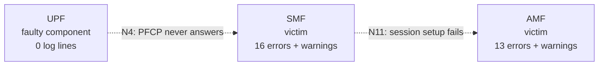
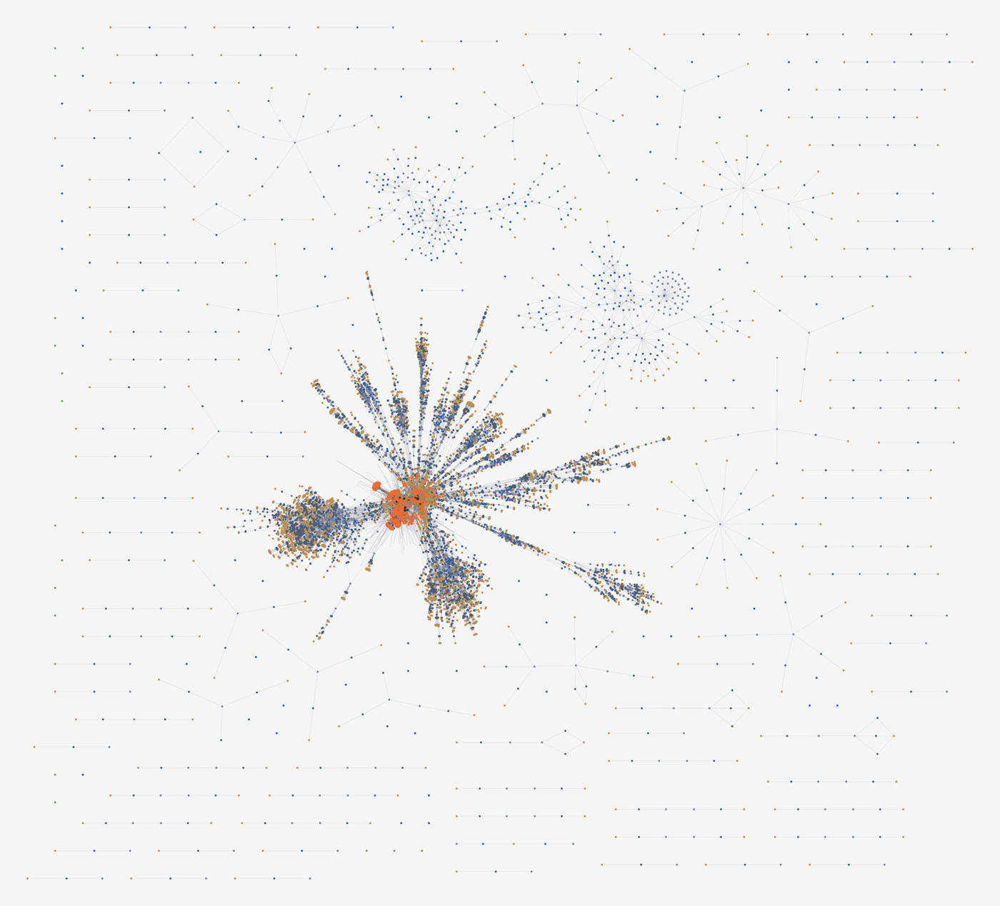
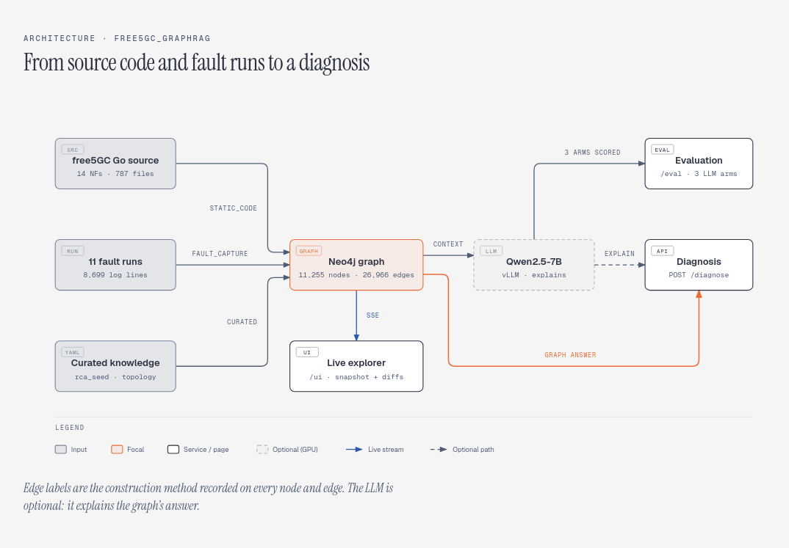
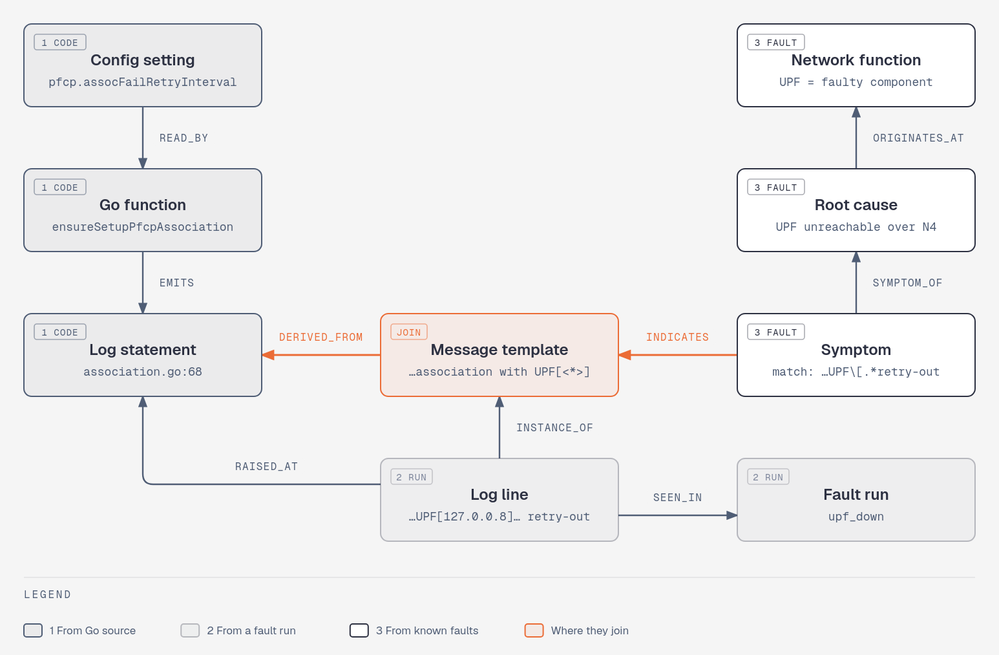
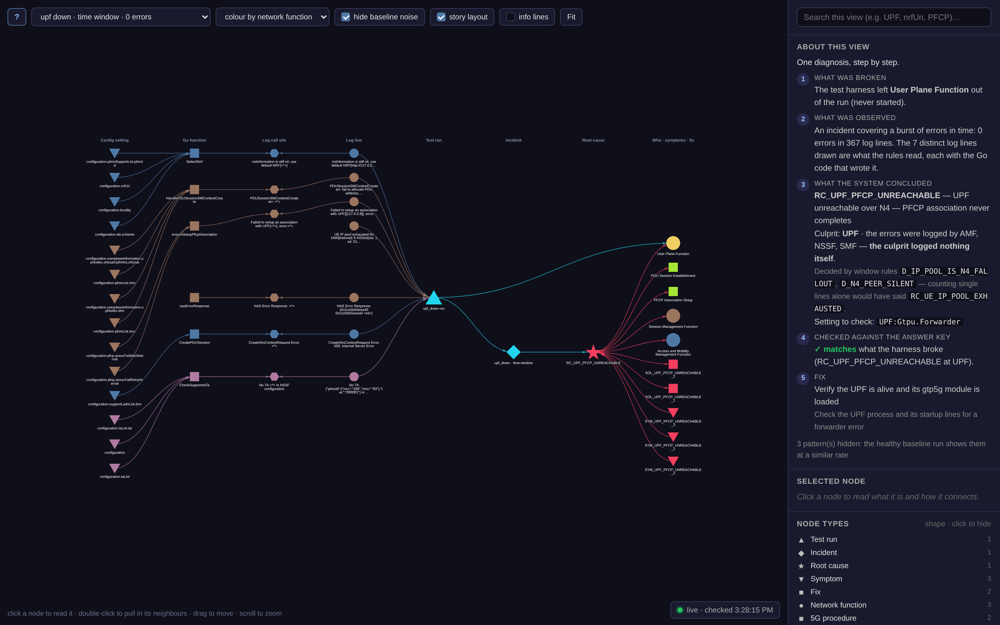
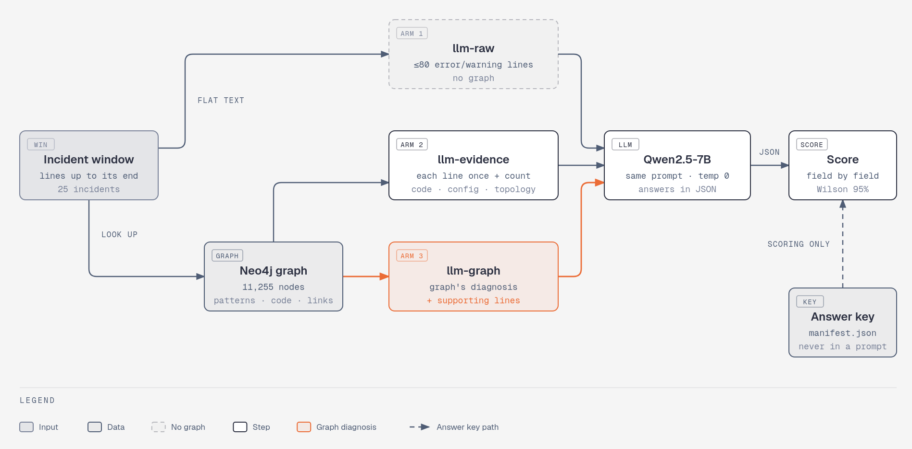
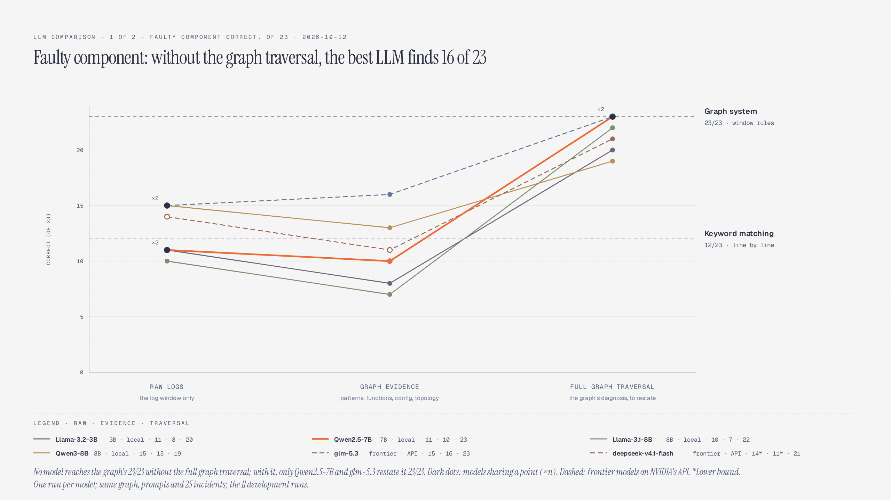
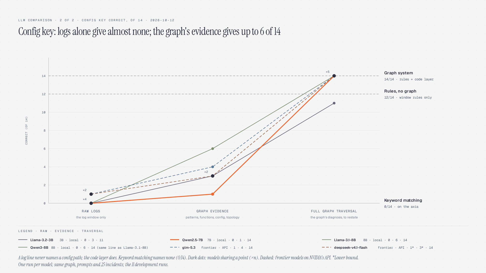

# Who Actually Broke It? Graph-Based Root Cause Analysis for free5GC

!!! Note
    **Author:** [Ng Warren](https://github.com/warren0813)<br>
    **Date:** 2026/10/29

When a 5G core breaks, the first question an operator asks is simple: **which network function is broken, and which setting needs to change?** Answering it from free5GC's logs is harder than it sounds, because the component that broke is often the one that says nothing.

This post walks through a tool built to answer that question. It combines free5GC's Go source code, logs from deliberately broken runs and a hand-written list of known faults into one knowledge graph, then diagnoses an incident by walking that graph instead of searching text. It shows how a single log line is linked back to the code that wrote it, how the tool did on 23 faulty incidents, and what happened when the same task went to six different LLMs, from a 3B model on a single local GPU to frontier models through an API.

---

## 1. The Problem: The Broken NF Is the Quiet One

free5GC is made of 14 network functions (NFs): AMF, SMF, UPF, NRF, UDM, UDR, AUSF, PCF, NSSF, N3IWF, TNGF, CHF, NEF and BSF. When one of them fails, its neighbours notice first, and they are the ones who log it.

Here is what the SMF writes when the UPF never started:

```text
time="2026-09-04T20:44:16.53+08:00" level="warning" NF="SMF" CAT="Main"
  msg="Failed to setup an association with UPF[[127.0.0.8]], error:request Transaction [1]: retry-out"
time="2026-09-04T20:44:55.53+08:00" level="warning" NF="SMF" CAT="Main"
  msg="Failed to setup an association with UPF[[127.0.0.8]], error:request Transaction [2]: retry-out"
```

The UPF's name appears only *inside the SMF's complaint*. A tool that ranks log lines (keyword rules, vector search, an LLM reading the raw text) can only return text that exists. And the faulty component often has no text.

It gets worse, because the loudest line is often the wrong one. In the same run the SMF also logs this, over and over, for every phone that tries to start a data session:

```text
level="warning" NF="SMF" msg="UE IP pool exhausted for DNN[internet] S-NSSAI[sst: 1 sd: 010203]"
```

Count lines and you conclude the IP pool is too small. It isn't. The pool belongs to a UPF that never associated, and resizing it fixes nothing. A simple keyword matcher with a majority vote makes exactly this mistake 7 times in our data.

So the job is not "find the error line". It is to tell the **faulty component** (who broke) apart from the **victims** (who noticed):



---

## 2. Why a Graph, Not Text Search

Retrieval over text answers "which lines look like the question?". Root cause analysis needs a different answer: "which component, not necessarily mentioned anywhere, explains all of these lines?"

A graph can store that difference directly. In this project every root cause has two separate relationships:

```text
(RootCause)-[:ORIGINATES_AT]->(NetworkFunction)   the faulty component
(RootCause)-[:AFFECTS]->(NetworkFunction)         the victims
```

From one SMF error line, a few hops reach "the UPF is the cause", even though the UPF never said a word. Here is the whole graph as it stands today:



> The full knowledge graph: 11,255 nodes and 26,966 edges in Neo4j. The dense centre is where log patterns (orange) meet the Go code that printed them (blue-grey).

---

## 3. System Architecture



Three inputs go into one Neo4j graph:

| Layer | What it holds | Where it comes from |
|---|---|---|
| **Code** | 1,909 Go functions, 3,820 log call sites, 650 config keys | Parsed automatically from 787 Go files of the 14 NFs |
| **Observation** | 8,699 log lines folded into 712 patterns, 25 incidents, 11 runs | Logs from deliberately broken runs |
| **Topology + diagnosis** | 14 NFs and their links; 14 root causes, 35 symptoms, 14 fixes, 8 window rules | Written by hand, in two YAML files |

On top of the graph sit a FastAPI service (`POST /diagnose`), a live graph explorer at `/ui`, an evaluation page at `/eval`, and an optional local LLM (vLLM on one RTX 3090) that explains the answer.

One rule holds throughout: **every node and every edge records how it was built**: parsed from code, recorded in a run, written by hand, or joined across those. When the system says something, you can always ask "where did that come from?".

---

## 4. How One Log Line Enters the Graph

This is the most interesting part, because it turns a log line into something you can follow back to the exact line of code that wrote it.

**Step 1: the Go source.** Here is the real function in the SMF that prints our warning (`internal/sbi/processor/association.go`):

```go
func ensureSetupPfcpAssociation(parentContext context.Context, upf *smf_context.UPF, upfStr string) {
	alertTime := time.Now()
	alertInterval := smf_context.GetSelf().AssocFailAlertInterval
	retryInterval := smf_context.GetSelf().AssocFailRetryInterval
	for {
		err := setupPfcpAssociation(upf, upfStr)
		if err == nil {
			// ...
			return
		}
		logger.MainLog.Warnf("Failed to setup an association with UPF[%s], error:%+v", upfStr, err)
		// ...
```

A small Go AST extractor (`tools/codegraph`) walks all 787 files and records three things here: the function, the `Warnf` call site and its format string, and the two config fields the function reads.

**Step 2: the log line**, captured from the run where the UPF was down:

```text
SMF  Failed to setup an association with UPF[[127.0.0.8]], error:request Transaction [1]: retry-out
```

**Step 3: the known fault**, written by hand in `rca_seed.yaml`. Every pattern in it was copied from a real log line, never written from memory:

```yaml
- id: RC_UPF_PFCP_UNREACHABLE
  originates_at: UPF
  symptoms:
    - match: 'Failed to setup an association with UPF\[.*retry-out'
```

All three meet at a **message template** built from the Go format string (`Failed to setup an association with UPF[<*>], error:<*>`):



From the log line you can now walk *left* to the function that wrote it and the settings that function reads, or *right* to the symptom, the root cause and the faulty component. **75.2% of all log lines** join to their exact call site this way (86.9% of the lines that come from free5GC's own code rather than libraries).

### 4.1 Window rules: reading the whole window, not one line

The same log line can mean two different things. Compare these two runs:

| Run | What was broken | NFs logging `register to NRF Error` |
|---|---|---|
| `amf_bad_nrf_uri` | the AMF's NRF address points at nothing | **1** (the AMF, 35 lines) |
| `nrf_absent` | the NRF never started | **10** (AMF, SMF, UDR, UDM, PCF, NSSF, CHF, AUSF, NEF, BSF; 33–35 lines each) |

Same error text, opposite answers. If one NF can't reach the NRF, **that NF's config is wrong**. If everyone can't, **the NRF is down**. No single line can tell you which; you have to count across the window. That is what the 8 hand-written *window rules* (called discriminators in the code) do:

```yaml
- id: D_NRF_SELF_MISCONFIG
  note: >
    Exactly one NF cannot register while every other NF can. The registry is
    healthy; that one NF's nrfUri points somewhere else.
  when:
    distinct_nfs_matching: {pattern: 'register to NRF Error\[Put', min: 1, max: 1}
  then:
    root_cause: RC_NRF_REGISTRATION_FAILED
    originates_at: {from_nf_matching: 'register to NRF Error\[Put'}
    config_key: {from_nf_matching: ..., template: '{nf}:configuration.nrfUri'}
```

Its sibling, `D_NRF_ABSENT`, fires when two or more distinct NFs fail at once and blames the NRF. Another rule, `D_IP_POOL_IS_N4_FALLOUT`, is what stops the "UE IP pool exhausted" flood from being blamed in the UPF case.

## 5. Breaking free5GC on Purpose

To test a diagnosis tool you need failures where you *know* the answer. The trick is fault injection: free5GC is broken on purpose, so the label comes for free. Each run is 60 seconds of free5GC with a UERANSIM base station and phone generating real traffic:

| Run | What breaks | Faulty component |
|---|---|---|
| `nrf_absent` | NRF never started; nobody can register | NRF |
| `amf_bad_nrf_uri` | AMF points at a wrong NRF address | AMF |
| `smf_bad_nrf_uri` | SMF cannot reach the NRF | SMF |
| `amf_port_conflict` | AMF's web port is taken; it cannot start | AMF |
| `pcf_absent` | PCF never started; policy setup fails | PCF |
| `udm_absent` | UDM never started; authentication fails | UDM |
| `udr_bad_mongo` | UDR's database address is wrong | UDR |
| `upf_down` | UPF never started; data path fails | UPF |
| `smf_wrong_upf_addr` | SMF has a wrong UPF address | SMF |
| `smf_tiny_ip_pool` | Phone IP pool is too small | SMF |
| `baseline` | nothing (the healthy control) | none |

These 11 runs produce **25 incidents** to diagnose: 23 faulty and 2 healthy. The answer key lives in each run's `manifest.json` and is only ever read by the scorer.

---

## 6. What the System Says

Ask the API about any log line, and the answer comes back as a walk through the graph. Trimmed for width:

```text
$ curl -s localhost:8080/diagnose -H 'content-type: application/json' \
       -d '{"event_id": "0c82366c729f360e"}'

  root cause     RC_UPF_PFCP_UNREACHABLE — UPF unreachable over N4
  culprit NF     UPF   (ORIGINATES_AT)          ← the UPF logged nothing at all
  observed at    AMF, NSSF, SMF   (the victims) ← the ones that complained
  governing cfg  UPF:Gtpu.Forwarder, SMF:configuration.userplaneInformation…UPF.addr
  interface      N4
  resolved by    D_IP_POOL_IS_N4_FALLOUT, D_N4_PEER_SILENT
                 (majority alone said RC_UE_IP_POOL_EXHAUSTED)
  remediation 1  Verify the UPF is alive and its gtp5g module is loaded
      confirmed by: SMF: UPF(<*>) setup association

  SUPPORTING LINES (with the call site that produced each)
  [warning] SMF  Failed to setup an association with UPF[[127.0.0.8]] … retry-out
      emitted by SMF:internal/sbi/processor.ensureSetupPfcpAssociation
      reads SMF:configuration.pfcp.assocFailAlertInterval, …assocFailRetryInterval
```

Nothing here came from similarity search; every field is an edge. Note the line `majority alone said RC_UE_IP_POOL_EXHAUSTED`: that is the loudest-line mistake from section 1, caught and overruled by a window rule. And the last two lines are the code layer at work: the exact Go function behind the evidence, and the settings it reads.

The live explorer at `/ui` shows the same diagnosis as a story you can click through: config settings, Go functions, log lines, the run, the incident, the root cause and finally the faulty component, with a step-by-step explanation on the right:



> The `/ui` explorer on the `upf_down` incident. It streams from Neo4j, so nodes appear within about two seconds of being loaded.

---

## 7. Results: Rules Over a Window Beat Reading Line by Line

Every method below gets the same knowledge base and the same log window for each incident; only the way it reasons differs:

- **Keyword matching, majority vote.** Every error or warning line votes for the root cause its text matches, and the cause with the most votes wins. This is roughly what a careful grep-based tool does.
- **Window rules, no graph.** The same votes, then the 8 window rules look at the *whole* window (how many NFs fail, which line is present or missing) and may overrule the vote. Plain Python, no Neo4j.
- **Full system (graph).** The same window rules, run end to end through the Neo4j graph, which also attaches the config keys from the matched fix.

Root cause and faulty component are scored on the 23 faulty incidents. The config key is scored only on the 14 incidents whose fault is a wrong setting; the other 9 come from runs where an NF was simply not started, so there is no setting to name. A run counts as solved when more than half of its incidents are right.

| Method | Root cause<br>(of 23) | Faulty component<br>(of 23) | Config key<br>(of 14) | Runs solved<br>(of 10) |
|---|:-:|:-:|:-:|:-:|
| Keyword matching, majority vote | 12 | 12 | 0 | 6 |
| Window rules, no graph | 23 | 23 | 12 | 10 |
| **Full system (graph)** | **23** | **23** | **14** | **10** |

All three methods correctly leave both healthy incidents alone.

Keyword matching gets the root cause wrong in 11 incidents, and every one of those mistakes is a victim's loud line outvoting the faulty component's quiet one:

| What actually broke | Keyword matching said | Why the vote goes wrong | Rule that fixes it |
|---|---|---|---|
| UPF unreachable over N4 (7×) | UE IP pool exhausted | The SMF repeats the pool warning for every session; the PFCP failure appears only a few times | `D_IP_POOL_IS_N4_FALLOUT` |
| AMF's SBI port taken (2×) | A peer NF is down | The AMF's one bind error is outnumbered by every other NF's "connection refused" aimed at it | `D_SBI_BIND_BEATS_FALLOUT` |
| UDR's database unreachable (2×) | UDM unavailable | The AMF's "Authentication procedure failed" looks the same whether the UDM or the UDR behind it is broken | `D_UDM_VS_UDR` |

The window rules fix all 11. With only 23 incidents, the 95% confidence interval for 23/23 is still [85.7%, 100%], and for 12/23 it is [33%, 71%]. They don't overlap, which is the claim this data supports.

Now the uncomfortable part, better stated here than left for a reviewer to find: **the graph database itself adds almost nothing to that accuracy.** The jump from 52% to 100% comes from the 8 window rules, and they run fine in plain Python. The graph's measured extra is **+2 config keys** (12/14 → 14/14). What the graph really adds is everything around the verdict: which function logged the line, which setting it reads, how to fix it, and a record of where each claim came from.

---

## 8. Can an LLM Do It?

The natural next question: why write rules at all? Give an LLM the logs and ask.

That was tested with three different inputs, keeping everything else fixed: same prompt, same output format (JSON with root cause, faulty component and config key), temperature 0.



1. **Raw logs:** the window's error and warning lines as plain text.
2. **Graph evidence:** each line once with its count, plus the Go function that wrote it, the config it reads, the topology and the list of known causes. Everything the graph *knows*, nothing it *concluded*.
3. **Full graph traversal:** the result of walking the graph for that incident: the root cause, the faulty component (via `ORIGINATES_AT`), the governing config keys, the fix and the supporting lines. The model's job is to restate and explain it.

### 8.1 One case, three inputs

Take `smf_wrong_upf_addr`. Here the SMF was given an unroutable UPF address, `10.255.255.1`, written into both `upNodes.UPF.nodeID` and `upNodes.UPF.addr` in `smfcfg.yaml`. The answer key: the root cause is "UPF unreachable over N4", the faulty component is the **SMF** (its own config is wrong), and the setting to fix is `SMF:configuration.userplaneInformation`.

The deciding evidence is the end of one line:

```text
SMF  Failed to setup an association with UPF[[10.255.255.1]], error:request Transaction [1]:
     write udp 127.0.0.1:8805->10.255.255.1:8805: sendto: invalid argument
```

`sendto` failing means the packet never left the SMF: the address it was given is unroutable. Compare `upf_down`, where the same warning ends in `retry-out`, because packets left fine and nobody answered. Same warning, different tail, different faulty component. The window rule `D_N4_ADDR_WRONG` encodes exactly this.

This run has 4 incidents. Here is what Qwen2.5-7B answered on them with each input, in its first full run:

| Input | What the model is given | Faulty component | Setting it named |
|---|---|:-:|---|
| Raw logs | the warning above plus the window's other error and warning lines | UPF 3×, SMF 1× | none |
| Graph evidence | each line once with its count, the Go function that wrote it (`ensureSetupPfcpAssociation`), the settings that function reads, and the list of known causes with their usual faulty component (UPF for this one) | UPF 4× | the PFCP retry timers `pfcp.assocFailAlertInterval` and `pfcp.assocFailRetryInterval` (2×), wrong |
| Full graph traversal | the graph's answer: faulty component SMF via `ORIGINATES_AT`, governing config `SMF:configuration.userplaneInformation`, the fix and the supporting lines | **SMF 4×** | `userplaneInformation` 4×, twice narrowed to **`upNodes.UPF.nodeID` and `upNodes.UPF.addr`** |

The setting column tells the story. With the graph's evidence, the model picked the only settings in front of it: the two retry timers read by the function that printed the warning. They are real settings in the right NF, but changing them only changes how often the SMF retries; it fixes nothing. The traversal instead follows `ORIGINATES_AT` to the SMF and the window rule's config key to `userplaneInformation`, the block that holds the UPF's address. In two answers the model even narrowed it down to `nodeID` and `addr`, the exact two keys changed to break the run.

A second run of the same model, the one in the tables below, names the same faulty components in every row; it differs only in the settings, naming none from the graph's evidence and narrowing to `nodeID` and `addr` once.

So the model gets the *kind* of fault right every time. What it can't do on its own is notice that `sendto: invalid argument` makes the SMF's own address the problem, not the peer behind it. That's the faulty-component-versus-victim confusion again.

### 8.2 Six models

One 7B model is a weak test, so the same experiment was run on six models: four small ones locally on the RTX 3090 through vLLM, and two frontier-scale open models through NVIDIA's hosted API (build.nvidia.com).

Each model got the same 25 incidents, the same prompts and the same graph; one run each.

**Faulty component named correctly** (out of 23)

| Model | Raw logs | Graph evidence | Full graph traversal |
|---|:-:|:-:|:-:|
| Llama-3.2-3B · local | 11 | 8 | 20 |
| Qwen2.5-7B · local | 11 | 10 | **23** |
| Llama-3.1-8B · local | 10 | 7 | 22 |
| Qwen3-8B · local | 15 | 13 | 19 |
| glm-5.3 · API | 15 | **16** | **23** |
| deepseek-v4.1-flash · API | 14\* | 11\* | 21 |

For comparison, the graph system scores 23 and keyword matching 12.


**Config key named correctly** (out of 14)

| Model | Raw logs | Graph evidence | Full graph traversal |
|---|:-:|:-:|:-:|
| Llama-3.2-3B · local | 0 | 3 | 11 |
| Qwen2.5-7B · local | 0 | 1 | **14** |
| Llama-3.1-8B · local | 0 | **6** | **14** |
| Qwen3-8B · local | 0 | **6** | **14** |
| glm-5.3 · API | 1 | 4 | **14** |
| deepseek-v4.1-flash · API | 1\* | 3\* | **14** |

For comparison, the graph system scores 14 and keyword matching 0.


\*deepseek returned no usable answer on 6 (raw logs) and 11 (graph evidence) of the 25 incidents. Those count as wrong, so its numbers there are lower bounds.

What stands out:

- **No model reaches the graph without the full graph traversal.** The best anyone does on the faulty component is glm-5.3 with 16 of 23.
- **The graph's evidence helps with the setting, not with the faulty component.** Config keys go from 0–1 on raw logs to 1–6 with the evidence: a log line never contains a config path, but the code layer does. For the faulty component, 5 of the 6 models do worse with the evidence than with raw logs.
- **Newer beats bigger at this scale.** Qwen3-8B matches the frontier models on raw logs (15 of 23). Llama-3.1-8B is no better than the older Qwen2.5-7B.
- **Even restating the answer is not free.** Only Qwen2.5-7B and glm-5.3 restate the traversal 23/23. The others "correct" it, mostly back to UPF on `smf_wrong_upf_addr`.

---

## 9. Closing Thoughts

This project is a proof of concept. It set out to show that a knowledge graph helps with a system as complex as free5GC, where 14 NFs depend on each other and the one that breaks is often the one that says nothing.

On this small set of deliberately broken runs, it does. The graph ties each log line to the Go function that wrote it and the settings that function reads, keeps the faulty component apart from the victims, and puts every answer next to its fix and its source. Keyword matching blames the wrong NF in 11 of 23 incidents; the graph gets all 23 right and names the setting to change in all 14 cases where there is one. None of the six LLMs gets there from the logs or the graph's evidence alone, but given the graph's answer they explain it well.

It is a demo, not a finished tool: the rules were written from these same 11 runs, and every fault is a single, loud one. Taking it to faults nobody has looked at yet is the next step.

---

## References

- free5GC: <https://free5gc.org/>
- free5GC installation guide: <https://free5gc.org/guide/3-install-free5gc/>
- UERANSIM: <https://github.com/aligungr/UERANSIM>
- Neo4j: <https://neo4j.com/>
- vLLM: <https://docs.vllm.ai/>
- NVIDIA API catalog: <https://build.nvidia.com/>

## About the author

Hey it's Warren! currently exploring 5G Core and working with free5GC.

### Connect with Me

- GitHub: [warren0813](https://github.com/warren0813)
