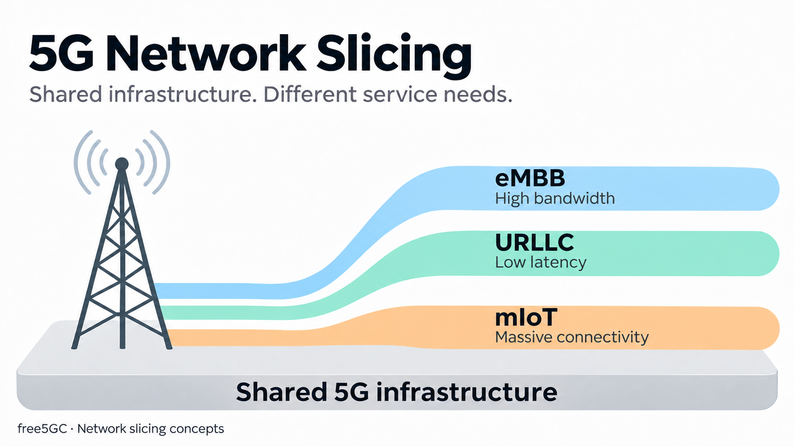
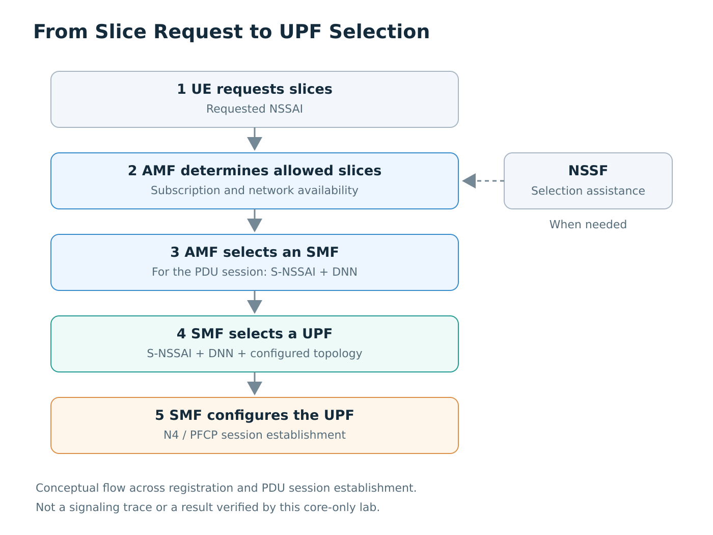
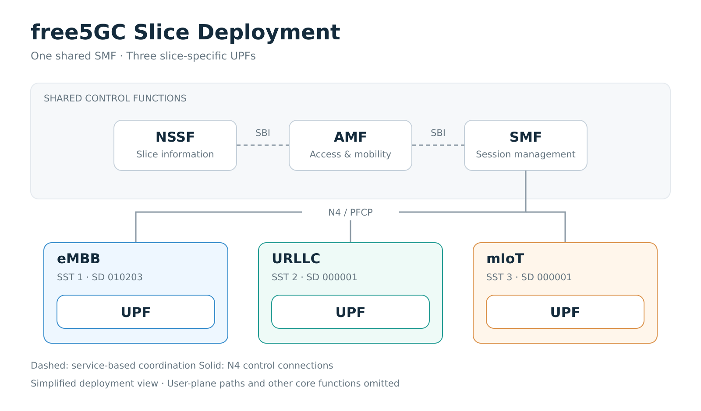
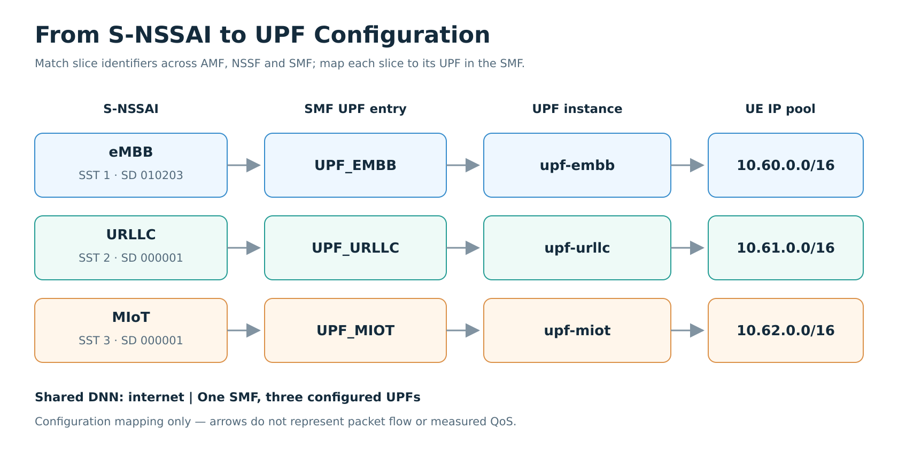

# Understanding 5G Network Slicing: A Three-UPF Configuration Lab with free5GC

> [!NOTE]
> Author: [Louis Wei](https://github.com/mrweixd)
> Date: 2026/11/03

---

## Introduction

A 5G network may serve people watching high-resolution video, machines exchanging time-sensitive control messages, and sensors reporting a few bytes of data every few minutes. These applications share the same infrastructure, but their requirements are quite different. A high data rate matters to video streaming; predictable delay matters to industrial control; and a sensor network needs to support large numbers of devices efficiently.

**Network slicing** gives a 5G operator a way to organize network resources around those different services. Instead of deploying an entirely separate physical network for each application, the operator can define logical networks, or *network slices*, that share some functions while using other resources independently. The 5G Core identifies these slices through Single Network Slice Selection Assistance Information (S-NSSAI) [1].

How does that idea translate into a free5GC deployment? In this article, we start with the three commonly discussed 5G service categories, follow the roles of NSSF, AMF, SMF, and UPF, and then build a small lab with **one SMF and three UPFs**. Each UPF is configured to support a different S-NSSAI. We use SMF logs to verify that the three UPFs establish PFCP node associations with the same SMF.

## 1. Why Do We Need Different Slice Types?

The three familiar 5G service categories are **eMBB**, **URLLC**, and **mMTC**. They are useful starting points for discussing network slicing, although they do not imply that every operator must deploy exactly three slices.

### Enhanced Mobile Broadband (eMBB)

eMBB focuses on applications that need high throughput or substantial network capacity, such as high-resolution video, cloud gaming, and large file downloads. A deployment designed for these workloads may prioritize transport capacity and suitable radio resources. In 3GPP's standardized Slice/Service Type (SST) table, eMBB uses **SST 1** [1, §5.15.2.2].

### Ultra-Reliable Low-Latency Communications (URLLC)

URLLC is intended for applications where delay and reliability are particularly important. Industrial automation and time-sensitive machine control are typical examples. Achieving those requirements takes more than choosing a slice identifier: radio scheduling, transport, core-network configuration, application placement, and QoS policy all contribute to the result. **URLLC uses SST 2**.

### Massive Machine-Type Communications (mMTC / MIoT)

Massive machine-type communications describes scenarios in which many devices send relatively small amounts of data, such as smart meters or environmental sensors. The main challenge is often the scale and efficiency of device connectivity rather than the throughput of any single device.

The standardized name for **SST 3** is **MIoT (Massive IoT)** [1, §5.15.2.2]. Here, *mMTC* refers to the application category, while *MIoT* is the SST name used in the configuration.

| Service category | Main concern | Standardized SST | Example application |
| --- | --- | ---: | --- |
| eMBB | High throughput and capacity | `1` | Video streaming |
| URLLC | Low delay and high reliability | `2` | Industrial control |
| mMTC / MIoT | Large numbers of connected devices | `3` | Smart metering |

These values describe a service type. They do not, by themselves, configure bandwidth, latency, or the number of devices a network can support.



*Figure 1. Different service needs can share the same infrastructure. The labels describe service goals, not measured performance or guarantees provided by the slice identifiers.*

## 2. How the 5G Core Identifies a Slice

The basic identifier is **S-NSSAI**, which consists of two fields:

- **SST (Slice/Service Type):** identifies the general service type, such as eMBB or URLLC.
- **SD (Slice Differentiator):** an optional three-byte value that distinguishes slices within a service type.

A list of S-NSSAIs is called **NSSAI**. For example, a UE can include *Requested NSSAI* during registration. The network then determines which S-NSSAIs can be used as *Allowed NSSAI*, taking the UE's subscription and the serving network's capabilities into account [1, §5.15].

Another term that appears alongside S-NSSAI is the **Data Network Name (DNN)**. The S-NSSAI identifies the slice, while the DNN identifies the data network to which a PDU session requests connectivity. During session establishment, both values help the network select the appropriate session-management and user-plane resources [2].

Our lab uses one DNN, `internet`, and three distinct S-NSSAIs:

| Configured slice | SST | SD | DNN | UE address pool | UPF node |
| --- | ---: | --- | --- | --- | --- |
| eMBB | `1` | `010203` | `internet` | `10.60.0.0/16` | `UPF_EMBB` |
| URLLC | `2` | `000001` | `internet` | `10.61.0.0/16` | `UPF_URLLC` |
| MIoT | `3` | `000001` | `internet` | `10.62.0.0/16` | `UPF_MIOT` |

Notice that URLLC and MIoT share the same SD value. This is valid because their SST values differ: the complete SST/SD pair identifies the S-NSSAI. The SD values and IP pools above are example settings for this lab.

## 3. From Slice Selection to Packet Forwarding

Network slicing involves several 5G Core functions, but each function has a different responsibility. It helps to follow the path from identifying a slice to controlling its user plane.

### AMF and NSSF: Which slices can the UE use?

The **Access and Mobility Management Function (AMF)** handles UE registration and mobility-related signaling. During registration, it processes the UE's slice information and works with the network's subscription and availability information to determine the Allowed NSSAI.

The **Network Slice Selection Function (NSSF)** provides slice-selection assistance. Through services such as `Nnssf_NSSelection` and `Nnssf_NSSAIAvailability`, it supports selection information and slice availability management [3]. The AMF may query NSSF when the procedure requires it; NSSF is not necessarily contacted for every registration. The free5GC blog [*Network Function NSSF Introduction*](https://free5gc.org/blog/20260128/20260128/) explains these services in more detail.

The important distinction is that **NSSF assists slice selection; it does not install packet-forwarding rules in a UPF**.

### AMF and SMF: Who manages the PDU session?

When a UE requests a PDU session, the AMF helps select an appropriate **Session Management Function (SMF)** for the requested S-NSSAI and DNN, and carries the related session-management signaling. The **Network Repository Function (NRF)** supports registration and discovery of network functions [2].

An SMF manages PDU session state and controls the UPFs used by those sessions. There is no requirement for an SMF to serve only one slice. For example, an operator can use:

- **One SMF for several S-NSSAIs:** a shared control-plane instance manages sessions across different slices.
- **Different SMFs for different S-NSSAIs:** session-management functions are separated for operational or deployment reasons.

Neither arrangement determines how many UPFs must be deployed. Our example uses the first option: one SMF with three configured S-NSSAIs and three separate UPFs.

### SMF and UPF: How is the user plane controlled?

The **User Plane Function (UPF)** processes and forwards user traffic. The SMF communicates with a UPF over the **N4 interface** using the **Packet Forwarding Control Protocol (PFCP)** [4]. In a typical data path, N3 carries GTP-U packets between the RAN and the UPF, while N6 connects the UPF to a data network.

Two PFCP procedures are worth separating. *PFCP Association Setup* establishes a node-level relationship between an SMF and a UPF. *PFCP Session Establishment* installs session-specific forwarding state, including packet-detection and forwarding rules. This article verifies the former, which is a useful first step when checking a new UPF topology.



*Figure 2. Conceptual steps across registration and PDU session establishment. NSSF provides assistance when needed; SMF selects and configures the UPF. This flow was not exercised by the core-only lab.*

## 4. Building the free5GC Lab

### Starting from the CI-test examples

The public [`free5gc/ci-test`](https://github.com/free5gc/ci-test) repository contains several useful topologies. Its [ULCL example](https://github.com/free5gc/ci-test/blob/main/composes/docker-compose-ci-e2e-ulcl.yaml) uses intermediate and PDU Session Anchor UPFs to support more advanced traffic steering. That is valuable for studying ULCL, but it is more complex than we need for a first look at slice deployment.

We instead adapt the [basic Compose example](https://github.com/free5gc/ci-test/blob/main/composes/docker-compose-ci-e2e-basic.yaml). The control-plane NFs remain available, while the user plane is simplified to **three independent UPF instances, each configured with one S-NSSAI**. No intermediate UPF or N9 hop is needed for this topology.



*Figure 3. Simplified lab deployment with one SMF and three UPFs. The experiment verified all three N4/PFCP node associations; dashed control-function links are architectural context. User-plane paths and other core functions are omitted.*

### Configuring the slices and UPFs

The generator writes separate demo configurations without changing the original CI-test YAML files:

| Generated file | Purpose |
| --- | --- |
| `config/slicing-demo/amfCfg.yaml` | List the three supported S-NSSAIs in the AMF configuration |
| `config/slicing-demo/nssfCfg.yaml` | Configure matching slice information for NSSF |
| `config/slicing-demo/smfCfg.yaml` | Configure one SMF, three S-NSSAIs, and the UPF topology |
| `config/slicing-demo/upf-embb.yaml` | Configure the eMBB UPF |
| `config/slicing-demo/upf-urllc.yaml` | Configure the URLLC UPF |
| `config/slicing-demo/upf-miot.yaml` | Configure the MIoT UPF |
| `composes/docker-compose-slicing-demo.yaml` | Run the core NFs and three UPFs |

In `smfCfg.yaml`, the SMF is configured to support all three S-NSSAIs. The following excerpt shows the relevant fields; the original DNN entries also contain DNS settings:

```yaml
# Under configuration.snssaiInfos
snssaiInfos:
  - sNssai: {sst: 1, sd: '010203'}
    dnnInfos:
      - dnn: internet
  - sNssai: {sst: 2, sd: '000001'}
    dnnInfos:
      - dnn: internet
  - sNssai: {sst: 3, sd: '000001'}
    dnnInfos:
      - dnn: internet
```



*Figure 4. Configuration mapping for the three lab slices. Each S-NSSAI maps to an SMF UPF entry, a UPF instance, and a UE address pool; all three use the DNN `internet`. Arrows indicate configuration relationships, not packet flow or measured QoS.*

The SMF also needs a mapping between UPFs and their supported S-NSSAIs. That mapping is stored under `configuration.userplaneInformation.upNodes`. For the eMBB UPF, it looks like this:

```yaml
# Excerpt from configuration.userplaneInformation.upNodes
UPF_EMBB:
  type: UPF
  nodeID: upf-embb.free5gc.org
  addr: upf-embb.free5gc.org
  sNssaiUpfInfos:
    - sNssai: {sst: 1, sd: '010203'}
      dnnUpfInfoList:
        - dnn: internet
          pools:
            - cidr: 10.60.0.0/16
  interfaces:
    - interfaceType: N3
      endpoints:
        - upf-embb.free5gc.org
      networkInstances:
        - internet
```

The URLLC and MIoT UPFs use the same structure with different identifiers, FQDNs, and IP pools. The SMF's topology also contains a `gNB1` access-node entry, which defines the potential user-plane graph. It does not require a running gNB to establish PFCP associations.

### Docker network settings

This experiment was carried out in an Ubuntu VirtualBox environment that already had another free5GC deployment. To avoid overlapping Docker subnets, duplicate Linux bridge names, and container-name conflicts, we used the following settings:

| Setting | Lab value |
| --- | --- |
| Docker private subnet | `10.230.200.0/24` |
| Bridge interface | `br-f5gc-slice` |
| Container-name prefix | `slice-` |
| SMF N4 address | `10.230.200.9:8805` |
| eMBB UPF | `10.230.200.81` |
| URLLC UPF | `10.230.200.82` |
| MIoT UPF | `10.230.200.83` |

During startup, we encountered an SMF configuration requirement. The SMF image used in this lab expects a `uerouting.yaml` file, even though this topology does not configure ULCL. We therefore mounted the minimal routing configuration already included in CI-test:

```yaml
# Under services.free5gc-smf.volumes
- ../config/ueRoutingCfg.yaml:/free5gc/config/uerouting.yaml:ro
```

This provides the expected configuration file without adding an ULCL forwarding topology.

### Launching the deployment

The companion [`generate_lab.py`](resources/generate_lab.py) and [`validate_lab.py`](resources/validate_lab.py) scripts generate and statically inspect this topology. They are supplied with this article, not with upstream CI-test. Download them to a `scripts/` directory next to a compatible checkout of [`free5gc/ci-test`](https://github.com/free5gc/ci-test):

```text
slicing-lab/
├── scripts/
│   ├── generate_lab.py
│   └── validate_lab.py
└── ci-test/
    ├── config/
    └── composes/
```

For a new lab, record the upstream revision before generating files:

```bash
git clone https://github.com/free5gc/ci-test.git
cd ci-test
git rev-parse HEAD
python3 -m pip install PyYAML
python3 ../scripts/generate_lab.py --ci-test .
python3 ../scripts/validate_lab.py --ci-test .
```

Check which Docker networks already exist before selecting the private subnet and bridge name:

```bash
docker network ls -q | xargs -r docker network inspect \
  --format '{{.Name}}: {{range .IPAM.Config}}{{.Subnet}} {{end}}'
```

The example uses `10.230.200.0/24` and `br-f5gc-slice`. If either conflicts with your host environment, generate the configuration using a free `/24` network and a distinct Linux bridge name, for example by passing `--subnet` and `--bridge-name` to the generator. The generator does not inspect host routes or reserve these resources automatically.

Once the configuration passes validation, launch the deployment:

```bash
docker compose -f composes/docker-compose-slicing-demo.yaml config --quiet
docker compose -f composes/docker-compose-slicing-demo.yaml up -d
docker compose -f composes/docker-compose-slicing-demo.yaml ps -a
```

The generator does not edit upstream CI-test YAML files and refuses to overwrite previously generated demo files unless `--force` is explicitly requested. Avoid using `--force` on an existing working lab; preserve the final hand-edited configuration instead.

### Reproducibility notes

The base CI-test Compose file uses image tags such as `free5gc/smf:latest` and `free5gc/upf:latest`. Because these tags can change, record the actual image identifiers along with the CI-test revision and Docker versions:

```bash
git rev-parse HEAD
docker --version
docker compose version
docker image inspect free5gc/smf:latest free5gc/upf:latest \
  --format '{{.RepoTags}} {{.Id}} {{json .RepoDigests}}'
```

The deployment was run on an Ubuntu VirtualBox VM on November 3, 2026. The following identifiers were recorded from the same local CI-test checkout and the running SMF/UPF containers:

| Component | Recorded version or identifier |
| --- | --- |
| Operating system | Ubuntu 22.04 LTS (VirtualBox VM) |
| Docker Engine | 29.8.0 (build `88096ef`) |
| Docker Compose | v5.5.1 |
| CI-test commit | `60f0c121f560e6ceebb10d29f1e265e7df8f8074` |
| SMF image (`free5gc/smf:latest`) | `sha256:5a38dceba22149ad5ae53515204561cbda9f610d79f203cc1c3ace769b8a2d31` |
| UPF image (`free5gc/upf:latest`) | `sha256:7fb69d4e3b03eeb428f27de4b4323a5bbdc14422774c5c6126efd72bdb8ad0a7` |

All three UPF containers (`slice-upf-embb`, `slice-upf-urllc`, and `slice-upf-miot`) reported the same UPF image ID. In the author's `docker image inspect` output, the repository digest strings were `free5gc/smf@sha256:5a38dceba22149ad5ae53515204561cbda9f610d79f203cc1c3ace769b8a2d31` and `free5gc/upf@sha256:7fb69d4e3b03eeb428f27de4b4323a5bbdc14422774c5c6126efd72bdb8ad0a7`, respectively. These values are reported as observed; compatibility with newer upstream revisions or updated images has not been established.

The experiment used the generated configuration together with the environment-specific changes described above (private subnet, bridge name, unique container names, and the `uerouting.yaml` mount). For an exact reproduction, preserve the final generated Compose and YAML files rather than relying on mutable `latest` tags alone.

## 5. Checking the Deployment

### Configuration and startup

During the original deployment, the validator compared the S-NSSAI entries across AMF, NSSF, and SMF, and checked UPF addresses, aliases, and pools. The captured output was:

```text
PASS: 3 SSTs match across AMF/NSSF/SMF; 1 SMF; 3 unique N3 UPFs; pools and aliases consistent.
```

Once the missing SMF routing-file mount was added, the core services started successfully. The SMF logs showed three configured UPF endpoints and an active N4/PFCP listener:

```text
[INFO][SMF][CTX] Endpoints: [upf-embb.free5gc.org]
[INFO][SMF][CTX] Endpoints: [upf-urllc.free5gc.org]
[INFO][SMF][CTX] Endpoints: [upf-miot.free5gc.org]
[INFO][SMF][PFCP][addr:10.230.200.9:8805] PFCP server started
```

The SMF also logged its registration with NRF. The recorded NF profile included the S-NSSAIs `(1, 010203)`, `(2, 000001)`, and `(3, 000001)`.

### PFCP associations with all three UPFs

The SMF logs collected on **November 3, 2026, at about 14:43 UTC** provide the main evidence for this deployment. After sending an Association Setup Request to each UPF, the SMF received an accepted response from every instance:

```text
Sending PFCP Association Request to UPF[upf-embb.free5gc.org](10.230.200.81)
Sending PFCP Association Request to UPF[upf-urllc.free5gc.org](10.230.200.82)
Sending PFCP Association Request to UPF[upf-miot.free5gc.org](10.230.200.83)

Received PFCP Association Setup Accepted Response from UPF[upf-embb.free5gc.org](10.230.200.81)
Received PFCP Association Setup Accepted Response from UPF[upf-urllc.free5gc.org](10.230.200.82)
Received PFCP Association Setup Accepted Response from UPF[upf-miot.free5gc.org](10.230.200.83)
```

*Listing 1. Relevant SMF log messages. Timestamps and logger prefixes have been omitted for readability.*

| UPF | Configured S-NSSAI | N4 endpoint | Result |
| --- | --- | --- | --- |
| eMBB | SST `1`, SD `010203` | `10.230.200.81` | Accepted |
| URLLC | SST `2`, SD `000001` | `10.230.200.82` | Accepted |
| MIoT | SST `3`, SD `000001` | `10.230.200.83` | Accepted |

The SMF subsequently logged `setup association` for all three addresses. Together, these messages confirm that one SMF established PFCP node associations with all three configured UPFs.

These messages were copied from the author's Docker terminal output. For another deployment, the relevant lines can be collected using:

```bash
docker compose -f composes/docker-compose-slicing-demo.yaml \
  logs --no-color free5gc-smf \
  | grep -E 'Sending PFCP Association|Received PFCP Association|setup association'
```

## 6. Discussion

This lab illustrates an important distinction in 5G network slicing: **the slice identifier, the control-plane deployment, and the user-plane deployment are separate design choices**.

The S-NSSAI identifies the requested or supported slice. The AMF and, where needed, NSSF handle information used for slice selection, taking subscription and serving-network context into account. The SMF can support several S-NSSAIs in one process and maintain PFCP associations with multiple UPFs. In our configuration, the three UPFs have separate addresses and UE IP pools, while the SMF is shared.

This configuration illustrates how session management can be shared while UPF instances remain separate. A different deployment could dedicate an SMF to each slice or share an UPF between multiple S-NSSAIs. Neither choice changes the basic responsibilities of AMF, NSSF, SMF, and UPF.

### Scope of this experiment

This core-only lab verified consistent slice configuration, SMF registration with NRF, and three accepted PFCP node associations. UE registration, PDU session establishment, slice-specific forwarding, and QoS performance were outside its scope. These would require an attached RAN/UE and additional test procedures.

## Conclusion

Network slicing is easier to understand once the slice identifier and the network functions are considered together. eMBB, URLLC, and mMTC/MIoT illustrate different service needs; S-NSSAI provides the corresponding identifier; and AMF, NSSF, SMF, and UPF carry out different parts of the network procedure.

Using generated configurations based on free5GC CI-test, we deployed one SMF and three UPFs, each configured to support a different S-NSSAI. The SMF registered an NF profile listing three S-NSSAIs with NRF and received accepted PFCP Association Setup responses from all three UPFs. The result is a compact starting point for exploring how 5G Core slices can share control-plane resources while using separate user-plane instances.

## References

1. 3GPP TS 23.501, *System Architecture for the 5G System (5GS)*, V18.6.0 (Release 18), §§5.15.2–5.15.5; SST definitions in Table 5.15.2.2-1. [ETSI TS 123 501 V18.6.0](https://www.etsi.org/deliver/etsi_ts/123500_123599/123501/18.06.00_60/ts_123501v180600p.pdf).
2. 3GPP TS 23.502, *Procedures for the 5G System (5GS)*, V18.6.0 (Release 18), §4.2.2 (Registration) and §4.3.2 (PDU Session Establishment). [ETSI TS 123 502 V18.6.0](https://www.etsi.org/deliver/etsi_ts/123500_123599/123502/18.06.00_60/ts_123502v180600p.pdf).
3. 3GPP TS 29.531, *Network Slice Selection Services*, V18.7.0 (Release 18), including `Nnssf_NSSelection` and `Nnssf_NSSAIAvailability`. [ETSI TS 129 531 V18.7.0](https://www.etsi.org/deliver/etsi_ts/129500_129599/129531/18.07.00_60/ts_129531v180700p.pdf).
4. 3GPP TS 29.244, *Interface between the Control Plane and the User Plane Nodes*, V18.7.0 (Release 18), §5.8 and §6.2.6 (PFCP Association), §6.3.2 (PFCP Session Establishment). [ETSI TS 129 244 V18.7.0](https://www.etsi.org/deliver/etsi_ts/129200_129299/129244/18.07.00_60/ts_129244v180700p.pdf).
5. free5GC, [`ci-test` repository](https://github.com/free5gc/ci-test), [basic Compose topology](https://github.com/free5gc/ci-test/blob/main/composes/docker-compose-ci-e2e-basic.yaml), and [ULCL Compose topology](https://github.com/free5gc/ci-test/blob/main/composes/docker-compose-ci-e2e-ulcl.yaml).
6. free5GC Blog, [*Network Function NSSF Introduction*](https://free5gc.org/blog/20260128/20260128/), January 28, 2026.
7. free5GC Blog, [*PFCP Session Lifecycle in free5GC: Establish, Modify, and Release Explained*](https://free5gc.org/blog/20260204/20260204/), February 4, 2026.
8. free5GC Blog, [*A Practical Guide to Network Slicing and Traffic Steering with free5GC and OAI-MEC*](https://free5gc.org/blog/20250625/20250625/), July 3, 2025.
