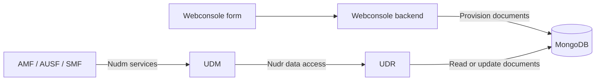
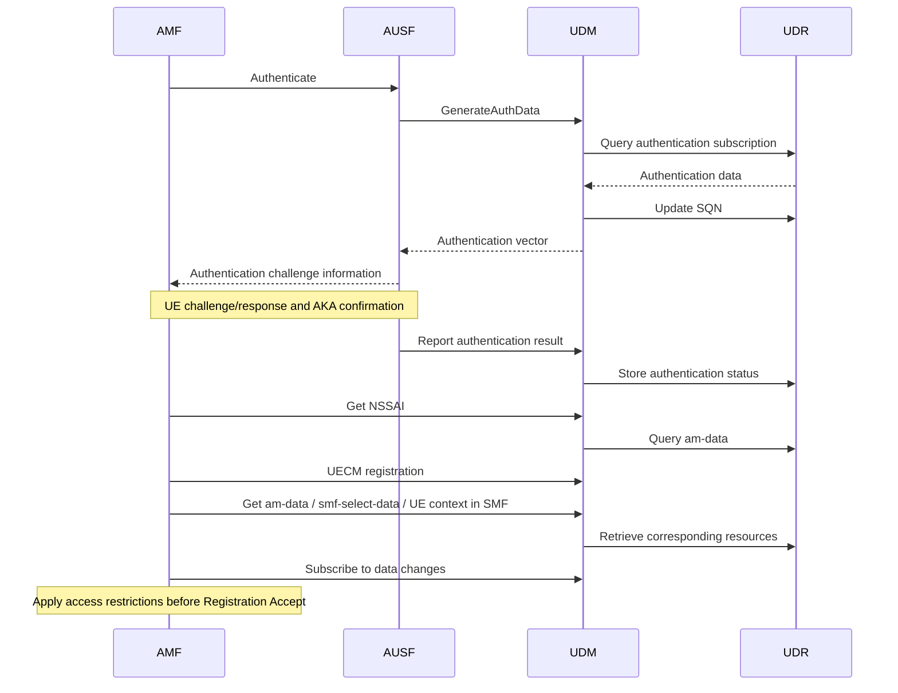

# Subscriber Data Management in free5GC

> [!NOTE]
> Author: [mori1213](https://github.com/mori1213)
> Date: 2026/11/16

---

## Introduction

Creating a subscriber in Webconsole is often the first step in a free5GC experiment. We enter an IMSI, authentication credentials, a network slice, and a DNN, then start the UE. However, those fields do not remain together as one subscriber record, and different network functions consume them at different stages.

This article follows that data from Webconsole into MongoDB, through UE Registration, and into PDU Session Establishment. We then change two subscription fields to observe two different effects: an access restriction that prevents registration, and a static IP address that changes the established session. The experiments use Docker and **free-ran-ue**, with one UE, one gNB, and no changes to NF source code.

Earlier posts introduce [UDM services](../20230719/UDM_introduce.md) and [bulk subscriber provisioning](../20260506/20260506.md). Here, the focus is how one subscriber's stored fields are consumed during registration and session establishment. Authentication success alone does not guarantee that registration is permitted, while successful registration does not determine every property of the subsequent session.

## UDM, UDR, and the Data Model

The **Unified Data Management (UDM)** exposes subscriber-related services to other NFs. For example, the AMF retrieves access and mobility data, and the SMF retrieves session management data. The UDM also participates in authentication and manages serving-NF registration information.

The **Unified Data Repository (UDR)** exposes data storage and retrieval services. In free5GC, MongoDB provides the persistent storage behind these services. UDM handlers call UDR APIs rather than directly querying MongoDB in the paths discussed here.

Three kinds of data should be distinguished:

- **Provisioned subscription data:** what the subscriber is configured to use, such as subscribed slices and DNN configurations.
- **Runtime context:** which AMF or SMF serves the UE. This changes as procedures execute.
- **Policy data:** information used in policy decisions. Webconsole also provisions policy collections, but these are not the same documents as UDM subscription data.

There is also another use of the word *subscription*: `Nudm_SDM_Subscribe` subscribes an NF to data-change notifications. It does not create a mobile subscriber account.

TS 23.502 describes the registration and session procedures, TS 29.503 specifies UDM services, and TS 29.505 describes subscription resources accessed through UDR. MongoDB collection names and Webconsole's database-writing mechanism are free5GC implementation choices, not a prescribed 3GPP database design.

## From Webconsole to MongoDB

An important implementation detail is that **Webconsole writes directly to MongoDB**. Subscriber creation does not follow a Webconsole → UDM → UDR SBI chain.



*Figure 1: Provisioning and runtime data access use different paths.*

The frontend's `mapFromDto()` in [`webconsole/frontend/src/lib/dtos/subscription.ts`](https://github.com/free5gc/webconsole/blob/a0966120536cd4b959e39836d1c950ae46905c7f/frontend/src/lib/dtos/subscription.ts) converts the form into several data models. The backend receives them in `PostSubscriberByID()`, and `dbOperation()` in [`webconsole/backend/WebUI/api_webui.go`](https://github.com/free5gc/webconsole/blob/a0966120536cd4b959e39836d1c950ae46905c7f/backend/WebUI/api_webui.go) writes the resulting BSON documents using the MongoDB utility functions.

The main collections are:

| Collection | Representative fields | Main use |
|---|---|---|
| `subscriptionData.authenticationData.authenticationSubscription` | `encPermanentKey`, `encOpcKey`, `sequenceNumber` | Authentication data generation |
| `subscriptionData.provisionedData.amData` | `nssai`, `subscribedUeAmbr`, `ratRestrictions` | Access and mobility subscription |
| `subscriptionData.provisionedData.smfSelectionSubscriptionData` | `subscribedSnssaiInfos`, `dnnInfos` | AMF's SMF selection information |
| `subscriptionData.provisionedData.smData` | `singleNssai`, `dnnConfigurations` | Session configuration for a slice and DNN |
| `policyData.ues.amData`, `policyData.ues.smData` | AM/SM policy information | Policy-related processing |

The authentication document is located using `ueId`. Provisioned AM and SM data additionally use `servingPlmnId`; SM data is further distinguished by S-NSSAI. Dots in these collection names are part of the collection names, not nested document paths.

Webconsole also keeps `webAuthenticationSubscription`, its own representation of the authentication settings. `WebAuthSubToModels()` in [`webconsole/backend/WebUI/utils.go`](https://github.com/free5gc/webconsole/blob/a0966120536cd4b959e39836d1c950ae46905c7f/backend/WebUI/utils.go) converts this into the authentication subscription read through UDR. These two collections should not be confused when inspecting runtime data.

One slice/DNN form entry contributes to several documents. Consequently, editing the form can update more than `smData`. For the controlled experiments below, we change only the selected MongoDB field after provisioning the subscriber.

## Subscription Data during UE Registration

In the fresh 5G AKA registration examined here, authentication is followed by retrieval of the access and mobility information used below. For the authentication protocol itself, see [Introduction to 5G AKA](../20251029/20251029.md). The following diagram is a simplified fresh-registration path; it omits NRF discovery, NSSF decisions, and most NAS exchanges.



*Figure 2: Subscription-related operations in the tested initial registration path.*

In [`udm/internal/sbi/processor/generate_auth_data.go`](https://github.com/free5gc/udm/blob/cc2271cb781e24fae3480c619f8f085454959bea/internal/sbi/processor/generate_auth_data.go), `GenerateAuthDataProcedure()` resolves the subscriber identity, queries the authentication subscription, and uses its credentials to generate authentication data. The procedure also updates SQN through UDR. The AMF receives the information needed for authentication and security establishment, not the subscriber's raw permanent key.

After authentication, [`amf/internal/gmm/handler.go`](https://github.com/free5gc/amf/blob/933a72738c77d341850b3a6942441b0505be7de9/internal/gmm/handler.go) contains the main access-related logic. `HandleInitialRegistration()` obtains subscribed NSSAI when necessary. UDM's `GetNssaiProcedure()` reads **amData** through UDR; there is no separate NSSAI collection in this path. Requested slices must also be considered against network availability, so subscribed NSSAI and Allowed NSSAI are not interchangeable terms.

`communicateWithUDM()` registers the serving AMF through UECM, retrieves AM data, SMF selection data and existing SMF context, and subscribes to data changes. The consumer functions in [`amf/internal/sbi/consumer/udm_service.go`](https://github.com/free5gc/amf/blob/933a72738c77d341850b3a6942441b0505be7de9/internal/sbi/consumer/udm_service.go) save the responses in the AMF UE context.

The AMF then checks RAT restrictions. This excerpt from `HandleInitialRegistration()` is the decision exercised in our first comparison:

```go
for _, restrictedRat := range ue.AccessAndMobilitySubscriptionData.RatRestrictions {
    if ue.RatType == restrictedRat {
        gmm_message.SendRegistrationReject(ue.RanUe[anType], ie.Cause5GMM_5GSSvcNotAllowed, "")
        return fmt.Errorf("RAT type %s is restricted for this subscriber", ue.RatType)
    }
}
```

This separates two questions: whether authentication succeeds, and whether this subscriber may register using the current radio access technology.

## Subscription Data during PDU Session Establishment

For a session, the AMF identifies the requested DNN and S-NSSAI and selects an SMF. The SMF first checks its own DNN configuration, then retrieves session subscription data from UDM.

In [`smf/internal/sbi/processor/pdu_session.go`](https://github.com/free5gc/smf/blob/fd0052a19cb8e0950b5ba17d2a94506803f7fe7b/internal/sbi/processor/pdu_session.go), `HandlePDUSessionSMContextCreate()` constructs `GetSmDataRequest` with the DNN, S-NSSAI and PLMN information. The consumer adds the SUPI and invokes Nudm SDM. Our logs show a request of this form, with query values decoded here for readability:

```text
GET /nudm-sdm/v2/imsi-208930000000001/sm-data
    ?dnn=internet
    &plmn-id={"mcc":"208","mnc":"93"}
    &single-nssai={"sst":1,"sd":"010203"}
```

`GetSmDataProcedure()` in [`udm/internal/sbi/processor/subscriber_data_management.go`](https://github.com/free5gc/udm/blob/cc2271cb781e24fae3480c619f8f085454959bea/internal/sbi/processor/subscriber_data_management.go) calls UDR. In the investigated implementation, it forwards the UE identity, serving PLMN and S-NSSAI, but **does not forward the DNN parameter** in that request. UDR's `QuerySmDataProcedure()` queries the matching slice data. The SMF subsequently selects:

```go
smContext.DnnConfiguration = sessSubData[0].DnnConfigurations[smContext.Dnn]
```

This distinction is visible in the baseline logs: the SMF→UDM request includes `dnn=internet`, whereas the UDM→UDR SM-data request contains `single-nssai` without a DNN filter. It is an implementation observation, not a general rule for all UDM implementations.

The selected DNN configuration has several consumers:

| Field | How SMF uses it |
|---|---|
| `pduSessionTypes` | Checks the requested session type against subscription and local support |
| `staticIpAddress` | Supplies the requested UE address to IP-pool selection |
| `sessionAmbr` | Sends subscribed session AMBR to PCF |
| `5gQosProfile` | Sends subscribed default QoS to PCF |
| `upSecurity` | Supplies user-plane security settings |

For the static-address case, `AllocUeIP()` in [`smf/internal/context/ue_datapath.go`](https://github.com/free5gc/smf/blob/fd0052a19cb8e0950b5ba17d2a94506803f7fe7b/internal/context/ue_datapath.go) reads the first configured IPv4 address:

```go
if len(c.DnnConfiguration.StaticIpAddress) > 0 {
    staticIPConfig := c.DnnConfiguration.StaticIpAddress[0]
    if staticIPConfig.Ipv4Addr != "" {
        c.SelectionParam.PDUAddress = net.ParseIP(staticIPConfig.Ipv4Addr).To4()
    }
}
```

Subscription data alone does not create a usable DNN or address pool. The selected slice/DNN must also have suitable SMF and UPF configuration. Similarly, subscribed AMBR is an input to policy processing; changing it is not by itself a measurement of enforced throughput.

## Experimental Setup

The experiment used Linux with the `gtp5g` module loaded, Docker Compose, MongoDB 4.4, and `free-ran-ue`. SBI used HTTP in the isolated lab. All cases used:

| Parameter | Value |
|---|---|
| SUPI | `imsi-208930000000001` |
| PLMN | `20893` |
| S-NSSAI | SST `1`, SD `010203` |
| DNN | `internet` |
| PDU Session Type | IPv4 |
| SMF dynamic pool | `10.60.0.0/16` |
| SMF static pool | `10.60.100.0/24` |

### Prerequisites and references

Begin with a working free5GC deployment and a connected free-ran-ue gNB. For detailed installation and configuration, see:

- [Official free5GC Compose documentation](https://github.com/free5gc/free5gc-compose) for the Docker-based core network.
- [Deployment of free5GC and free-ran-ue](https://free5gc.org/guide/free-ran-ue/free-ran-ue/) for matching the core, gNB, UE, and Webconsole settings. This guide uses VMs; the configuration relationships also apply to containers.
- [Official free5GC CI test repository](https://github.com/free5gc/ci-test) for examples of a Docker topology using free-ran-ue.

The lab used a configuration adapted from the CI examples. The commands below assume Compose services named `db`, `ue`, `gnb`, `free5gc-amf`, and `free5gc-smf`; substitute the names and configuration paths used by your deployment. The UE container needs the TUN device and network administration capability. Use a dedicated test subscriber and database for the comparisons.

Create the subscriber through Webconsole using the values in the table above, with authentication credentials matching the UE configuration. Keep the same credentials, PLMN, DNN, and S-NSSAI throughout the experiment. For Case C, configure the static address pool for the selected UPF and slice/DNN in the SMF configuration before starting the comparisons; see the [official static IP guide](../../guide/Static-IP/set-static-ip.md) for the full setup.

For brevity, define `dc` in the directory containing your Compose file:

```bash
dc() { docker compose "$@"; }
```

The recorded lab provisioned the subscriber through Webconsole's backend API and received HTTP 201. The form uses the same backend. To inspect the documents created by provisioning:

```bash
dc exec -T db mongo free5gc --quiet --eval '
const key = {ueId:"imsi-208930000000001", servingPlmnId:"20893"};
printjson(db.getCollection("subscriptionData.provisionedData.amData")
  .findOne(key, {_id:0,nssai:1,ratRestrictions:1}));
printjson(db.getCollection("subscriptionData.provisionedData.smData")
  .findOne(key, {_id:0,singleNssai:1,dnnConfigurations:1}));'
```

These commands use the `mongo` shell bundled with the tested MongoDB 4.4 image. For newer images, use `mongosh` where appropriate, and select your configured database name.

### Case A: Normal registration and session establishment

Start one UE:

```bash
dc exec -T ue ./free-ran-ue ue -c ./uecfg.yaml
```

Selected lines from the actual UE output were:

```text
UE Registration finished
PDU session UE IP: 10.60.0.1
PDU session DNN: internet
UE 208930000000001 PDU session establishment complete
UE tunnel device setup as ueTun0
```

UDM and UDR logs contained successful `nssai`, `am-data`, `smf-select-data`, and `sm-data` requests. This established the baseline for the following comparisons. The result demonstrates registration and session/address establishment; Internet reachability and throughput were not measured.

### Case B: Authentication succeeds, but registration is restricted

Stop the UE process before changing data. In the dedicated lab database, restrict NR for the same subscriber:

```bash
dc exec -T db mongo free5gc --quiet --eval '
db.getCollection("subscriptionData.provisionedData.amData").updateOne(
  {ueId:"imsi-208930000000001",servingPlmnId:"20893"},
  {$set:{ratRestrictions:["NR"]}});'
```

Before each comparison, clear the lab's active AMF/SMF context and reconnect the gNB **after** the AMF is ready:

```bash
dc stop gnb ue
dc restart free5gc-amf free5gc-smf
dc up -d --no-build --pull never gnb ue
dc exec -T ue ./free-ran-ue ue -c ./uecfg.yaml
```

In the tested configuration, a Compose health dependency waits for AMF readiness before starting the gNB. If your configuration does not provide this dependency, wait for the AMF to listen on N2 before reconnecting the gNB.

The observed evidence was:

```text
AUSF: 5G AKA confirmation succeeded
AMF:  Send Registration Reject
AMF:  RAT type NR is restricted for this subscriber
UE:   Cause5GMM:5GS Service Not Allowed
```

The last line is the cause field extracted from the UE's longer error message. The simulator reports that it expected Registration Accept; the AMF log identifies the actual decision. Credentials, DNN, and slice were unchanged. Authentication worked, but the retrieved access subscription prevented registration. No PDU session was established in this run.

### Case C: Use the subscription to select a static IPv4 address

Stop the UE process, restore unrestricted access, and add a static address to the DNN configuration:

```bash
dc exec -T db mongo free5gc --quiet --eval '
const key = {ueId:"imsi-208930000000001",servingPlmnId:"20893"};
db.getCollection("subscriptionData.provisionedData.amData")
  .updateOne(key, {$unset:{ratRestrictions:""}});
key["singleNssai.sst"] = 1;
key["singleNssai.sd"] = "010203";
db.getCollection("subscriptionData.provisionedData.smData").updateOne(key,
  {$set:{"dnnConfigurations.internet.staticIpAddress":[{ipv4Addr:"10.60.100.10"}]}});'
```

The address belongs to the already configured static pool and was unused. Repeat the context-reset/start sequence above. The UE now reported:

```text
UE Registration finished
PDU session UE IP: 10.60.100.10
PDU session DNN: internet
UE 208930000000001 PDU session establishment complete
```

In another terminal, `dc exec -T ue ip -4 addr show ueTun0` confirmed:

```text
inet 10.60.100.10/32 scope global ueTun0
```

This connects the MongoDB `staticIpAddress` field to UDM's session subscription response, SMF's address-selection code, and the resulting UE interface. It does not require a second DNN or changes to the UPF implementation.

| Case | Subscription change | Registration | PDU session / address |
|---|---|---|---|
| A | Baseline | Successful | Established, `10.60.0.1` |
| B | `amData.ratRestrictions = ["NR"]` | Rejected after successful AKA | Not established |
| C | Remove restriction; set static IPv4 | Successful | Established, `10.60.100.10` |

Each row represents one completed comparison run, not a statistical reliability test. After collecting the output, stop the lab with `dc stop`; this preserves its dedicated database volume.

## Implementation Observations

The experiments deliberately use a fresh access/session context. AMF retains retrieved data, and an existing security context can also change the authentication path. Updating MongoDB is not proof that an already registered UE immediately consumes the new values. Although SDM defines notification operations, the Webconsole AM/SM write path inspected here does not itself call an SDM change-notification API. Dynamic updates to active sessions are outside this experiment.

Direct MongoDB edits were used only to isolate fields in a disposable subscriber. They are not a replacement for a production provisioning interface. Saving the full subscriber again through Webconsole can rewrite several documents, making a single-field comparison harder to interpret.

Finally, distinguish subscription problems from deployment problems. For example, an unavailable SMF or an unmatched local slice/DNN configuration can prevent a session before the intended subscription check is reached. A useful diagnosis records both the UE outcome and the NF operation that produced it.

## Conclusion

In free5GC, Webconsole splits subscriber configuration into several MongoDB documents. UDR exposes these documents through data services, while UDM supplies the information required by the consuming NFs. AMF uses access and mobility subscription data during registration; SMF uses session subscription data to configure the requested DNN within a slice.

The two comparisons demonstrate that division directly: an NR restriction rejected registration after successful authentication, while a static-address subscription changed the address of an otherwise successful session. Tracing a field from storage to an NF decision makes subscriber configuration easier to understand and troubleshoot.

## References
- [3GPP TS 23.502, V18.13.0](https://www.etsi.org/deliver/etsi_ts/123500_123599/123502/18.13.00_60/ts_123502v181300p.pdf), sections 4.2.2.2.2 and 4.3.2.2.1: registration and PDU session procedures.
- [3GPP TS 29.503, V18.11.0](https://www.etsi.org/deliver/etsi_ts/129500_129599/129503/18.11.00_60/ts_129503v181100p.pdf), sections 5.2.2.2.3–5.2.2.2.5: AM, SMF selection, and SM subscription data retrieval.
- [3GPP TS 29.505, V18.5.0](https://www.etsi.org/deliver/etsi_ts/129500_129599/129505/18.05.00_60/ts_129505v180500p.pdf), sections 5.2.3–5.2.5: AM, SMF selection, and SM subscription resources.
