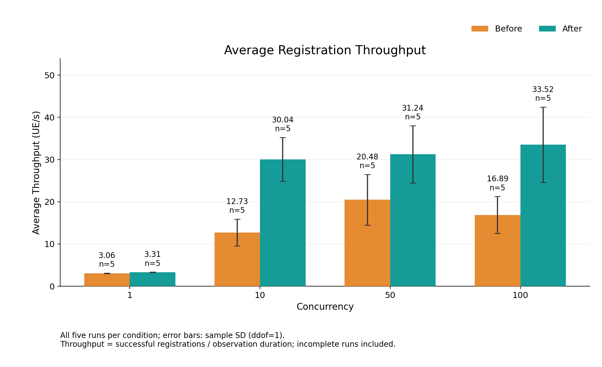
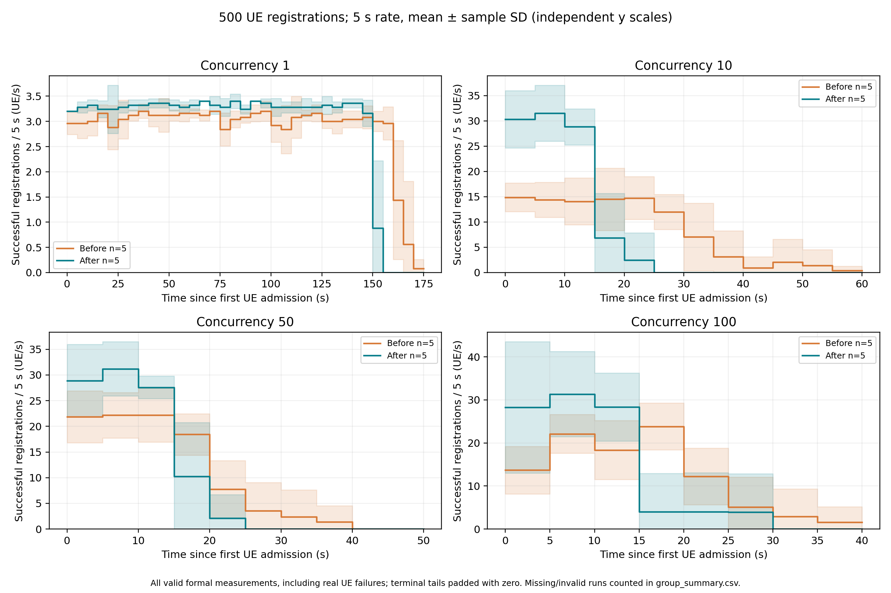
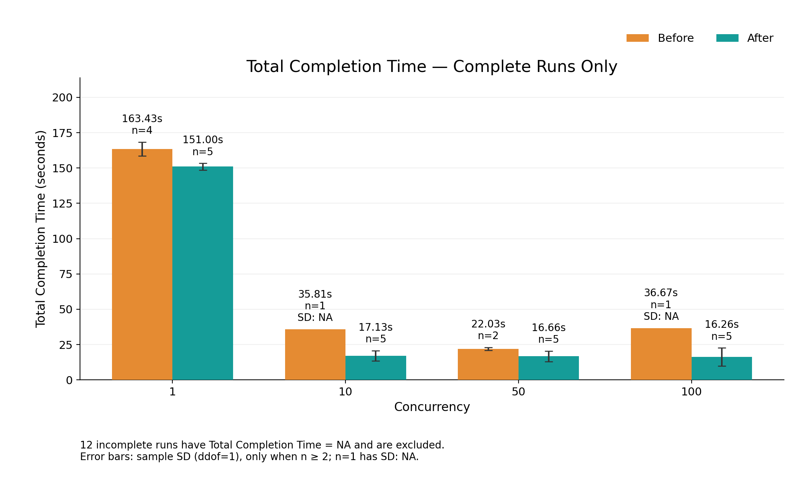
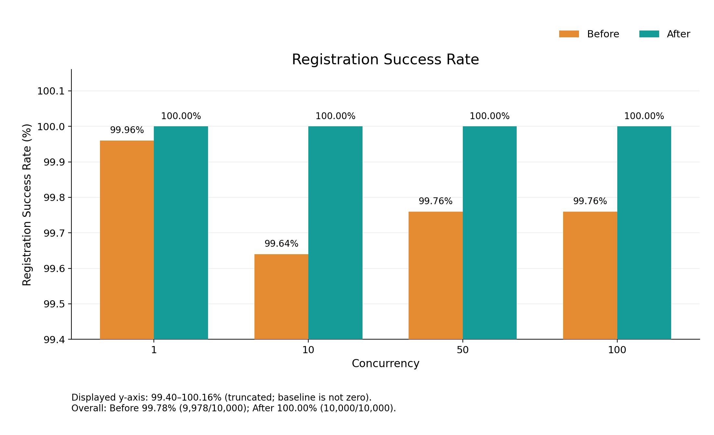

# Evaluating HTTP/2 Timeout Configuration in free5GC: Design, Implementation, and UE Registration Performance

> [!NOTE]
> Author: Chieh-Ting Lee
> Co-author: Chia-Hui Chen
> Date: 2026/11/18

---

## 1. Introduction

UE registration involves several network functions (NFs), and their service-based interface (SBI) exchanges depend on HTTP connection management. A connection that survives between requests can serve subsequent exchanges; a connection that has already closed must be replaced. Timeout settings therefore deserve attention alongside application processing when investigating registration performance.

This article examines three related changes: [util PR #49](https://github.com/free5gc/util/pull/49), [openapi PR #86](https://github.com/free5gc/openapi/pull/86), and [free5gc PR #1200](https://github.com/free5gc/free5gc/pull/1200). Together, they expose server idle and client health-check timers through NF configuration. We explain the implementation and evaluate a controlled HTTP-only adaptation using 40 existing registration runs. No benchmark was rerun for this article.

The After configuration achieved higher mean throughput at all four concurrency levels and completed all 10,000 registration attempts successfully. These observations describe this experiment; they do not isolate any individual timer or establish that connection reuse caused the throughput improvements.

## 2. HTTP/2 Connection Management in free5GC

HTTP/2 supports multiple streams over a connection. Reusing that connection can avoid repeated TCP establishment and transport initialization. This experiment used cleartext HTTP/2, or h2c, on loopback; TLS handshake savings are therefore outside its measured mechanism.

Three timers address different conditions. Server `idleTimeout` controls how long an idle connection may remain available. Client `readIdleTimeout` determines when an absence of received frames triggers a PING health check. It is not a per-request response deadline and does not simply count time since the last application request. Received HTTP/2 frames, including a PING response, affect this check.

Client `pingTimeout` bounds the wait for the health-check response. In the dependency used here, `golang.org/x/net` v0.55.0, `http2/transport.go` implements `(*ClientConn).healthCheck()` with a timeout context, calls `cc.Ping(ctx)`, and calls `cc.closeForLostPing()` if that check fails. `http2/config.go` supplies a 15-second default when the configured ping timeout is zero. A zero read-idle timeout disables the periodic read-idle health check.

Longer server idle periods could improve reuse across short gaps. Longer read-idle periods could reduce health-check frequency during quiet intervals, while longer ping timeouts could tolerate delayed responses but detect a failed peer later. These are implementation-based expectations, not behaviors directly demonstrated throughout the registration campaign. An active connection receiving frames may never reach its read-idle threshold.

## 3. Implementation of Configurable HTTP Timeouts

### Server configuration

In [util `httpwrapper/httpwrapper.go`](https://github.com/free5gc/util/blob/b402218c245048bfc0285aa0321c49cab0155cb6/httpwrapper/httpwrapper.go), `NewHttp2Server` gains an explicit duration argument. Its server literal changes this assignment:

```diff
- IdleTimeout: 1 * time.Millisecond,
+ IdleTimeout: idleTimeout,
```

The wrapper enables HTTP/1, HTTP/2, and unencrypted HTTP/2 through `http.Protocols`. It delegates connection handling to Go's HTTP server rather than introducing a custom idle-monitor goroutine. `util/metrics/Server.go`, `NewServer`, also forwards the duration to the wrapper. Wrapper tests cover zero, one millisecond, and thirty seconds; those tests check construction, not registration throughput.

### YAML to NF startup

PR #1200 updates configuration files and NF submodule references. The referenced [AMF `pkg/factory/config.go`](https://github.com/free5gc/amf/blob/aa91473e6c478382c2b4213bee87016d254f6619/pkg/factory/config.go) adds optional `*time.Duration` fields to `Configuration`, with YAML tags for `idleTimeout`, `readIdleTimeout`, and `pingTimeout`. Pointer fields distinguish omission from explicit zero. `GetIdleTimeout()`, `GetReadIdleTimeout()`, and `GetPingTimeout()` return configured durations or backward-compatible fallbacks.

The sample [free5gc `config/amfcfg.yaml`](https://github.com/free5gc/free5gc/blob/70ff8a2ae029c6d8d69530c6484645bbf3b3181f/config/amfcfg.yaml) supplies:

```yaml
configuration:
  idleTimeout: 60s
  readIdleTimeout: 60s
  pingTimeout: 15s
```

In AMF `internal/sbi/server.go`, `NewServer` passes `cfg.GetIdleTimeout()` as the fourth argument to `httpwrapper.NewHttp2Server`. In AMF `pkg/service/init.go`, `NewApp` configures client defaults before constructing the application:

```go
if err := openapi.ConfigureHTTP2Clients(cfg.GetReadIdleTimeout(), cfg.GetPingTimeout()); err != nil {
    return nil, err
}
```

Equivalent HTTP-related changes were retained for AUSF, NRF, NSSF, PCF, UDM, and UDR in the controlled build. Other NFs referenced by the upstream integration PR were outside this workload.

### Client transport configuration

In [openapi `client.go`](https://github.com/free5gc/openapi/blob/6bc165236b7b842e907ee18b462f585b91362e0c/client.go), `ConfigureHTTP2Clients` rejects negative durations, takes a process-wide mutex, and returns without rebuilding clients if settings are unchanged. Otherwise it recreates four shared clients: regular and NRF-management clients, each for HTTP and HTTPS. It clears cached cleartext wrappers and closes idle connections on the previous clients. Explicit clients supplied through `SetHTTPClient` remain unaffected. Configuration belongs at startup, before traffic; this is not evidence of live reconfiguration during our experiment.

`NewHttp2Client` already accepts transport timer arguments. Its underlying `http2.Transport` contains:

```go
ReadIdleTimeout: transportReadIdleTimeout,
PingTimeout:     transportPingTimeout,
```

The transport is wrapped by `otelhttp.NewTransport`. The new API makes the shared defaults configurable without replacing request deadlines.

| Parameter | Before effective value | After if YAML omitted | After measured value |
|---|---:|---:|---:|
| Server idle timeout | 1ms | 1ms | 60s |
| Client read-idle timeout | 1s | 1s | 60s |
| Client ping timeout | 2s | 2s | 15s |

Thus, configurability and supplied YAML values must be distinguished. The library constants and omitted-field fallbacks preserve earlier values. Explicit server `0s` disables this idle timer in the wrapper configuration; client ping `0s` selects the transport default rather than an unlimited wait. Regular client request timeout remained 10 seconds, NRF-management request timeout one second, and the harness UE deadline thirty seconds.

## 4. Experimental Setup and Methodology

The benchmark ran on one VMware VM with Ubuntu 22.04.5 LTS, Linux 6.8.0-138-generic, four vCPUs, approximately 7.7 GiB RAM, Go 1.26.2, and Docker 29.8.1. Each workload container had the same three-CPU and four-GiB limits, with `GOMAXPROCS=2` per process. Core NFs and the simulator shared this VM.

Each run attempted 500 distinct UEs. Concurrency was 1, 10, 50, or 100, with five Before and five After runs per level: 40 formal runs and 20,000 attempts. A closed-loop coordinator admitted at most C active registrations. Success, failure, or timeout released a slot for the next UE; there was no fixed arrival interval. Concurrency naturally declined when the pending queue emptied.

Before and After shared the same non-HTTP source base, module dependencies, simulator, topology, logging, and resource limits. After applied the 26-file `inventory/http-only.patch` plus explicit timeout YAML. The isolation manifest excludes unrelated candidate changes. This is a comparison of custom controlled builds, not complete upstream releases. The common configuration base was free5gc `ab1280ed772ad1900a0c6c00ac4f7852eb9d491d`; no single upstream commit represents the complete After tree.

Each run used fresh containers and a fresh database. Readiness checks preceded admission, but no UE traffic warm-up was performed. Versions were interleaved and concurrency order rotated. The tested path included seven registration NFs; OAuth and BSF integration were disabled. SMF, UPF, PDU sessions, and radio propagation were outside scope.

Success required decoded NAS Registration Accept, transmission of protected Registration Complete, receipt of Configuration Update, a unique successful terminal event, and the same IMSI entering AMF Registered state. Authentication success alone was insufficient. The simulator retained successful sockets until batch teardown and supported identical-message retransmission replay.

Metrics were recomputed from existing events and checked against CSV summaries:

- **Observation duration:** last terminal event minus first admission, including failure and deadline waits. Admission precedes TCP dial; successful terminal follows the Configuration Update procedure return.
- **Throughput:** verified successful UEs divided by observation duration, calculated per run and then averaged across all five runs.
- **Completion time:** final successful terminal minus first admission, defined only for verified 500/500 runs with complete events and no infrastructure error.
- **Success rate:** verified successes divided by 500 per run; pooled version rates use successes divided by 10,000 attempts.
- **Registration rate:** successes in each half-open interval `[5k, 5(k+1))`, relative to first admission, divided by five seconds. Zero-success intervals remain included.
- **Successful-UE latency:** terminal minus admission per successful UE; mean and percentiles exclude failures. Group variability uses sample standard deviation, `ddof=1`; a single completion sample has undefined SD.

## 5. Experimental Results and Analysis

The following values use the original run CSV. Throughput entries are mean ± sample SD, with five runs each. Improvements use unrounded means: `100 × (After / Before − 1)`.

| Concurrency | Before throughput (UE/s) | After throughput (UE/s) | Improvement | Before success | After success |
|---:|---:|---:|---:|---:|---:|
| 1 | 3.06 ± 0.08 | 3.31 ± 0.05 | 8.11% | 99.96% | 100.00% |
| 10 | 12.73 ± 3.17 | 30.04 ± 5.19 | 135.99% | 99.64% | 100.00% |
| 50 | 20.48 ± 5.98 | 31.24 ± 6.79 | 52.54% | 99.76% | 100.00% |
| 100 | 16.89 ± 4.38 | 33.52 ± 8.90 | 98.51% | 99.76% | 100.00% |



*Figure 1. Existing measured throughput figure; incomplete registration runs remain included.*

After improved mean throughput at every tested level. The largest relative improvement occurred at C=10; gains did not increase monotonically with concurrency. Higher C also increased variability. Failure-related waiting contributes to throughput differences because unsuccessful attempts remain in the observation window.



*Figure 2. Existing five-second registration-rate figure. This interval metric differs from whole-run throughput.*

| Concurrency | Before completion time (s), n | After completion time (s), n |
|---:|---:|---:|
| 1 | 163.43 ± 4.91, 4 | 151.00 ± 2.36, 5 |
| 10 | 35.81; SD NA, 1 | 17.13 ± 3.59, 5 |
| 50 | 22.03 ± 1.02, 2 | 16.66 ± 3.80, 5 |
| 100 | 36.67; SD NA, 1 | 16.26 ± 6.37, 5 |



*Figure 3. Completion time is conditional on full success; sample counts are unequal.*

Only 28 runs completed 500/500. The other 12 completion times remain NA, never zero or a partial-success duration. Consequently, shorter After completion means describe successful subsets and cannot replace the all-run throughput comparison.



*Figure 4. Existing success-rate figure; inspect the displayed vertical scale when interpreting differences.*

Before achieved 9,978/10,000 successes, or 99.78%; After achieved 10,000/10,000, or 100%. The 22 unsuccessful Before attempts comprise sixteen failures and six timeouts. Twelve have direct HTTP/2 error evidence: six rejects and six deadline cases following transport failure. The remaining ten rejects lack conclusive underlying transport attribution.

A separate existing four-request probe observed new TCP local ports for every Before request, whereas After reused one connection across subsequent requests with gaps of 10ms, 100ms, and 1.1s. Both used HTTP/2. This supports a short-gap reuse difference in that probe. It neither measures connection churn across all registration runs nor proves a bulk-registration performance cause. No PING-ACK loss experiment was conducted.

## 6. Limitations and Future Work

Some Before completion groups contain only one or two successful samples. Selection by success and five-run group sizes limit statistical interpretation; sample SD is not a significance test. A single shared VM introduces scheduling, resource competition, and logging effects. Within-condition ordering was not fully counterbalanced: Before ran first at C=1/C=50, After at C=10/C=100.

All three timers and their configuration plumbing changed together. Their independent contributions cannot be separated, and short runs need not cross the 60-second read-idle threshold. Future work should vary one timer at a time, randomize paired ordering, use independent machines, and correlate registration events with connection counts and frame traces. Controlled idle-expiry and lost-PING tests would establish behaviors not tested here. Longer workloads and PDU-session coverage would improve external validity.

## 7. Conclusion

The changes provide a traceable YAML-to-server/client configuration path while preserving omitted-field defaults. Under the measured 60s/60s/15s treatment, this controlled deployment showed higher mean registration throughput and a higher observed success rate than the 1ms/1s/2s baseline. The results support further investigation of HTTP connection management while leaving timer-specific causality and production-scale behavior open.

## 8. References

- [free5gc/util PR #49](https://github.com/free5gc/util/pull/49): configurable server idle timeout and metrics forwarding.
- [free5gc/openapi PR #86](https://github.com/free5gc/openapi/pull/86): process-wide HTTP/2 client configuration.
- [free5gc/free5gc PR #1200](https://github.com/free5gc/free5gc/pull/1200): sample YAML and NF submodule integration.
- [AMF startup implementation](https://github.com/free5gc/amf/blob/aa91473e6c478382c2b4213bee87016d254f6619/pkg/service/init.go) and [SBI server](https://github.com/free5gc/amf/blob/aa91473e6c478382c2b4213bee87016d254f6619/internal/sbi/server.go).
- [Go HTTP/2 v0.55.0 transport](https://github.com/golang/net/blob/v0.55.0/http2/transport.go) and [configuration](https://github.com/golang/net/blob/v0.55.0/http2/config.go): health checks and timer defaults.
- [Go 1.26.2 HTTP server](https://github.com/golang/go/blob/go1.26.2/src/net/http/server.go): server configuration semantics.

### Data Availability

The benchmark data and validation records are retained by the authors. No public dataset is currently available.
