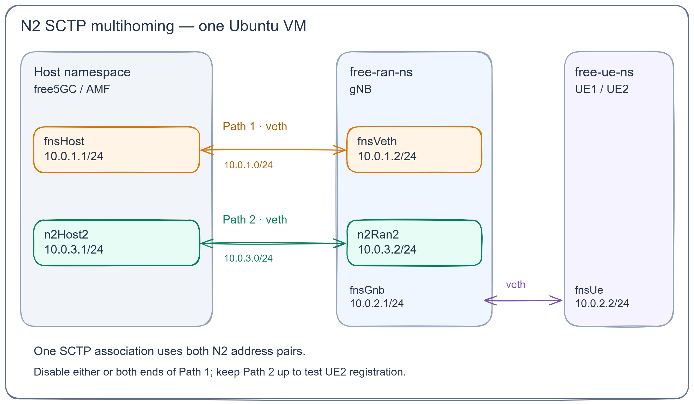
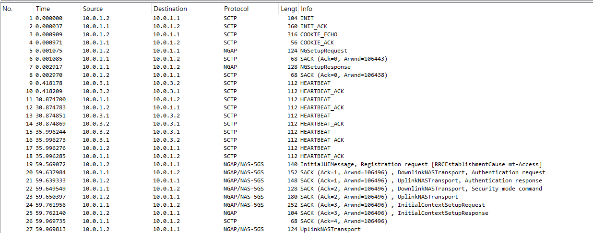
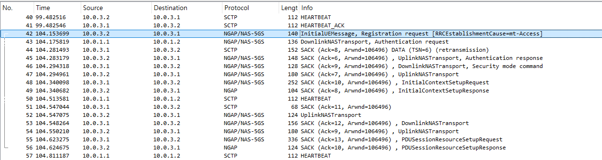
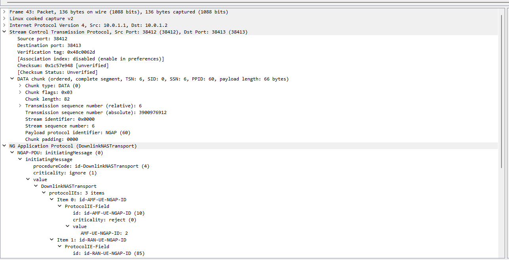
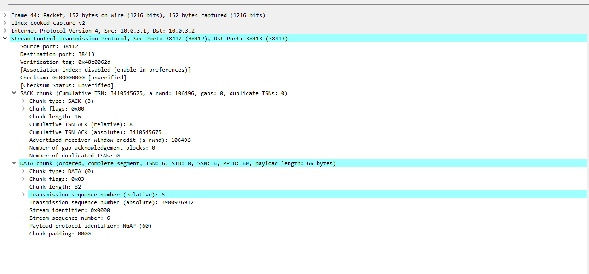

# Testing N2 SCTP Multihoming with free5GC and free-ran-ue

> [!NOTE]
> Author: [SHEN,YU-LUN](https://github.com/joshhandsome)
> Date: 2026/11/23

## Introduction

Reliable signaling is essential in mobile networks. On the N2 interface, the gNB and AMF exchange NGAP messages over SCTP. SCTP multihoming allows an association to include multiple IP addresses at one or both endpoints, providing alternative paths that can help maintain communication when a network path fails.

In free5GC, the AMF supports configuring multiple N2 IP addresses. Multihoming is not limited to the AMF side—the gNB can also use multiple local addresses within the same SCTP association. To support this configuration in free-ran-ue, we extended its N2 configuration and address handling to accept multiple IP addresses while preserving compatibility with existing single-IP configurations.

In this post, we set up a free5GC and free-ran-ue test environment with two network paths. We then disable an interface on either the AMF or gNB side, or both ends of the first path, and check whether a new UE can complete registration. Finally, we discuss how network interfaces, routing, and retransmission settings affect the fault tolerance that multihoming can provide.

## Experimental Setup

This guide assumes a working free5GC and free-ran-ue setup in which a UE can already complete registration and PDU session establishment. The subscriber profiles used for testing must be provisioned, and the PLMN, TAC, slice, and DNN settings must match across the components. The snippets below show only the N2 changes needed for this experiment.

The free-ran-ue build must include the multiple-N2-address changes described in [PR #377](https://github.com/free-ran-ue/free-ran-ue/pull/377), together with the corresponding [util validation changes](https://github.com/free-ran-ue/util/pull/23).

### Network Topology

We run all components inside a single Ubuntu VM. free5GC runs in the host network namespace, while the gNB and UE run in separate network namespaces.

Two veth pairs connect the host to the gNB namespace:

| Path | AMF-side interface | AMF IP address | gNB-side interface | gNB IP address |
|---|---|---|---|---|
| Path 1 | `fnsHost` | `10.0.1.1/24` | `fnsVeth` | `10.0.1.2/24` |
| Path 2 | `n2Host2` | `10.0.3.1/24` | `n2Ran2` | `10.0.3.2/24` |

The gNB communicates with the UE through another veth pair on `10.0.2.0/24`.

[](n2-topology.png)

*Experimental network topology within one Ubuntu VM. Path 1 and Path 2 belong to the same SCTP association. Click the diagram to view it at its original size.*

These virtual interfaces allow us to interrupt one connection while keeping the other available. Since all components run inside one VM, the setup does not provide redundancy against failure of the VM itself.

### Create the Network Namespaces

From the **free-ran-ue repository root**, run:

```bash
make ns-up
```

The script creates the `free-ran-ns` and `free-ue-ns` namespaces, the first host-to-gNB veth pair, and the gNB-to-UE veth pair.

Bring up the loopback interface in both namespaces:

```bash
sudo ip -n free-ran-ns link set lo up
sudo ip -n free-ue-ns link set lo up
```

Run this setup before starting the gNB and UE. Re-running `make ns-up` recreates the namespaces and interrupts the existing network setup.

### Add the Second N2 Path

Create another veth pair and move its gNB-side interface into `free-ran-ns`:

```bash
sudo ip link add n2Host2 type veth peer name n2Ran2
sudo ip link set n2Ran2 netns free-ran-ns
```

Assign the second pair of IP addresses:

```bash
sudo ip addr add 10.0.3.1/24 dev n2Host2
sudo ip -n free-ran-ns addr add 10.0.3.2/24 dev n2Ran2
```

Bring up both interfaces:

```bash
sudo ip link set n2Host2 up
sudo ip -n free-ran-ns link set n2Ran2 up
```

Verify that both AMF addresses are reachable from the gNB namespace:

```bash
sudo ip netns exec free-ran-ns ping -c 3 10.0.1.1
sudo ip netns exec free-ran-ns ping -c 3 10.0.3.1
```

Both addresses should respond before proceeding. The address assignments create directly connected routes, so no additional static routes are needed for this topology.

### Configure the AMF

In the **free5GC repository**, edit `config/amfcfg.yaml`. Under `configuration`, set:

```yaml
configuration:
  ngapIpList:
    - 10.0.1.1
    - 10.0.3.1
```

Only the relevant field is shown here. Keep the remaining configuration.

### Configure the gNB

In the **free-ran-ue repository**, edit `config/gnb.yaml`:

```yaml
gnb:
  amfN2Ip:
    - "10.0.1.1"
    - "10.0.3.1"
  ranN2Ip:
    - "10.0.1.2"
    - "10.0.3.2"
```

`amfN2Ip` contains the remote AMF addresses, while `ranN2Ip` contains the local gNB addresses. Both lists are passed to a single SCTP connection establishment operation.

The existing scalar format remains supported:

```yaml
gnb:
  amfN2Ip: "10.0.1.1"
  ranN2Ip: "10.0.1.2"
```

Existing single-IP configuration files therefore do not need to be rewritten.

### SCTP Settings Used in the Tests

The latest experiment, which disabled both ends of the first veth pair, used these settings:

| Endpoint | Path retransmission threshold | Association retransmission threshold |
|---|---:|---:|
| AMF | 5 | 7 |
| gNB | 5 | 10 |

To reproduce that experiment, use an AMF binary rebuilt with the association-threshold change in [AMF PR #322](https://github.com/free5gc/amf/pull/322). The sysctl commands below set the path threshold; they do not change the association threshold explicitly configured by the AMF. The reason for the change is discussed later in this post.

Before starting the AMF and gNB, we explicitly set the path threshold to `5` in both network namespaces:

```bash
sudo modprobe sctp
sudo sysctl -w net.sctp.path_max_retrans=5
sudo ip netns exec free-ran-ns \
  sysctl -w net.sctp.path_max_retrans=5
```

Earlier single-end failure tests used different AMF thresholds. The results table records the settings for each experiment.

## Failover Experiments

The goal of these experiments is to verify whether N2 signaling remains available when the first network path becomes unavailable. We first register UE1, disable an interface on the first path, and then start UE2 while that path remains down. UE2 is expected to complete registration and PDU session establishment through the remaining path.

In this setup, N3 shares the first veth pair with one of the N2 paths. Disabling that pair also interrupts user-plane traffic. Therefore, uninterrupted UE ping traffic is not a success criterion for this experiment.

The packet captures presented below were collected during our tests to explain the observed behavior. Readers do not need to capture packets to follow the procedure.

### Register UE1

Start free5GC. Then, from the **free-ran-ue repository root**, launch the gNB:

```bash
sudo ip netns exec free-ran-ns \
  ./build/free-ran-ue gnb -c config/gnb.yaml
```

In another terminal, also at the **free-ran-ue repository root**, start UE1:

```bash
sudo ip netns exec free-ue-ns \
  ./build/free-ran-ue ue -c config/ue.yaml
```

Confirm that the UE log reports successful registration and PDU session establishment:

```text
UE Registration finished
...
PDU session establishment complete
```

Keep UE1, the gNB, and free5GC running throughout the experiment.

### Disable the First Path

The first path connects the AMF-side interface `fnsHost` (`10.0.1.1`) to the gNB-side interface `fnsVeth` (`10.0.1.2`).

We test three ways to interrupt **this same path**: disable its AMF-side interface, disable its gNB-side interface, or disable both ends.

In every scenario, the second path—`n2Host2` (`10.0.3.1`) ↔ `n2Ran2` (`10.0.3.2`)—remains up.

| Scenario | First path: AMF-side interface | First path: gNB-side interface | Second path |
|---|---|---|---|
| Disable the AMF-side interface only | Down | Administratively up | Kept up |
| Disable the gNB-side interface only | Administratively up | Down | Kept up |
| Disable both ends of the first path | Down | Down | Kept up |

Disabling either end interrupts the first veth connection. An interface left administratively up does not mean that the first path remains usable when its peer is down.

Choose one scenario per run, and restore both ends of the first path before testing another scenario.

**AMF-side interface only:**

```bash
sudo ip link set fnsHost down
```

**gNB-side interface only:**

```bash
sudo ip -n free-ran-ns link set fnsVeth down
```

**Both ends of the first path:**

```bash
sudo ip link set fnsHost down
sudo ip -n free-ran-ns link set fnsVeth down
```

The two commands in the last scenario are executed sequentially, rather than simultaneously.

### Register UE2 While the First Path Is Down

Prepare a second UE configuration, `config/ue2.yaml`, with a different IMSI and TUN interface name. Its subscriber profile must also be provisioned in free5GC.

From the **free-ran-ue repository root**, start UE2 without restoring the first path:

```bash
sudo ip netns exec free-ue-ns \
  ./build/free-ran-ue ue -c config/ue2.yaml
```

The expected result is successful registration and PDU session establishment.

In our both-ends-down test, UE2 produced the following log:

```text
2026/11/19 14:31:58 [INFO][UE][RAN] Processing UE Registration
2026/11/19 14:31:59 [INFO][UE][RAN] UE Registration finished
2026/11/19 14:31:59 [INFO][UE][PDU] Processing PDU session establishment
2026/11/19 14:31:59 [INFO][UE][PDU] PDU session UE IP: 10.60.0.2
...
2026/11/19 14:31:59 [INFO][UE][PDU] UE 208930000000002 PDU session establishment complete
```

### What Happened in the Packet Capture?

Before the failure, UE1’s Registration Request traveled from gNB address `10.0.1.2` to AMF address `10.0.1.1`, as shown in packet 19.

[](ue1-registration.png)

*Figure 1. UE1 registration before the failure. Packet 19 carries the Registration Request in an InitialUEMessage over the first address pair.*

While the first path was unavailable, UE2’s Registration Request used `10.0.3.2 → 10.0.3.1`, as shown in packet 42. Subsequent signaling completed over the second path.

[](ue2-registration.png)

*Figure 2. UE2 registration during the failure. Packet 42 uses the second address pair. The Time column in these screenshots shows seconds elapsed since the beginning of the capture.*

Click a screenshot to view it at its original size.

Packets 43 and 44 provide a closer look at the retransmission behavior:

| Packet | Time (UTC) | Source → Destination | Absolute DATA TSN |
|---|---|---|---|
| 43 | 14:31:59.471 | `10.0.1.1 → 10.0.1.2` | `3900976912` |
| 44 | 14:31:59.577 | `10.0.3.1 → 10.0.3.2` | `3900976912` |

The AMF first attempted to send the DATA chunk over the first path, then retransmitted it over the second.

[](packet43-first-path.png)

*Figure 3. Packet 43 uses the first address pair and carries DATA with absolute TSN `3900976912`.*

[](packet44-second-path.png)

*Figure 4. Packet 44 uses the second address pair while retaining the same DATA TSN.*

The IP addresses changed, but the DATA Transmission Sequence Number remained the same. This shows that the same DATA chunk was retransmitted over the alternative path.

The two transmissions were approximately 106 ms apart. This describes the interval between these particular transmissions, not the total failover time from the interface-down operation.

The capture contained no new connection-establishment handshake after the failure. Communication continued through the existing SCTP association.

### Restore the First Path

After UE2 completes registration, bring both ends of the first veth pair up:

```bash
sudo ip link set fnsHost up
sudo ip -n free-ran-ns link set fnsVeth up
```

Path recovery may take time while SCTP probes the previously unavailable addresses.

In the both-ends-down test, the AMF received a HEARTBEAT ACK over the first path at **14:33:06.969 UTC**. The gNB subsequently received a HEARTBEAT ACK for its own probe at **14:34:44.761 UTC**. Endpoint-state checks confirmed that both paths were active again.

This confirms that the first path became available again. We did not generate additional NGAP DATA after recovery in this run, so we do not claim that application traffic switched back to the first path.

### Results

All three scenarios allowed UE2 to register and establish a PDU session while the first path was unavailable. The first path also recovered after the interfaces were brought back up.

Each threshold pair below is shown as **path / association**.

| Scenario | AMF thresholds | gNB thresholds | UE2 registration and PDU session | Path recovery |
|---|---|---|---|---|
| AMF-side interface down | `2 / 4` | `5 / 10` | Successful | Confirmed |
| gNB-side interface down | `2 / 4` | `5 / 10` | Successful | Confirmed |
| Both ends of the first path down | `5 / 7` | `5 / 10` | Successful | Confirmed |

## Discussion and Conclusion

### Multiple IP Addresses and Network Interfaces

Multiple IP addresses can be assigned to the same interface. However, this provides less protection against interface failure: if that interface goes down, all paths using it are affected.

For path redundancy, [RFC 3257](https://www.rfc-editor.org/rfc/rfc3257.html#section-3) discusses using multiple interfaces with appropriate routing. The [Cisco Ultra Cloud Core 5G AMF deployment guide](https://www.cisco.com/c/en/us/td/docs/wireless/ucc/amf/2026-01/config-and-admin/ucc-5g-amf-configuration-and-administration-guide-release-2026-01/m_f113794_sctp-config-stack-multihoming.html) also recommends different physical interfaces for different VIP addresses. Our experiments use two veth pairs to model separate connections.

### SCTP Retransmission Settings

SCTP uses separate failure thresholds for individual paths and the overall association:

- **Path retransmission threshold:** when a path’s error counter exceeds this threshold, that path is marked inactive.
- **Association retransmission threshold:** when the association’s error counter exceeds this threshold, the entire association is terminated.

The [Linux SCTP default path threshold](https://www.kernel.org/doc/html/latest/networking/ip-sysctl.html#proc-sys-net-sctp-variables) is `5`, while the AMF configuration used in our initial tests set the association threshold to `4`. An association threshold that is too low can cause the connection to terminate before path failover completes.

We submitted [AMF PR #322](https://github.com/free5gc/amf/pull/322) to increase the AMF association threshold to `7`, giving the association more tolerance than an individual path. With the path threshold set to `5` and the association threshold set to `7`, our both-ends-down experiment completed successfully. This setting reduces the risk of terminating the association too early, although the thresholds alone do not guarantee successful failover.

### Conclusion

We extended free-ran-ue to support multiple N2 IP addresses while preserving compatibility with existing single-IP configurations.

In our experiments, UE2 successfully completed registration and PDU session establishment while the first path was unavailable. Packet captures confirmed that NGAP signaling continued over the second path within the existing SCTP association. After restoring the interfaces, the first path became available again.

These results demonstrate N2 signaling continuity under the tested failure conditions.

## References

1. [3GPP TS 38.412 — NG signalling transport, Section 7](https://www.etsi.org/deliver/etsi_ts/138400_138499/138412/19.00.00_60/ts_138412v190000p.pdf)
2. [RFC 3257 — SCTP Applicability Statement, Sections 2.2 and 3](https://www.rfc-editor.org/rfc/rfc3257.html)
3. [RFC 9260 — Stream Control Transmission Protocol, Section 8](https://www.rfc-editor.org/rfc/rfc9260.html#section-8)
4. [Cisco UCC 5G AMF — SCTP Multihoming and Stack Parameters Support](https://www.cisco.com/c/en/us/td/docs/wireless/ucc/amf/2026-01/config-and-admin/ucc-5g-amf-configuration-and-administration-guide-release-2026-01/m_f113794_sctp-config-stack-multihoming.html)
5. [free-ran-ue PR #377 — Support single or multiple N2 IP addresses](https://github.com/free-ran-ue/free-ran-ue/pull/377)
6. [util PR #23 — N2 IP list validation](https://github.com/free-ran-ue/util/pull/23)
7. [AMF PR #322 — Increase SCTP association retransmission limit to 7](https://github.com/free5gc/amf/pull/322)

8. [Linux kernel documentation — SCTP sysctl parameters](https://www.kernel.org/doc/html/latest/networking/ip-sysctl.html#proc-sys-net-sctp-variables)

## About Me

Hi! I'm SHEN,YU-LUN. I'm researching 5G networks and have recently joined the free5GC community. If you have questions about this post, feel free to reach out.

GitHub: [https://github.com/joshhandsome](https://github.com/joshhandsome)
